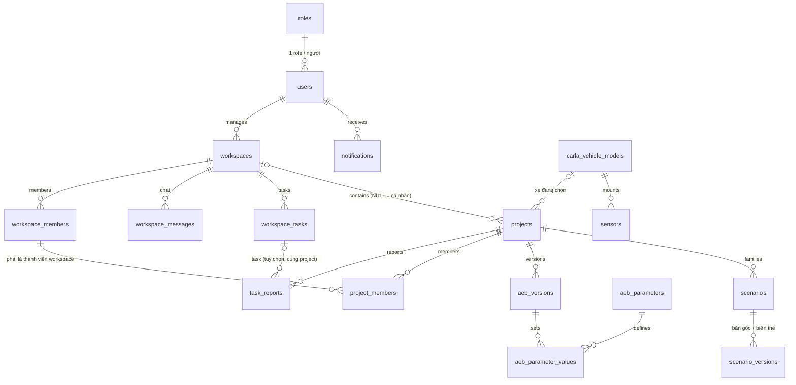
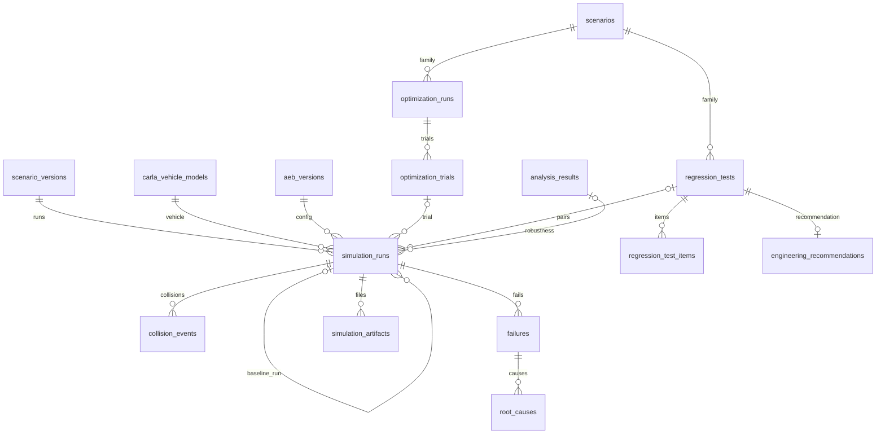

# Từ điển dữ liệu VehicSim (MySQL, 29 bảng)

Tài liệu giải thích **từng bảng, từng cột** của database VehicSim: nghĩa nghiệp vụ, ràng buộc, ai
ghi/đọc, và bảng nào phục vụ chức năng nào (13 FE theo tài liệu nhóm 06/10/2026).

- **Nguồn sự thật:** [database/mysql/01_schema.sql](../../database/mysql/01_schema.sql). Tài liệu này
  chỉ giải thích; lệch nhau thì file SQL đúng. Code Java đọc/ghi bằng SQL thuần (`JdbcTemplate` qua `Db` / `Queries` ở
  [src/main/java/com/vehicsim/vehicsim/](../../src/main/java/com/vehicsim/vehicsim/), JPA cho `users` / `roles`); không còn bản
  mirror của schema để giữ đồng bộ.
- **Vì sao 29 bảng, đổi gì so với bản 32 bảng:** [ADR-036](../adr/ADR-036-schema-29-bang.md). Bảng thứ 30
  (`project_members`), loại lỗi `NEAR_MISS` và 2 loại thông báo mới: [ADR-037](../adr/ADR-037-thanh-vien-project-near-miss.md).
  Bỏ phiên bản xe, Admin tạo workspace, báo cáo theo project (còn 29 bảng):
  [ADR-038](../adr/ADR-038-bo-phien-ban-xe-admin-tao-workspace.md).
- **DB tạo từ bản cũ hơn:** chạy các file trong `database/mysql/migrations/` theo thứ tự (§10).
- **Máy kiểm:** `test_schema_doc_covers_every_table_and_column` bắt buộc mọi bảng và cột trong file SQL
  có mặt ở đây. Bảng cột ở §6 được sinh từ file SQL ngày 07/10/2026; về sau đổi cột thì sửa tay §6.
- MySQL `vehicsim` là **database duy nhất** của hệ thống. Ngoài MySQL: mã OTP và rate limit ở Redis
  (TTL); cấu hình hệ thống (LLM key, CARLA host) ở `.env`; nhật ký thao tác ở file log; quyền theo
  role kiểm ở Spring Security.

## 1. Tổng quan

| | Số lượng |
|---|---|
| Bảng | 29 |
| Cột | 378 |
| Khoá ngoại | 80 (nhiều khoá ghép) |
| CHECK | 27 |
| Engine / charset | InnoDB · `utf8mb4` / `utf8mb4_0900_ai_ci` · MySQL ≥ 8.0.16 (cần CHECK) |

| # | Nhóm | Bảng | Code đang dùng |
|---|---|---|---|
| 1 | Tài khoản | `roles`, `users` | Có |
| 2 | Workspace, cộng tác, task | `workspaces`, `workspace_members`, `workspace_messages`, `notifications`, `workspace_tasks`, `task_reports` | `workspaces` (seed) |
| 3 | Project & xe | `projects`, `project_members`, `carla_vehicle_models`, `sensors` | Có, trừ `project_members`, `sensors` |
| 4 | AEB | `aeb_parameters`, `aeb_versions`, `aeb_parameter_values` | Có |
| 5 | Kịch bản | `scenarios`, `scenario_versions` | Có |
| 6 | Tối ưu & regression | `optimization_runs`, `optimization_trials`, `regression_tests` | `regression_tests` |
| 7 | Mô phỏng, đánh giá, lỗi | `simulation_runs`, `simulation_artifacts`, `collision_events`, `failures`, `root_causes` | Có |
| 8 | Phân tích, kết quả regression, khuyến nghị | `analysis_results`, `regression_test_items`, `engineering_recommendations` | Có; analysis_results mới dùng BASELINE_DATASET |
| 9 | Tri thức kỹ thuật | `tech_references` | Chưa |

Bảng chưa có code là thiết kế trước theo FE (0 dòng); màn hình / API đến ở các demo sau.

### 1.1 Role (mỗi người đúng một role — ADR-035)

| Role | Được làm |
|---|---|
| ADMIN | Quản trị user / role, tạo workspace và gán Manager (ADR-038), quản lý `tech_references` |
| MANAGER | Quản lý workspace được Admin gán: xem mọi thành viên, thêm Engineer / Reviewer, giao task, duyệt báo cáo của các project. Không làm kỹ thuật, không tạo project, không duyệt khuyến nghị |
| ENGINEER | Toàn bộ quy trình kỹ thuật trong project của workspace (xe, kịch bản, mô phỏng, tối ưu, regression) |
| REVIEWER | Xem kết quả, Accept / Reject khuyến nghị — quyết định cuối, không cần Manager (ADR-037). Không chạy mô phỏng |
| EXPERIENCER | Người tự đăng ký: project cá nhân, chạy tới tối ưu + regression; **không có** khuyến nghị / duyệt |

Quyền xem thành viên (kiểm ở API, ADR-038): Manager xem mọi thành viên workspace mình quản lý; trong project chỉ
owner và thành viên của chính project đó xem được danh sách thành viên — không xem được thành viên project khác.

## 2. Quy ước

- **Khoá chính:** `id BIGINT UNSIGNED AUTO_INCREMENT`; bảng tra cứu nhỏ dùng `INT` (`roles`,
  `aeb_parameters`). `aeb_parameter_values` dùng khoá chính ghép.
- **Tên cột:** `created_date` cho lúc tạo, `updated_at` cho lần sửa gần nhất (`ON UPDATE CURRENT_TIMESTAMP`);
  người thao tác là `*_user_id`; số phiên bản là `version_no`; cờ là `BOOLEAN`; JSON là `*_json`.
- **Đơn vị SI, ghi trong tên cột:** `_m` mét · `_mps` m/s · `_mps2` m/s² · `_mps3` m/s³ · `_s` giây ·
  `_deg` độ · `_pct` phần trăm 0–100 · `_kg` · `_nm` N·m. Riêng tốc độ kịch bản dùng `ego_speed_kmh` như IR.
- **Thời gian:** `DATETIME` không múi giờ, quy ước lưu UTC.
- **Không lưu file nhị phân / bí mật dạng rõ:** video, dữ liệu cảm biến, ảnh đại diện chỉ lưu đường dẫn;
  mật khẩu là hash; OTP ở Redis.
- **Chính sách xoá:** `RESTRICT` cho dữ liệu gốc (không xoá được project / kịch bản / version / lần kiểm
  đã có run — project thì chuyển `ARCHIVED`); `CASCADE` cho bảng con thuần (kết quả, file, nguyên nhân);
  `SET NULL` cho tham chiếu tuỳ chọn.
- **Ký hiệu ở §6:** **PK** khoá chính · **FK** khoá ngoại (khoá ghép ghi cả cặp cột đích) · **UQ** duy nhất
  · **GEN** cột sinh `VIRTUAL` · **AI** auto increment. "Bắt buộc" ✓ = `NOT NULL`.

## 3. Mẫu thiết kế xuyên suốt

### 3.1 Khoá ngoại ghép ép "cùng project"

Một run, regression, lần tối ưu hay phân tích chỉ được dùng kịch bản / AEB **của cùng project**. Xe là danh
mục chung (`carla_vehicle_models`), không thuộc project. Bảng cha có `UNIQUE (project_id, id)`; bảng con lặp lại
`project_id` và trỏ cả cặp:

```sql
-- simulation_runs không thể dùng AEB version của project khác:
FOREIGN KEY (project_id, aeb_version_id) REFERENCES aeb_versions(project_id, id)
```

Vì vậy `scenario_id` và `project_id` **lặp lại có chủ đích** ở `simulation_runs`, `optimization_trials`…
— đừng "chuẩn hoá" bỏ chúng.

### 3.2 "Đúng một" bằng cột sinh + UNIQUE

`UNIQUE` bỏ qua `NULL`, nên cột sinh = khoá khi thoả điều kiện, `NULL` khi không:

| Cột sinh | Ép |
|---|---|
| `aeb_versions.baseline_project_key` | Đúng một BASELINE mỗi project. Accept: hạ baseline cũ về `ARCHIVED` **trước**, rồi nâng candidate — một transaction |
| `projects.personal_owner_key` | Không trùng tên project cá nhân của cùng người |

### 3.3 Run phải thuộc đúng việc và chạy đúng cấu hình

CHECK `purpose = X ⇔ cột liên kết có giá trị`, cộng FK ghép với `aeb_version_id`:

| `purpose` | Cột bắt buộc | FK ép |
|---|---|---|
| `REGRESSION` | `regression_test_id` + `baseline_run_id` | `fk_sr_regression`: đúng candidate, **đúng xe, đúng bộ mô phỏng** của test; `fk_sr_baseline`: cùng biến thể + seed + bộ mô phỏng + xe với run baseline |
| `OPTIMIZATION` | `optimization_trial_id` | `fk_sr_trial`: đúng candidate của trial |
| `ROBUSTNESS` | `analysis_result_id` | `fk_sr_analysis`: cùng project, đúng AEB version được kiểm |

`regression_test_items.fk_rti_pair` ép mỗi dòng kết quả ghép đúng run candidate với đúng run baseline của
đúng test. Máy kiểm: `test_regression_pairs_same_seeds_and_accept_swaps_baseline`,
`test_regression_never_pairs_kinematic_with_carla`.

### 3.4 Danh tính bộ mô phỏng (`simulator_version`)

`simulation_runs.simulator_version` ghi **chính xác** bộ mô phỏng: `vehicsim-kinematic-1.0` (bộ động học,
đổi logic thì đổi tên — `KINEMATIC_SIMULATOR` trong `Bundle`/`RunService`) hoặc `carla-<x.y.z>-xosc3` (`carla-<x.y.z>` trần là runner trực tiếp đã gỡ ở ADR-042; từ
`client.get_server_version()`). `simulator_type` (KINEMATIC / CARLA) chỉ để lọc; CHECK ép hai cột khớp.
Vì `simulator_version` nằm trong `fk_sr_baseline`, MySQL **không cho** ghép động học với CARLA, hay
CARLA 0.9.15 với 0.9.16, hay `vehicsim-kinematic-1.0` với `1.1` ([ADR-027](../adr/ADR-027-bo-mo-phong-cam-duoc-hop-dong-json.md)).

### 3.5 Khớp với CARLA 0.9.16

| Dữ liệu | Bảng / cột | Phía CARLA |
|---|---|---|
| Xe ego | `carla_vehicle_models.carla_blueprint_id` | `world.get_blueprint_library().find(...)` |
| Kích thước | `carla_vehicle_models.length_m/width_m/height_m` | `actor.bounding_box.extent × 2` — gắn mesh, chỉ đối chiếu |
| Vật lý ép được | `carla_vehicle_models.mass_kg`, `drag_coefficient`, `center_of_mass_*_m` | `VehiclePhysicsControl` qua `apply_physics_control` |
| Bánh xe | `carla_vehicle_models.tire_friction`, `max_brake_torque_nm` | `WheelPhysicsControl` — đo thấy chưa đổi quãng phanh (TD-17), chưa gửi |
| Phanh thực đo | `carla_vehicle_models.carla_full_brake_decel_mps2` | Giảm tốc khi phanh 100% — controller CARLA đổi giảm tốc AEB → bàn đạp (qua `.xosc`; NULL = 4,6 m/s²) |
| Cảm biến | `sensors.carla_blueprint_id`, `location_*`, `rotation_*`, `attributes_json` | `sensor.*` blueprint + `carla.Transform` + `set_attribute` |
| Thời tiết | `scenario_versions.weather`, `time_of_day` | `carla.WeatherParameters` (do ScenarioRunner đọc từ `Environment` trong `.xosc`, `XoscExport`) |
| Map | `scenario_versions.map_name` (dự kiến), `simulation_runs.map_name` (thực nạp) | `client.load_world` / `world.get_map().name` |
| Bước mô phỏng | `simulation_runs.fixed_delta_seconds` | `WorldSettings.synchronous_mode = True`, `fixed_delta_seconds` |
| Người đi bộ | `collision_events.other_actor_type_id` | `walker.pedestrian.0001` |
| Va chạm | `collision_events.frame`, `normal_impulse_*` | `sensor.other.collision` → `carla.CollisionEvent` |

### 3.6 Phục vụ tối ưu

- **Không gian tìm kiếm:** `aeb_parameters.min_value/max_value` là biên tuyệt đối; `optimization_runs.search_space_json`
  chọn tập con. Trial nào cũng là một `aeb_versions` đủ 4 tham số chỉnh được, nên đem đi regression như candidate tay.
- **Mục tiêu (Pareto, ADR-040 §6–7):** `optimization_trials.rms_jerk_mps3`, `impact_speed_mps`, `stopping_distance_m` — ba
  mục tiêu MOBO, cùng cực tiểu; `collision_rate_pct` là chỉ số phụ; `score` cho ParEGO / Chebyshev.
  - *RMS jerk*: trung bình `simulation_runs.rms_jerk_mps3` của các run **có phanh** (RMS của `Δa/dt` trong pha phanh).
  - *Vận tốc va chạm*: trung bình `impact_speed_mps` trên **mọi** run của họ, không va chạm tính 0.
  - *Quãng phanh dừng*: trung bình `stopping_distance_m` của các run có phanh — gồm cả ca va chạm (run kết thúc khi xe còn chạy thì cộng
    `v²/(2·decel_available)`), nên cấu hình hay va chạm không thể "đẹp" nhờ bị bỏ khỏi trung bình.
  - *Ràng buộc mặc định* trong `objective_config_json`: va chạm không vượt baseline, phanh oan tăng ≤ 5 điểm %. Trial vi phạm có
    `constraint_violated = TRUE` và không vào mặt Pareto. Phanh oan (`is_false_positive`) là ràng buộc, không phải trục.
- **So được:** mọi trial dùng cùng họ kịch bản, cùng `carla_vehicle_model_id`, cùng `simulator_version` của lần
  tối ưu; seed cố định theo biến thể.
- **Đặc trưng cho độ nhạy / SHAP:** cột lọc của biến thể (`ego_speed_kmh`, `trigger_distance_m`,
  `target_speed_kmh`, `stops_at_curb`, `weather`, `time_of_day`, `road_friction`) + 4 tham số AEB →
  chỉ số kết quả trong `simulation_runs` (`collision_occurred`, `min_ttc_s`, `is_false_positive`, `max_jerk_mps3`…).
- **Robustness:** `analysis_results` (ROBUSTNESS_VALIDATION) giữ cấu hình nhiễu ở `config_json`; mỗi mẫu là
  một run `ROBUSTNESS` ghi nhiễu đã áp vào `run_config_json`.

### 3.7 Giới hạn MySQL đã gặp (đừng "sửa" ngược)

- Cột nằm trong `CHECK` không được tham gia FK có referential action (ERROR 3823) ⇒ các FK đó `RESTRICT`
  cả hai chiều (`fk_sv_parent`, `fk_sr_*`, `fk_tr_reviewer`, `fk_er_reviewer`…).
- Cột sinh dùng `VIRTUAL` (STORED cấm FK có CASCADE trên cột gốc).
- Tên khoá ngoại / CHECK là duy nhất **trong cả schema** ⇒ migration 005 chuyển bảng cũ sang schema tạm
  thay vì đổi tên tại chỗ.
- FK tự tham chiếu (`fk_sr_baseline`) phải thêm ở câu `ALTER` **sau** câu tạo khoá đích (`uq_sr_replay`),
  không cùng một câu (ERROR 1215, gặp ở migration 006).
- `optimization_*` và `regression_tests` tạo **trước** `simulation_runs`; `analysis_results` tạo sau nhưng
  vẫn là đích FK của `simulation_runs` (dựng với `FOREIGN_KEY_CHECKS = 0`).
- Nạp file SQL **phải** dùng `--default-character-set=utf8mb4`.

### 3.8 Chuỗi truy vết một run

```
simulation_runs (kết quả chấm AEB/FCW + telemetry_json)
      ├──1:n── collision_events
      ├──1:n── failures ──1:n── root_causes ──n:1── aeb_parameters  (tham số nghi ngờ)
      ├──1:n── simulation_artifacts ──n:1── sensors
      └── scenario_versions · carla_vehicle_models · aeb_versions · random_seed · simulator_version  (tái lập được)
```

## 4. Sơ đồ quan hệ (ERD)

Tài khoản, workspace, project:



Thực thi, tối ưu, regression, phân tích:



## 5. Luồng dữ liệu theo vòng MVP

| Bước | Màn / lệnh | Module ghi | Bảng được ghi |
|---|---|---|---|
| 0. Khởi tạo | `scripts/seed_vehicsim.py` | `vehicsim/bootstrap.py` | `aeb_parameters`, `carla_vehicle_models` (nếu thiếu, kèm thông số vật lý), `workspaces` (ACTIVE), `projects` (chọn sẵn xe), `aeb_versions` (v1.0 BASELINE), `aeb_parameter_values` |
| — Tài khoản | Đăng ký / đăng nhập; `scripts/create_admin.py --role …` | `services/auth/users.py` | `users` (tự đăng ký = EXPERIENCER) |
| 1. Mô tả → biến thể | Kịch bản mới | `describe.py` (LLM) → `family.py` | `scenarios`, `scenario_versions` (bản gốc + biến thể có cột lọc) |
| 2. Chạy baseline | Chạy họ | `runs.py` | `simulation_runs` (`PENDING → RUNNING → COMPLETED/FAILED`, kết quả ghi vào chính dòng), `collision_events`, `failures` + `root_causes`, `simulation_artifacts` |
| 3. Phân tích lỗi | Ca lỗi, phát lại | `views.py` (chỉ đọc) | — đọc `failures`, `root_causes`, `simulation_runs.telemetry_json` |
| 4. Candidate | Cấu hình AEB | `aeb.py` | `aeb_versions` (CANDIDATE), `aeb_parameter_values` (kiểm `[min, max]`) |
| 5. Regression | Kiểm định | `regression.py` + `runs.py` | `regression_tests` (chốt xe + bộ mô phỏng), `simulation_runs` (REGRESSION); khi chốt: `regression_test_items`, `engineering_recommendations` |
| 6. Quyết định (chỉ REVIEWER) | Khuyến nghị → Review | `regression.decide` | `engineering_recommendations`; Accept: baseline cũ `ARCHIVED`, candidate `BASELINE`; Reject: candidate `REJECTED` |

## 6. Từ điển từng bảng

### 6.1 Tài khoản

#### `roles` — FE-02

Danh mục 5 role hệ thống (seed). Không có màn CRUD — bảng tra cứu nhỏ.

| Cột | Kiểu | Bắt buộc | Mặc định | Khoá | Nghĩa |
|---|---|---|---|---|---|
| `id` | INT UNSIGNED | ✓ |  | PK; AI | Khoá chính. |
| `code` | ENUM | ✓ |  | UQ | Mã role: `ADMIN`, `MANAGER`, `ENGINEER`, `REVIEWER`, `EXPERIENCER`. Code so quyền theo mã này. Giá trị: 'ADMIN', 'MANAGER', 'ENGINEER', 'REVIEWER', 'EXPERIENCER'. |
| `name` | VARCHAR(100) | ✓ |  |  | Tên hiển thị. |
| `description` | VARCHAR(500) |  |  |  | Role được làm gì (seed). |
| `created_date` | DATETIME | ✓ | `CURRENT_TIMESTAMP` |  | Lúc tạo. |

#### `users` — FE-01/02/03

Tài khoản. Mỗi người **đúng một role** (`role_id`). Tự đăng ký = EXPERIENCER; role khác do Admin cấp (hiện qua `scripts/create_admin.py`, TD-28). Không xoá cứng: khoá bằng `is_active`. **Code dùng:** `services/auth/users.py`.

| Cột | Kiểu | Bắt buộc | Mặc định | Khoá | Nghĩa |
|---|---|---|---|---|---|
| `id` | BIGINT UNSIGNED | ✓ |  | PK; AI | Khoá chính. |
| `email` | VARCHAR(255) | ✓ |  | UQ | Email đăng nhập, đã chuẩn hoá (bỏ khoảng trắng, chữ thường) trước khi ghi — `users.normalize_email`. |
| `password_hash` | VARCHAR(255) | ✓ |  |  | Hash mật khẩu (`salt:hash`), không bao giờ trả ra API. |
| `role_id` | INT UNSIGNED | ✓ |  | FK → `roles` | Role duy nhất của người này. _Mỗi người đúng 1 role; tự đăng ký = EXPERIENCER_ |
| `is_active` | BOOLEAN | ✓ | `TRUE` |  | `FALSE` = Admin vô hiệu hoá: không đăng nhập được, dữ liệu giữ nguyên. _ADMIN khóa/mở user; không xóa cứng để giữ lịch sử_ |
| `last_login_at` | DATETIME |  |  |  | Lần đăng nhập gần nhất. |
| `last_name` | VARCHAR(80) | ✓ |  |  | Họ (từ đầu của họ tên). Tên một từ thì để chuỗi rỗng. |
| `middle_name` | VARCHAR(80) |  |  |  | Tên đệm (các từ giữa), có thể trống. |
| `first_name` | VARCHAR(80) | ✓ |  |  | Tên (từ cuối). API ghép ba cột thành `full_name` — `users.join_full_name`. |
| `date_of_birth` | DATE |  |  |  | Ngày sinh (hồ sơ, FE-03). |
| `gender` | ENUM |  |  |  | Giới tính (hồ sơ). Giá trị: 'MALE', 'FEMALE', 'OTHER'. |
| `phone_number` | VARCHAR(30) |  |  | UQ | Số điện thoại; duy nhất nếu có. |
| `address` | VARCHAR(500) |  |  |  | Địa chỉ (hồ sơ). |
| `bio` | TEXT |  |  |  | Giới thiệu ngắn (hồ sơ). |
| `avatar_url` | VARCHAR(2048) |  |  |  | URL ảnh đại diện — không lưu nhị phân. |
| `created_date` | DATETIME | ✓ | `CURRENT_TIMESTAMP` |  | Lúc tạo tài khoản. |
| `updated_at` | DATETIME | ✓ | `CURRENT_TIMESTAMP ON UPDATE CURRENT_TIMESTAMP` |  | Lần sửa gần nhất. |

### 6.2 Workspace, cộng tác, task

#### `workspaces` — FE-03

Nhóm làm việc. **Admin tạo và gán thẳng một MANAGER** quản lý — không có bước xin / duyệt (ADR-038). Manager xem
được mọi thành viên của workspace mình (kiểm ở API). **Code dùng:** seed (`BootstrapService`) tạo một workspace ACTIVE;
`WorkspaceRepository` đọc cho màn `/workspace` của Manager (Manager chỉ thấy workspace có `manager_id` của mình, ADMIN thấy tất cả).
Chưa có API Admin tạo workspace / gán Manager.

| Cột | Kiểu | Bắt buộc | Mặc định | Khoá | Nghĩa |
|---|---|---|---|---|---|
| `id` | BIGINT UNSIGNED | ✓ |  | PK; AI | Khoá chính. |
| `name` | VARCHAR(150) | ✓ |  | UQ `uq_workspaces_manager_name` | Tên workspace; duy nhất theo manager. |
| `description` | TEXT |  |  |  | Mô tả mục đích. |
| `manager_id` | BIGINT UNSIGNED | ✓ |  | UQ `uq_workspaces_manager_name`; FK → `users` | MANAGER do Admin gán (service kiểm role). |
| `status` | ENUM | ✓ | `'ACTIVE'` |  | `ACTIVE` / `ARCHIVED`. Giá trị: 'ACTIVE', 'ARCHIVED'. |
| `created_by_user_id` | BIGINT UNSIGNED | ✓ |  | FK → `users` | Admin tạo workspace. |
| `created_date` | DATETIME | ✓ | `CURRENT_TIMESTAMP` |  | Lúc tạo. |
| `updated_at` | DATETIME | ✓ | `CURRENT_TIMESTAMP ON UPDATE CURRENT_TIMESTAMP` |  | Lần sửa gần nhất. |

#### `workspace_members` — FE-03

Engineer / Reviewer thuộc workspace nào, do Manager thêm. **Code dùng:** `WorkspaceService` thêm / bớt (chỉ tài khoản ENGINEER / REVIEWER đang hoạt động; workspace ARCHIVED không đổi; chủ project trong workspace chưa bớt được). Thành viên chưa lọc dữ liệu người đó thấy (TD-30).

| Cột | Kiểu | Bắt buộc | Mặc định | Khoá | Nghĩa |
|---|---|---|---|---|---|
| `id` | BIGINT UNSIGNED | ✓ |  | PK; AI | Khoá chính. |
| `workspace_id` | BIGINT UNSIGNED | ✓ |  | UQ `uq_workspace_members`; FK → `workspaces` | Workspace. |
| `user_id` | BIGINT UNSIGNED | ✓ |  | UQ `uq_workspace_members`; FK → `users` | Thành viên. Service chỉ cho thêm người mang ENGINEER / REVIEWER. |
| `added_by_user_id` | BIGINT UNSIGNED |  |  | FK → `users` | Manager đã thêm. |
| `joined_at` | DATETIME | ✓ | `CURRENT_TIMESTAMP` |  | Lúc được thêm. |

#### `workspace_messages` — FE-03-06

Kênh chat của workspace. Chưa có code.

| Cột | Kiểu | Bắt buộc | Mặc định | Khoá | Nghĩa |
|---|---|---|---|---|---|
| `id` | BIGINT UNSIGNED | ✓ |  | PK; AI | Khoá chính. |
| `workspace_id` | BIGINT UNSIGNED | ✓ |  | FK → `workspaces` | Kênh chat của workspace nào. |
| `sender_id` | BIGINT UNSIGNED | ✓ |  | FK → `users` | Người gửi. |
| `message_text` | TEXT | ✓ |  |  | Nội dung. |
| `created_date` | DATETIME | ✓ | `CURRENT_TIMESTAMP` |  | Lúc gửi. |
| `edited_at` | DATETIME |  |  |  | Lúc sửa gần nhất; `NULL` = chưa sửa. |

#### `notifications` — FE-03-08

Thông báo cho từng người. Chưa có code.

| Cột | Kiểu | Bắt buộc | Mặc định | Khoá | Nghĩa |
|---|---|---|---|---|---|
| `id` | BIGINT UNSIGNED | ✓ |  | PK; AI | Khoá chính. |
| `user_id` | BIGINT UNSIGNED | ✓ |  | FK → `users` | Người nhận. |
| `workspace_id` | BIGINT UNSIGNED |  |  | FK → `workspaces` | Workspace liên quan (nếu có). |
| `type` | ENUM | ✓ |  |  | Loại sự kiện. `WORKSPACE_ASSIGNED` = Admin gán Manager cho workspace (ADR-038), `FAILURE_DETECTED` = run có lỗi mới, `CANDIDATE_CREATED` = có AEB candidate mới (UC-22, ADR-037). Giá trị: 'SIMULATION_DONE', 'SIMULATION_FAILED', 'REGRESSION_DONE', 'RECOMMENDATION_PENDING', 'RECOMMENDATION_DECIDED', 'TASK_ASSIGNED', 'REPORT_SUBMITTED', 'WORKSPACE_ASSIGNED', 'MEMBER_ADDED', 'FAILURE_DETECTED', 'CANDIDATE_CREATED', 'SYSTEM'. |
| `title` | VARCHAR(255) | ✓ |  |  | Tiêu đề hiển thị. |
| `content` | TEXT | ✓ |  |  | Nội dung. |
| `reference_type` | VARCHAR(50) |  |  |  | Loại đối tượng được nhắc tới: `SIMULATION_RUN`, `TASK`, `RECOMMENDATION`, `WORKSPACE`… _SIMULATION_RUN, TASK, RECOMMENDATION, WORKSPACE…_ |
| `reference_id` | BIGINT UNSIGNED |  |  |  | Id của đối tượng đó (không có FK vì trỏ nhiều bảng). |
| `is_read` | BOOLEAN | ✓ | `FALSE` |  | Đã đọc chưa. |
| `created_date` | DATETIME | ✓ | `CURRENT_TIMESTAMP` |  | Lúc tạo. |

#### `workspace_tasks` — FE-03-07, FE-13

Task Manager giao cho Engineer / Reviewer. **Code dùng:** `WorkspaceTaskService` (màn `/workspace/{id}/tasks`): chỉ giao cho thành viên đang hoạt động, project phải thuộc workspace và ACTIVE, hạn mới không ở quá khứ, `DONE` thì `progress_pct = 100`; task có báo cáo không xoá (FK `fk_tr_task` CASCADE sẽ xoá báo cáo) và không đổi `project_id` (FK ghép chặn); bớt thành viên thì task chưa DONE của họ về `assigned_to_user_id = NULL`. Người được giao chưa tự cập nhật tiến độ.

| Cột | Kiểu | Bắt buộc | Mặc định | Khoá | Nghĩa |
|---|---|---|---|---|---|
| `id` | BIGINT UNSIGNED | ✓ |  | PK; AI; UQ `uq_wt_id_project` | Khoá chính. |
| `workspace_id` | BIGINT UNSIGNED | ✓ |  | FK → `workspaces` | Workspace. |
| `project_id` | BIGINT UNSIGNED |  |  | UQ `uq_wt_id_project`; FK → `projects` | Project mà task nói tới (tuỳ chọn). Báo cáo của task phải cùng project này. |
| `title` | VARCHAR(255) | ✓ |  |  | Tên task. |
| `description` | TEXT |  |  |  | Mô tả. |
| `priority` | ENUM | ✓ | `'MEDIUM'` |  | Độ ưu tiên. Giá trị: 'LOW', 'MEDIUM', 'HIGH', 'URGENT'. |
| `status` | ENUM | ✓ | `'TODO'` |  | `TODO → IN_PROGRESS → REVIEW → DONE`. Giá trị: 'TODO', 'IN_PROGRESS', 'REVIEW', 'DONE'. |
| `progress_pct` | TINYINT UNSIGNED | ✓ | `0` |  | Tiến độ 0–100 (`ck_wt_progress`). |
| `assigned_to_user_id` | BIGINT UNSIGNED |  |  | FK → `users` | Người được giao (Engineer / Reviewer). |
| `created_by_user_id` | BIGINT UNSIGNED | ✓ |  | FK → `users` | Manager giao. |
| `due_date` | DATE |  |  |  | Hạn. |
| `created_date` | DATETIME | ✓ | `CURRENT_TIMESTAMP` |  | Lúc tạo. |
| `updated_at` | DATETIME | ✓ | `CURRENT_TIMESTAMP ON UPDATE CURRENT_TIMESTAMP` |  | Lần sửa gần nhất. |

CHECK: `ck_wt_progress`.

#### `task_reports` — FE-13

Báo cáo công việc gửi **theo từng project**; Manager của workspace chứa project duyệt (ADR-038). Gắn với một task
thì tuỳ chọn, nhưng task đó phải thuộc đúng project của báo cáo. **Code dùng:** `WorkspaceReportService` (màn `/workspace/{id}/reports`): Manager / ADMIN xem và duyệt; chỉ `SUBMITTED` mới duyệt được, một lần; `REJECTED` bắt buộc `review_note`; UPDATE có điều kiện `status = 'SUBMITTED'` nên hai người duyệt cùng lúc thì người sau nhận lỗi. Chưa có luồng nộp báo cáo.

| Cột | Kiểu | Bắt buộc | Mặc định | Khoá | Nghĩa |
|---|---|---|---|---|---|
| `id` | BIGINT UNSIGNED | ✓ |  | PK; AI | Khoá chính. |
| `project_id` | BIGINT UNSIGNED | ✓ |  | FK → `projects`; FK → `workspace_tasks(id,project_id)` | Project được báo cáo. |
| `task_id` | BIGINT UNSIGNED |  |  | FK → `workspace_tasks(id,project_id)` | Task được báo cáo (tuỳ chọn); FK ghép ép task cùng project. |
| `submitted_by_user_id` | BIGINT UNSIGNED | ✓ |  | FK → `users` | Người nộp (service kiểm: thành viên hoặc owner của project). |
| `report_title` | VARCHAR(255) | ✓ |  |  | Tiêu đề. |
| `report_content` | TEXT | ✓ |  |  | Nội dung báo cáo. |
| `attachment_url` | VARCHAR(1024) |  |  |  | File đính kèm (URL). |
| `status` | ENUM | ✓ | `'SUBMITTED'` |  | `SUBMITTED` → Manager `APPROVED` / `REJECTED`. Giá trị: 'SUBMITTED', 'APPROVED', 'REJECTED'. |
| `reviewed_by_user_id` | BIGINT UNSIGNED |  |  | FK → `users` | Manager duyệt; bắt buộc khi đã duyệt (`ck_tr_review`). _Manager duyệt_ |
| `reviewed_at` | DATETIME |  |  |  | Lúc duyệt. |
| `review_note` | TEXT |  |  |  | Nhận xét của Manager. |
| `created_date` | DATETIME | ✓ | `CURRENT_TIMESTAMP` |  | Lúc nộp. |

CHECK: `ck_tr_review`.

### 6.3 Project và xe

#### `projects` — FE-04

Nơi chứa xe, AEB, kịch bản, run. Thuộc workspace hoặc là project cá nhân; người dùng tự tạo (ENGINEER / EXPERIENCER), Manager không tạo. **Code dùng:** MVP chạy trên project ACTIVE đầu tiên (`views.current_project`).

| Cột | Kiểu | Bắt buộc | Mặc định | Khoá | Nghĩa |
|---|---|---|---|---|---|
| `id` | BIGINT UNSIGNED | ✓ |  | PK; AI; UQ `uq_projects_id_ws` | Khoá chính. |
| `workspace_id` | BIGINT UNSIGNED |  |  | UQ `uq_projects_ws_name`; UQ `uq_projects_id_ws`; FK → `workspaces` | Workspace chứa project; `NULL` = project cá nhân của EXPERIENCER. |
| `name` | VARCHAR(150) | ✓ |  | UQ `uq_projects_ws_name`; UQ `uq_projects_personal_name` | Tên; duy nhất trong workspace, hoặc trong các project cá nhân của cùng người. |
| `description` | TEXT |  |  |  | Mô tả. |
| `status` | ENUM | ✓ | `'ACTIVE'` |  | `ACTIVE` / `ARCHIVED`. Project đã có run thì chỉ lưu trữ, không xoá. Giá trị: 'ACTIVE', 'ARCHIVED'. |
| `created_by_user_id` | BIGINT UNSIGNED | ✓ |  | FK → `users` | Người tạo (ENGINEER trong workspace, EXPERIENCER với project cá nhân). |
| `carla_vehicle_model_id` | BIGINT UNSIGNED |  |  | FK → `carla_vehicle_models` | Xe project đang dùng cho run mới (UC-23); `NULL` = chưa chọn xe. Đổi xe thì run cũ giữ xe của nó. |
| `personal_owner_key` | BIGINT UNSIGNED |  |  | UQ `uq_projects_personal_name`; GEN | **GEN**: = người tạo khi là project cá nhân, `NULL` khi thuộc workspace — để `UNIQUE` chặn trùng tên project cá nhân. |
| `created_date` | DATETIME | ✓ | `CURRENT_TIMESTAMP` |  | Lúc tạo. |
| `updated_at` | DATETIME | ✓ | `CURRENT_TIMESTAMP ON UPDATE CURRENT_TIMESTAMP` |  | Lần sửa gần nhất. |

#### `project_members` — UC-72/73/74

Thành viên của một project thuộc workspace (thêm / xoá / xem). Owner là người tạo (`projects.created_by_user_id`),
không cần dòng ở đây. Project cá nhân không có thành viên. Không có cột role: mỗi người một role hệ thống.
Chỉ owner và thành viên của project này xem được danh sách thành viên của nó (kiểm ở API, ADR-038). Chưa có code.

| Cột | Kiểu | Bắt buộc | Mặc định | Khoá | Nghĩa |
|---|---|---|---|---|---|
| `id` | BIGINT UNSIGNED | ✓ |  | PK; AI | Khoá chính. |
| `project_id` | BIGINT UNSIGNED | ✓ |  | UQ `uq_project_members`; FK → `projects(id,workspace_id)` | Project. |
| `workspace_id` | BIGINT UNSIGNED | ✓ |  | FK → `projects(id,workspace_id)`; FK → `workspace_members(workspace_id,user_id)` | Bằng `projects.workspace_id`. Hai FK ghép ép thành viên đang ở đúng workspace của project; `NOT NULL` nên project cá nhân không có dòng nào. |
| `user_id` | BIGINT UNSIGNED | ✓ |  | UQ `uq_project_members`; FK → `workspace_members(workspace_id,user_id)`; FK → `users` | Thành viên. Rời workspace thì tự rời mọi project của workspace đó (CASCADE). |
| `added_by_user_id` | BIGINT UNSIGNED |  |  | FK → `users` | Người đã thêm (service kiểm quyền: owner của project). |
| `joined_at` | DATETIME | ✓ | `CURRENT_TIMESTAMP` |  | Lúc được thêm. |

#### `carla_vehicle_models` — FE-04-01/02

Danh mục xe: blueprint CARLA + kích thước + **thông số vật lý cố định**. Không có phiên bản, app không cho sửa
(ADR-038); run, regression, tối ưu trỏ thẳng vào đây nên run cũ luôn tái lập đúng xe. Seed `vehicle.audi.etron`
(cỡ VF8; CARLA không có VinFast) với thông số của xe MVP cũ — chưa đo lại trên CARLA (TD-17). **Code dùng:**
`common.active_vehicle` / `vehicle_by_id`, `runs.carla_vehicle` (→ khối `vehicle.carla` của bundle).

| Cột | Kiểu | Bắt buộc | Mặc định | Khoá | Nghĩa |
|---|---|---|---|---|---|
| `id` | BIGINT UNSIGNED | ✓ |  | PK; AI | Khoá chính. |
| `carla_blueprint_id` | VARCHAR(100) | ✓ |  | UQ | Blueprint xe CARLA, vd `vehicle.audi.etron` — runner spawn đúng blueprint này. |
| `display_name` | VARCHAR(150) |  |  |  | Tên hiển thị (cũng là tên xe trong bundle). |
| `length_m` | DECIMAL(6,3) | ✓ |  |  | Dài (m), đọc từ `bounding_box.extent.x × 2` — gắn với mesh, không ép được. |
| `width_m` | DECIMAL(6,3) | ✓ |  |  | Rộng (m), từ bounding box. Bộ động học dùng để biết người đi bộ có nằm trên đường đi của xe không. |
| `height_m` | DECIMAL(6,3) | ✓ |  |  | Cao (m), từ bounding box; runner đối chiếu. |
| `num_wheels` | TINYINT UNSIGNED | ✓ | `4` |  | Số bánh (2 hoặc 4). |
| `mass_kg` | DECIMAL(8,2) | ✓ |  |  | VehiclePhysicsControl.mass — runner luôn ép. |
| `drag_coefficient` | DECIMAL(4,3) |  |  |  | VehiclePhysicsControl.drag_coefficient |
| `center_of_mass_x_m` | DECIMAL(6,3) |  |  |  | VehiclePhysicsControl.center_of_mass (m, so với gốc actor); đủ x/y/z hoặc để trống cả ba (`ck_cvm_center_of_mass`). |
| `center_of_mass_y_m` | DECIMAL(6,3) |  |  |  | Trọng tâm, trục y (m). |
| `center_of_mass_z_m` | DECIMAL(6,3) |  |  |  | Trọng tâm, trục z (m). |
| `tire_friction` | DECIMAL(4,2) |  |  |  | WheelPhysicsControl.tire_friction, mọi bánh (ma sát mặt đường thuộc kịch bản) — chưa gửi sang CARLA (TD-17). |
| `max_brake_torque_nm` | DECIMAL(8,2) |  |  |  | WheelPhysicsControl.max_brake_torque, mọi bánh — chưa gửi (TD-17). |
| `wheelbase_m` | DECIMAL(5,3) |  |  |  | Đối chiếu với vị trí bánh của blueprint. |
| `max_speed_mps` | DECIMAL(6,2) |  |  |  | Tốc độ tối đa (m/s) — đối chiếu, không ép vào CARLA. |
| `max_brake_decel_mps2` | DECIMAL(5,2) | ✓ |  |  | Giới hạn phanh của xe — bộ động học dùng; AEB không xin quá mức này. |
| `carla_full_brake_decel_mps2` | DECIMAL(5,2) |  |  |  | Đo trên CARLA: giảm tốc khi phanh 100% — controller CARLA đổi giảm tốc AEB ra bàn đạp; NULL = mặc định 4,6 (TD-17). |
| `is_supported` | BOOLEAN | ✓ | `TRUE` |  | Còn cho project chọn xe này không. |

CHECK: `ck_cvm_dims`, `ck_cvm_wheels`, `ck_cvm_physics`, `ck_cvm_center_of_mass`.

#### `sensors` — FE-04, FE-08-03

Bộ cảm biến của mẫu xe, cố định như thông số xe; tham số đúng tên attribute blueprint CARLA. Chưa có code: runner hiện chỉ gắn `sensor.other.collision` (+ camera khi `--video`).

| Cột | Kiểu | Bắt buộc | Mặc định | Khoá | Nghĩa |
|---|---|---|---|---|---|
| `id` | BIGINT UNSIGNED | ✓ |  | PK; AI | Khoá chính. |
| `carla_vehicle_model_id` | BIGINT UNSIGNED | ✓ |  | UQ `uq_sensors_model_name`; FK → `carla_vehicle_models` | Gắn trên mẫu xe nào. |
| `name` | VARCHAR(100) | ✓ |  | UQ `uq_sensors_model_name` | Tên trong bộ cảm biến của xe, vd `front_radar`. |
| `sensor_type` | ENUM |  |  |  | Nhóm cảm biến (camera RGB / depth / segmentation, LiDAR, radar, collision, obstacle, lane invasion). |
| `carla_blueprint_id` | VARCHAR(100) | ✓ |  |  | vd: sensor.camera.rgb, sensor.lidar.ray_cast, sensor.other.radar |
| `location_x_m` | DECIMAL(7,3) | ✓ | `0` |  | Vị trí gắn so với gốc xe (m, hệ toạ độ CARLA: x tiến, y phải, z lên). |
| `location_y_m` | DECIMAL(7,3) | ✓ | `0` |  | Như trên, trục y. |
| `location_z_m` | DECIMAL(7,3) | ✓ | `0` |  | Như trên, trục z. |
| `rotation_pitch_deg` | DECIMAL(7,3) | ✓ | `0` |  | Góc gắn (độ) — `carla.Rotation`. |
| `rotation_yaw_deg` | DECIMAL(7,3) | ✓ | `0` |  | Như trên, yaw. |
| `rotation_roll_deg` | DECIMAL(7,3) | ✓ | `0` |  | Như trên, roll. |
| `attributes_json` | JSON |  |  |  | Attribute đúng tên blueprint CARLA (image_size_x, fov, range, sensor_tick…) |
| `is_enabled` | BOOLEAN | ✓ | `TRUE` |  | Có spawn khi chạy không. |

### 6.4 AEB

#### `aeb_parameters` — FE-09

4 tham số AEB chỉnh được (ADR-040), có biên `[min_value, max_value]` — cũng là không gian tìm kiếm của tối ưu MOBO. Sáu tham số
còn lại của lõi AEB (ngưỡng phát hiện, vận tốc tương đối, tầm dự đoán, biên an toàn, giới hạn jerk, thời gian phản hồi actuator)
là **hằng số trong `com.vehicsim.core.AebStack`**, không nằm ở DB và không có trong bundle.

| Cột | Kiểu | Bắt buộc | Mặc định | Khoá | Nghĩa |
|---|---|---|---|---|---|
| `id` | INT UNSIGNED | ✓ |  | PK; AI | Khoá chính. |
| `code` | VARCHAR(50) | ✓ |  | UQ | Mã tham số; code mô phỏng đọc theo mã (`AebParams.from_codes`). |
| `name` | VARCHAR(100) | ✓ |  |  | Tên hiển thị. |
| `category` | ENUM | ✓ |  |  | Khâu: DECISION / CONTROL / VEHICLE_DYNAMICS. Không có PERCEPTION: lỗi nhận thức không có tham số AEB nào để chỉnh. Giá trị: 'DECISION', 'CONTROL', 'VEHICLE_DYNAMICS'. |
| `unit` | VARCHAR(20) | ✓ |  |  | Đơn vị. |
| `min_value` | DECIMAL(14,6) | ✓ |  |  | Biên dưới — kiểm giá trị + không gian tìm kiếm MOBO |
| `max_value` | DECIMAL(14,6) | ✓ |  |  | Biên trên. |
| `default_value` | DECIMAL(14,6) | ✓ |  |  | Giá trị mặc định (seed). |
| `description` | TEXT |  |  |  | Ý nghĩa. |
| `sort_order` | TINYINT UNSIGNED | ✓ |  | UQ | Thứ tự hiển thị; duy nhất. |

CHECK: `ck_aeb_params_range`.

#### `aeb_versions` — FE-09

Các bộ tham số AEB của project. Đúng một BASELINE; Accept = hạ baseline cũ về ARCHIVED **trước**, rồi nâng candidate (một transaction). **Code dùng:** `aeb.py`, `regression.decide`.

| Cột | Kiểu | Bắt buộc | Mặc định | Khoá | Nghĩa |
|---|---|---|---|---|---|
| `id` | BIGINT UNSIGNED | ✓ |  | PK; UQ `uq_aeb_versions_project_id`; AI | Khoá chính. |
| `project_id` | BIGINT UNSIGNED | ✓ |  | UQ `uq_aeb_versions_no`; UQ `uq_aeb_versions_project_id`; FK → `projects`; FK → `aeb_versions(project_id,id)` | Project (một hệ AEB mỗi project). |
| `version_no` | INT UNSIGNED | ✓ |  | UQ `uq_aeb_versions_no` | Số phiên bản trong project. |
| `label` | VARCHAR(100) |  |  |  | vd: v1.0, v1.1 |
| `status` | ENUM | ✓ | `'CANDIDATE'` |  | `DRAFT`, `CANDIDATE`, `BASELINE` (đúng một), `ACCEPTED`, `REJECTED`, `ARCHIVED` (baseline cũ sau Accept). Giá trị: 'DRAFT', 'BASELINE', 'CANDIDATE', 'ACCEPTED', 'REJECTED', 'ARCHIVED'. |
| `source` | ENUM | ✓ | `'MANUAL'` |  | `MANUAL` (kỹ sư) hoặc `OPTIMIZATION` (sinh từ một trial). Giá trị: 'MANUAL', 'OPTIMIZATION'. |
| `parent_version_id` | BIGINT UNSIGNED |  |  | FK → `aeb_versions(project_id,id)` | Version cha mà candidate được sinh từ đó; cùng project (FK ghép). |
| `notes` | TEXT |  |  |  | Kỹ sư ghi vì sao tạo version này (vd: TTC 1.8s phanh sớm hơn). Migration 007 ghi thêm vào đây giá trị khác mặc định của 6 tham số đã rút khỏi scope (v1.3, v5, v6, V9292) để còn truy vết. |
| `baseline_project_key` | BIGINT UNSIGNED |  |  | UQ; GEN | **GEN**: = `project_id` khi `BASELINE` — `UNIQUE` ép một baseline mỗi project. |
| `created_by_user_id` | BIGINT UNSIGNED | ✓ |  | FK → `users` | Người tạo. |
| `created_date` | DATETIME | ✓ | `CURRENT_TIMESTAMP` |  | Lúc tạo. |

CHECK: `ck_aeb_versions_no`.

#### `aeb_parameter_values` — FE-09

Giá trị 4 tham số của từng AEB version.

| Cột | Kiểu | Bắt buộc | Mặc định | Khoá | Nghĩa |
|---|---|---|---|---|---|
| `aeb_version_id` | BIGINT UNSIGNED | ✓ |  | PK; FK → `aeb_versions` | AEB version. |
| `parameter_id` | INT UNSIGNED | ✓ |  | PK; FK → `aeb_parameters` | Tham số. |
| `param_value` | DECIMAL(14,6) | ✓ |  |  | Giá trị; ≥ 0 (CHECK), trong `[min_value, max_value]` (service kiểm). Mỗi version đủ 10 dòng. |

CHECK: `ck_apv_nonneg`.

### 6.5 Kịch bản

#### `scenarios` — FE-05

Họ kịch bản (mô típ, vd người đi bộ băng ngang), thuộc một trong 7 nhóm Euro NCAP. **Code dùng:** `FamilyService`, `ScenarioRules`.

| Cột | Kiểu | Bắt buộc | Mặc định | Khoá | Nghĩa |
|---|---|---|---|---|---|
| `id` | BIGINT UNSIGNED | ✓ |  | PK; UQ `uq_scenarios_project_id`; AI | Khoá chính. |
| `project_id` | BIGINT UNSIGNED | ✓ |  | UQ `uq_scenarios_code`; UQ `uq_scenarios_name`; UQ `uq_scenarios_project_id`; FK → `projects` | Project. |
| `category` | ENUM | ✓ | `'CCRS'` | KEY `idx_scenarios_category` | 7 nhóm kịch bản Euro NCAP: `CCRS` (đứng yên), `CCRM` (đi đều), `CCRB` (phanh gấp), `CP_CROSSING` (băng qua), `CPLA` (cùng chiều), `TURNING` (rẽ cắt), `CUT_IN` (cắt làn — Euro NCAP không có giá trị chuẩn, nhóm tự đặt). MVP chỉ có `CP_CROSSING`; `FamilyService` luôn ghi tường minh. Giá trị: 'CCRS', 'CCRM', 'CCRB', 'CP_CROSSING', 'CPLA', 'TURNING', 'CUT_IN'. |
| `code` | VARCHAR(30) | ✓ |  | UQ `uq_scenarios_code` | Mã họ trong project: `PX`, `PX2`… _S01, S02…_ |
| `name` | VARCHAR(150) | ✓ |  | UQ `uq_scenarios_name` | Tên họ; duy nhất trong project (trùng thì `family.py` thêm ` (mã)`). |
| `description` | TEXT |  |  |  | Mô tả. |
| `created_by_user_id` | BIGINT UNSIGNED | ✓ |  | FK → `users` | Người tạo. |
| `created_date` | DATETIME | ✓ | `CURRENT_TIMESTAMP` |  | Lúc tạo. |
| `updated_at` | DATETIME | ✓ | `CURRENT_TIMESTAMP ON UPDATE CURRENT_TIMESTAMP` |  | Lần sửa gần nhất. |

#### `scenario_versions` — FE-05/06

Bản gốc (giữ không gian tham số + câu mô tả) và các biến thể lưới (giữ một điểm + cột lọc). **Code dùng:** `family.py`, `runs.spec_for_run` (ma sát).

| Cột | Kiểu | Bắt buộc | Mặc định | Khoá | Nghĩa |
|---|---|---|---|---|---|
| `id` | BIGINT UNSIGNED | ✓ |  | PK; UQ `uq_sv_scenario_id`; AI | Khoá chính. |
| `scenario_id` | BIGINT UNSIGNED | ✓ |  | UQ `uq_sv_no`; UQ `uq_sv_scenario_id`; FK → `scenarios`; FK → `scenario_versions(scenario_id,id)` | Họ kịch bản. |
| `version_no` | INT UNSIGNED | ✓ |  | UQ `uq_sv_no` | Số trong họ: 1 = bản gốc, 2… = biến thể (nhãn `PX-002`). |
| `source` | ENUM | ✓ |  |  | Bản gốc `NATURAL_LANGUAGE` / `MANUAL` / `IMPORTED_XOSC`; biến thể `GENERATED`. Giá trị: 'NATURAL_LANGUAGE', 'MANUAL', 'IMPORTED_XOSC', 'GENERATED'. |
| `parent_version_id` | BIGINT UNSIGNED |  |  | FK → `scenario_versions(scenario_id,id)` | Biến thể → bản gốc **cùng họ**; bản gốc `NULL` (`ck_sv_generated`). |
| `natural_language_input` | TEXT |  |  |  | Câu mô tả gốc (FE-06) — để truy vết. |
| `llm_model` | VARCHAR(100) |  |  |  | Model LLM đã trích IR. |
| `scenario_ir_json` | JSON | ✓ |  |  | Bản gốc: không gian tham số; biến thể: một điểm tham số cụ thể. **IR vẫn tính người đi bộ bằng m/s** (`pedestrian_speed_mps`) — đó là hợp đồng với worker; cột `target_speed_kmh` chỉ là bản sao để lọc. |
| `target_type` | ENUM | ✓ | `'VEHICLE'` |  | Đối tượng mục tiêu: `VEHICLE` hoặc `PEDESTRIAN` (TURNING có cả hai: CCFtap xe, CPTA người). Giá trị: 'VEHICLE', 'PEDESTRIAN'. |
| `ego_speed_kmh` | DECIMAL(6,2) | ✓ | `50.00` |  | Tốc độ xuất phát xe ego (km/h, vd: 10–80 km/h). Cột lọc + đặc trưng cho phân tích độ nhạy. **Bản gốc** mang giá trị giữ chỗ 50 (cột NOT NULL của bản chuẩn); điểm tham số thật nằm ở biến thể / IR. |
| `target_speed_kmh` | DECIMAL(6,2) |  |  |  | Tốc độ xe mục tiêu hoặc người đi bộ (km/h, vd: xe trước 20/50 km/h; người đi bộ 5/8 km/h). MVP: = `pedestrian_speed_mps` × 3,6 (làm tròn 2 số lẻ). |
| `initial_distance_m` | DECIMAL(6,2) |  |  |  | Khoảng cách ban đầu giữa xe ego và đối tượng (m, vd: 12 m hoặc 40 m). |
| `lateral_overlap_pct` | DECIMAL(5,2) |  |  |  | Độ chồng lấn / lệch ngang (%, vd: 25%, 50%, 75%, 100%). **Nghĩa còn mở (TD-41):** giao thức ghi khoảng −50%…50% nhưng định nghĩa 100% là hai đường tâm trùng nhau; CHECK chỉ chặn ngoài [−100, 100]. |
| `target_decel_mps2` | DECIMAL(5,2) |  |  |  | Gia tốc phanh của xe phía trước, chỉ cho CCRB (m/s², −2 hoặc −6). Âm, và chỉ khi `target_type = VEHICLE` (`ck_sv_decel`). Trong file `.xosc` phải ghi thành thời gian giảm tốc (ScenarioRunner đọc `rate` như thời gian) — bộ sinh `.xosc` đổi (TD-27). |
| `trigger_distance_m` | DECIMAL(6,2) |  |  |  | Khoảng cách kích hoạt tình huống (m, vd: người đi bộ bắt đầu đi khi xe còn cách 37.5 m); trigger tương đối, không theo giây. |
| `stops_at_curb` | BOOLEAN |  | `FALSE` |  | Người đi bộ dừng ở mép lề đường — ca đo phanh oan (False Positive). |
| `weather` | ENUM | ✓ | `'CLEAR'` |  | Thời tiết; runner đổi sang `carla.WeatherParameters`. Bản gốc giữ giá trị giữ chỗ. Giá trị: 'CLEAR', 'CLOUDY', 'RAIN', 'HEAVY_RAIN', 'FOG'. |
| `time_of_day` | ENUM | ✓ | `'DAY'` |  | Thời điểm; runner đổi sang `sun_altitude_angle`. Bản gốc giữ giá trị giữ chỗ. Giá trị: 'DAY', 'DUSK', 'NIGHT'. |
| `road_friction` | DECIMAL(4,2) |  | `1.00` |  | μ mặt đường; bộ động học dùng. CARLA chưa ép được vào vật lý (TD-17), chỉ có hình ảnh mưa |
| `max_duration_s` | DECIMAL(6,2) | ✓ | `15.00` |  | Thời gian mô phỏng tối đa (s). Euro NCAP dùng 15 s, nhưng bộ động học chạy theo hằng số `MAX_DURATION_S = 12` (không đọc cột này) nên `FamilyService` ghi 12.00 — đúng giá trị các run đã chạy (TD-42). |
| `openscenario_version` | VARCHAR(20) |  | `'1.0'` |  | Phiên bản OpenSCENARIO của `.xosc`. |
| `openscenario_content` | LONGTEXT |  |  |  | Nội dung file OpenSCENARIO XML (.xosc) nạp vào ScenarioRunner (FE-06-09) |
| `opendrive_content` | LONGTEXT |  |  |  | Nội dung file OpenDRIVE (.xodr); NULL = map có sẵn của CARLA |
| `map_name` | VARCHAR(100) |  | `'Town01'` |  | Bản đồ CARLA LogicFile (vd: Town01, Town10HD). Mặc định của DB là Town01 (đoạn đường thẳng, theo tài liệu kịch bản) nhưng `FamilyService` ghi tường minh `Town10HD` — map đã dùng cho mọi run cũ. |
| `validation_status` | ENUM | ✓ | `'NOT_VALIDATED'` |  | Kết quả kiểm IR / `.xosc`. Giá trị: 'NOT_VALIDATED', 'VALID', 'INVALID'. |
| `status_message` | TEXT |  |  |  | Ghi chú tạo / lỗi kiểm. |
| `created_by_user_id` | BIGINT UNSIGNED | ✓ |  | FK → `users` | Người tạo. |
| `created_date` | DATETIME | ✓ | `CURRENT_TIMESTAMP` |  | Lúc tạo. |

CHECK: `ck_sv_generated`, `ck_sv_ranges` (tốc độ / khoảng cách / thời gian dương, chồng lấn trong [−100, 100]), `ck_sv_decel`.

**Luật theo category** (CCRB bắt buộc có gia tốc phanh + khoảng cách; CP_CROSSING bắt buộc tốc độ người đi bộ + cự ly kích hoạt; CCRS phải có xe mục tiêu đứng yên = 0; `target_type` phải khớp category…) không ép được ở DB vì category nằm ở bảng `scenarios`: `ScenarioRules` (Java) kiểm trước khi `FamilyService` ghi.

### 6.6 Tối ưu và regression

#### `optimization_runs` — FE-11-01

Một lần tối ưu tham số AEB trên cả họ, cố định xe và bộ mô phỏng. Chưa có code (Demo 3) — điểm bắt đầu: [fe13-y-tuong-tu-forge.md](fe13-y-tuong-tu-forge.md).

| Cột | Kiểu | Bắt buộc | Mặc định | Khoá | Nghĩa |
|---|---|---|---|---|---|
| `id` | BIGINT UNSIGNED | ✓ |  | PK; UQ `uq_or_project_id`; AI | Khoá chính. |
| `project_id` | BIGINT UNSIGNED | ✓ |  | UQ `uq_or_project_id`; FK → `scenarios(project_id,id)`; FK → `projects`; FK → `aeb_versions(project_id,id)` | Project. |
| `scenario_id` | BIGINT UNSIGNED | ✓ |  | FK → `scenarios(project_id,id)` | Họ kịch bản: mọi trial chấm trên cả họ (chống học vẹt một kịch bản). |
| `base_aeb_version_id` | BIGINT UNSIGNED | ✓ |  | FK → `aeb_versions(project_id,id)` | AEB version xuất phát (thường là baseline). |
| `carla_vehicle_model_id` | BIGINT UNSIGNED | ✓ |  | FK → `carla_vehicle_models` | Xe cố định cho mọi trial. |
| `simulator_version` | VARCHAR(30) | ✓ |  |  | vd: vehicsim-kinematic-1.0, carla-0.9.16 |
| `name` | VARCHAR(150) | ✓ |  |  | Tên lần tối ưu. |
| `algorithm` | ENUM | ✓ | `'MOBO'` |  | `MOBO` (Multi-Objective Bayesian Optimization), `NSGA_II`, `RANDOM_SEARCH` (đối chứng). Giá trị: 'MOBO', 'NSGA_II', 'RANDOM_SEARCH'. |
| `acquisition_function` | ENUM |  |  |  | Hàm thu nhận đa mục tiêu, chỉ với MOBO: Expected Hypervolume Improvement (EHVI / qEHVI), ParEGO, MESMO, USEMO. Giá trị: 'EHVI', 'qEHVI', 'MESMO', 'USEMO', 'PAREGO'. |
| `n_initial_points` | INT UNSIGNED |  |  |  | Số điểm khởi tạo trước khi hàm thu nhận chọn điểm |
| `search_space_json` | JSON | ✓ |  |  | Không gian tìm kiếm 4 tham số AEB: TTC_THRESHOLD, BRAKE_ACTIVATION_DELAY, MAX_DECELERATION, BRAKE_BUILDUP_RATE (con của [min_value, max_value]) |
| `objective_config_json` | JSON | ✓ |  |  | Cấu hình 3 mục tiêu: Braking Comfort (RMS Jerk), Collision Mitigation (Impact Speed), Stopping Performance (Stopping Distance), kèm ràng buộc; mặc định `{"constraints": {"collision_rate_pct": {"max": "baseline"}, "false_activation_increase_pts": {"max": 5}}}` — trial vi phạm bị loại khỏi mặt Pareto |
| `max_trials` | INT UNSIGNED | ✓ |  |  | Ngân sách số trial (kế hoạch rủi ro: 50–100 run). |
| `random_seed` | BIGINT UNSIGNED |  |  |  | Seed của bộ tối ưu (tái lập chuỗi điểm thử). |
| `status` | ENUM | ✓ | `'PENDING'` |  | Trạng thái chạy. Giá trị: 'PENDING', 'RUNNING', 'COMPLETED', 'FAILED', 'CANCELLED'. |
| `error_message` | TEXT |  |  |  | Lỗi nếu FAILED. |
| `created_by_user_id` | BIGINT UNSIGNED | ✓ |  | FK → `users` | Người tạo (ENGINEER / EXPERIENCER). |
| `started_at` | DATETIME |  |  |  | Lúc bắt đầu. |
| `finished_at` | DATETIME |  |  |  | Lúc xong. |
| `created_date` | DATETIME | ✓ | `CURRENT_TIMESTAMP` |  | Lúc tạo. |

CHECK: `ck_or_trials`, `ck_or_acquisition`.

#### `optimization_trials` — FE-11-03/04

Mỗi trial = một candidate AEB version + điểm số ba mục tiêu (trục Pareto). Chưa có code.

| Cột | Kiểu | Bắt buộc | Mặc định | Khoá | Nghĩa |
|---|---|---|---|---|---|
| `id` | BIGINT UNSIGNED | ✓ |  | PK; UQ `uq_ot_id_candidate`; AI | Khoá chính. |
| `project_id` | BIGINT UNSIGNED | ✓ |  | FK → `aeb_versions(project_id,id)`; FK → `optimization_runs(project_id,id)` | Project (lặp lại có chủ đích cho FK ghép). |
| `optimization_run_id` | BIGINT UNSIGNED | ✓ |  | UQ `uq_ot_run_trial`; FK → `optimization_runs(project_id,id)` | Lần tối ưu. |
| `trial_number` | INT UNSIGNED | ✓ |  | UQ `uq_ot_run_trial` | Thứ tự trial. |
| `candidate_aeb_version_id` | BIGINT UNSIGNED | ✓ |  | UQ; UQ `uq_ot_id_candidate`; FK → `aeb_versions(project_id,id)` | Bộ tham số thử = một AEB version (`source = OPTIMIZATION`), đem đi regression được. |
| `sampling_source` | ENUM | ✓ | `'INITIAL_DESIGN'` |  | Điểm này từ đâu: thiết kế ban đầu, hàm thu nhận, active learning, nhập tay — màn Active learning tracker. Giá trị: 'INITIAL_DESIGN', 'ACQUISITION', 'ACTIVE_LEARNING', 'MANUAL'. |
| `acquisition_value` | DECIMAL(14,6) |  |  |  | Giá trị hàm thu nhận EHVI / ParEGO lúc thuật toán chọn điểm |
| `rms_jerk_mps3` | DECIMAL(8,3) |  |  |  | Mục tiêu 1: Braking Comfort — RMS jerk (m/s³), cực tiểu; trung bình các run có phanh của họ. |
| `impact_speed_mps` | DECIMAL(8,3) |  |  |  | Mục tiêu 2: Collision Mitigation — vận tốc va chạm (m/s), cực tiểu; trung bình trên mọi run của họ (không va chạm = 0). |
| `stopping_distance_m` | DECIMAL(8,3) |  |  |  | Mục tiêu 3: Stopping Performance — quãng phanh dừng (m), cực tiểu; trung bình các run có phanh của họ (kể cả ca va chạm). |
| `collision_rate_pct` | DECIMAL(5,2) |  |  |  | Tỉ lệ va chạm trên tập kịch bản (%) — chỉ số phụ. |
| `objective_values_json` | JSON |  |  |  | Vector 3 mục tiêu [rms_jerk, impact_speed, stopping_distance] và các chỉ số phụ |
| `score` | DECIMAL(18,6) |  |  |  | Điểm vô hướng hóa (nếu dùng ParEGO / Chebyshev) |
| `constraint_violated` | BOOLEAN | ✓ | `FALSE` |  | Trial vi phạm ràng buộc trong `objective_config_json` (vd tỉ lệ va chạm vượt trần). |
| `is_pareto_optimal` | BOOLEAN | ✓ | `FALSE` |  | Nằm trên Pareto front (không trial nào tốt hơn ở mọi mục tiêu). Kỹ sư chọn điểm đánh đổi. |
| `status` | ENUM | ✓ | `'PENDING'` |  | Trạng thái; `PRUNED` = dừng sớm. Giá trị: 'PENDING', 'RUNNING', 'COMPLETED', 'FAILED', 'PRUNED'. |
| `created_date` | DATETIME | ✓ | `CURRENT_TIMESTAMP` |  | Lúc tạo. |
| `completed_at` | DATETIME |  |  |  | Lúc chấm xong. |

CHECK: `ck_ot_rates`.

#### `regression_tests` — FE-12-01/02

So candidate với baseline trên cả họ, cùng seed, cùng xe, cùng bộ mô phỏng. **Code dùng:** `regression.py`.

| Cột | Kiểu | Bắt buộc | Mặc định | Khoá | Nghĩa |
|---|---|---|---|---|---|
| `id` | BIGINT UNSIGNED | ✓ |  | PK; UQ `uq_rt_project_id`; UQ `uq_rt_id_candidate`; UQ `uq_rt_run_scope`; AI | Khoá chính; mã hiển thị `RT-001`, khuyến nghị `REC-001`. |
| `project_id` | BIGINT UNSIGNED | ✓ |  | UQ `uq_rt_project_id`; FK → `aeb_versions(project_id,id)`; FK → `projects`; FK → `scenarios(project_id,id)` | Project. |
| `scenario_id` | BIGINT UNSIGNED | ✓ |  | FK → `scenarios(project_id,id)` | Họ kịch bản được so. |
| `baseline_aeb_version_id` | BIGINT UNSIGNED | ✓ |  | FK → `aeb_versions(project_id,id)` | Baseline lúc tạo test. |
| `candidate_aeb_version_id` | BIGINT UNSIGNED | ✓ |  | UQ `uq_rt_id_candidate`; UQ `uq_rt_run_scope`; FK → `aeb_versions(project_id,id)` | Candidate được kiểm; khác baseline (`ck_rt_distinct`). |
| `carla_vehicle_model_id` | BIGINT UNSIGNED | ✓ |  | UQ `uq_rt_run_scope`; FK → `carla_vehicle_models` | Mọi cặp run chạy đúng xe này |
| `simulator_version` | VARCHAR(30) | ✓ |  | UQ `uq_rt_run_scope` | Mọi cặp run chạy đúng bộ mô phỏng này (không trộn động học với CARLA) |
| `name` | VARCHAR(150) |  |  |  | Tên. |
| `description` | TEXT |  |  |  | Mô tả. |
| `pass_criteria_json` | JSON | ✓ |  |  | Tiêu chí + bộ kịch bản đã chọn — §7. _vd: không va chạm mới, phanh oan tăng ≤ 0,5 điểm %_ |
| `execution_status` | ENUM | ✓ | `'PENDING'` |  | Chạy xong chưa: `PENDING → RUNNING → COMPLETED`, `FAILED` khi có run hỏng (giao diện hiện ERROR). Giá trị: 'PENDING', 'RUNNING', 'COMPLETED', 'FAILED', 'CANCELLED'. |
| `verdict` | ENUM | ✓ | `'PENDING'` |  | Kết luận, chỉ khác `PENDING` khi `COMPLETED` (`ck_rt_verdict`): `PASSED` = đạt mọi tiêu chí; `REGRESSED` = có ca tệ hơn baseline; `FAILED` = trượt tiêu chí khác. Giá trị: 'PENDING', 'PASSED', 'REGRESSED', 'FAILED'. |
| `total_scenarios` | INT UNSIGNED | ✓ | `0` |  | Số cặp được so. |
| `fixed_scenarios` | INT UNSIGNED | ✓ | `0` |  | Số ca candidate tốt hơn baseline. |
| `regressed_scenarios` | INT UNSIGNED | ✓ | `0` |  | Số ca candidate tệ hơn baseline. |
| `created_by_user_id` | BIGINT UNSIGNED | ✓ |  | FK → `users` | Người tạo (ENGINEER / EXPERIENCER). |
| `created_date` | DATETIME | ✓ | `CURRENT_TIMESTAMP` |  | Lúc tạo. |
| `finished_at` | DATETIME |  |  |  | Lúc chốt. |

CHECK: `ck_rt_distinct`, `ck_rt_verdict`.

### 6.7 Mô phỏng, đánh giá, lỗi

#### `simulation_runs` — FE-07/08/09

Một lần chạy một biến thể × xe × AEB version × seed × bộ mô phỏng, **gồm luôn kết quả chấm AEB/FCW**. **Code dùng:** `runs.py` (ghi), `views.py`, `regression.py` (đọc).

| Cột | Kiểu | Bắt buộc | Mặc định | Khoá | Nghĩa |
|---|---|---|---|---|---|
| `id` | BIGINT UNSIGNED | ✓ |  | PK; UQ `uq_sr_replay`; UQ `uq_sr_pair`; AI | Khoá chính. |
| `project_id` | BIGINT UNSIGNED | ✓ |  | FK → `projects`; FK → `scenarios(project_id,id)`; FK → `aeb_versions(project_id,id)`; FK → `analysis_results(project_id,id,aeb_version_id)` | Project. |
| `scenario_id` | BIGINT UNSIGNED | ✓ |  | FK → `scenarios(project_id,id)`; FK → `scenario_versions(scenario_id,id)` | lặp lại có chủ đích để FK ghép ép cùng project |
| `scenario_version_id` | BIGINT UNSIGNED | ✓ |  | UQ `uq_sr_replay`; UQ `uq_sr_pair`; FK → `scenario_versions(scenario_id,id)`; FK → `simulation_runs(id,scenario_version_id,random_seed,simulator_version,carla_vehicle_model_id)` | Biến thể được chạy. |
| `carla_vehicle_model_id` | BIGINT UNSIGNED | ✓ |  | UQ `uq_sr_replay`; FK → `carla_vehicle_models`; FK → `simulation_runs(id,scenario_version_id,random_seed,simulator_version,carla_vehicle_model_id)`; FK → `regression_tests(id,candidate_aeb_version_id,carla_vehicle_model_id,simulator_version)` | Xe đã chạy (danh mục chung). Run REGRESSION phải cùng xe với run baseline và với regression test. |
| `aeb_version_id` | BIGINT UNSIGNED | ✓ |  | FK → `aeb_versions(project_id,id)`; FK → `regression_tests(id,candidate_aeb_version_id,carla_vehicle_model_id,simulator_version)`; FK → `optimization_trials(id,candidate_aeb_version_id)`; FK → `analysis_results(project_id,id,aeb_version_id)` | AEB version — cùng project (FK ghép). |
| `simulator_type` | ENUM | ✓ |  |  | `KINEMATIC` / `CARLA` — nhóm để lọc; khớp `simulator_version` (`ck_sr_simulator`). Giá trị: 'KINEMATIC', 'CARLA'. |
| `simulator_version` | VARCHAR(30) | ✓ |  | UQ `uq_sr_replay`; FK → `simulation_runs(id,scenario_version_id,random_seed,simulator_version,carla_vehicle_model_id)`; FK → `regression_tests(id,candidate_aeb_version_id,carla_vehicle_model_id,simulator_version)` | Danh tính bộ mô phỏng: vehicsim-kinematic-1.0 | carla-0.9.16; đổi logic động học thì đổi tên |
| `map_name` | VARCHAR(100) |  |  |  | Map CARLA thực nạp (world.get_map().name); NULL với động học |
| `fixed_delta_seconds` | DECIMAL(6,4) | ✓ | `0.0500` |  | Bước mô phỏng, CARLA chạy synchronous_mode — cần để tái lập |
| `max_duration_s` | DECIMAL(8,2) |  |  |  | Hết giờ mô phỏng thì end_reason = TIMEOUT |
| `purpose` | ENUM | ✓ |  |  | `BASELINE`, `EVALUATION` (AEB khác baseline), `OPTIMIZATION`, `REGRESSION`, `ROBUSTNESS`. Giá trị: 'BASELINE', 'EVALUATION', 'OPTIMIZATION', 'REGRESSION', 'ROBUSTNESS'. |
| `status` | ENUM | ✓ | `'PENDING'` |  | `PENDING → RUNNING → COMPLETED / FAILED`; `PAUSED`, `STOPPED` cho điều khiển tay. Giá trị: 'PENDING', 'RUNNING', 'PAUSED', 'COMPLETED', 'FAILED', 'STOPPED'. |
| `random_seed` | BIGINT UNSIGNED | ✓ |  | UQ `uq_sr_replay`; FK → `simulation_runs(id,scenario_version_id,random_seed,simulator_version,carla_vehicle_model_id)` | Seed nhiễu perception — cùng biến thể + seed + bộ mô phỏng ⇒ cùng kết quả. Mặc định `48000 + scenario_version_id`. |
| `baseline_run_id` | BIGINT UNSIGNED |  |  | UQ `uq_sr_pair`; FK → `simulation_runs(id,scenario_version_id,random_seed,simulator_version,carla_vehicle_model_id)` | Run REGRESSION chạy lại đúng biến thể + seed + bộ mô phỏng + xe của run này |
| `regression_test_id` | BIGINT UNSIGNED |  |  | UQ `uq_sr_pair`; FK → `regression_tests(id,candidate_aeb_version_id,carla_vehicle_model_id,simulator_version)` | Run thuộc regression nào (`purpose = REGRESSION`). |
| `optimization_trial_id` | BIGINT UNSIGNED |  |  | FK → `optimization_trials(id,candidate_aeb_version_id)` | Run thuộc trial nào (`purpose = OPTIMIZATION`). |
| `analysis_result_id` | BIGINT UNSIGNED |  |  | FK → `analysis_results(project_id,id,aeb_version_id)` | Run ROBUSTNESS thuộc lần kiểm robustness nào (FE-11-05) |
| `run_config_json` | JSON |  |  |  | Bản chụp tham số biến thể lúc chạy (+ nhiễu nếu ROBUSTNESS) |
| `verdict` | ENUM |  |  |  | `PASS` / `FAIL` (FAIL = va chạm, phanh oan hoặc bỏ sót). Giá trị: 'PASS', 'FAIL'. |
| `end_reason` | ENUM |  |  |  | Vì sao dừng: người đi bộ qua hết, xe dừng, va chạm, hết giờ, lỗi. Giá trị: 'TARGET_CLEARED', 'EGO_STOPPED', 'COLLISION', 'TIMEOUT', 'ERROR'. |
| `simulated_duration_s` | DECIMAL(9,3) |  |  |  | Thời lượng mô phỏng (s). |
| `collision_occurred` | BOOLEAN |  |  |  | Có va chạm không. |
| `first_detection_time_s` | DECIMAL(8,3) |  |  |  | Perception phát hiện người đi bộ lần đầu (độ trễ phát hiện) |
| `first_detection_distance_m` | DECIMAL(8,3) |  |  |  | Khoảng cách lúc phát hiện lần đầu (m). |
| `fcw_activated` | BOOLEAN |  |  |  | FCW đã cảnh báo |
| `fcw_time_s` | DECIMAL(8,3) |  |  |  | Lúc FCW cảnh báo (s). |
| `aeb_activated` | BOOLEAN |  |  |  | AEB có ra lệnh phanh không. |
| `aeb_activation_time_s` | DECIMAL(8,3) |  |  |  | Lúc AEB ra lệnh (s). |
| `is_false_positive` | BOOLEAN |  |  |  | Phanh oan: an toàn mà vẫn phanh gấp |
| `is_false_negative` | BOOLEAN |  |  |  | Bỏ sót: có nguy cơ mà không phanh |
| `rms_jerk_mps3` | DECIMAL(8,3) |  |  |  | Objective 1: RMS jerk (m/s³) trong pha phanh, từ lúc phanh tác dụng tới hết run — căn trung bình bình phương `Δa/dt` (dt = 0,05 s). `NULL` nếu không phanh. Worker ghi (`brake_phase_metrics`); run cũ tính lại ở migration 008. |
| `impact_speed_mps` | DECIMAL(8,3) |  |  |  | Objective 2: tốc độ lúc va chạm (m/s); `NULL` nếu không va chạm (khi gộp theo họ tính 0). |
| `min_distance_m` | DECIMAL(10,3) |  |  |  | Khoảng cách nhỏ nhất tới người đi bộ (m). |
| `min_ttc_s` | DECIMAL(8,3) |  |  |  | TTC nhỏ nhất (s). |
| `braking_response_time_s` | DECIMAL(8,3) |  |  |  | Từ lệnh AEB tới lúc phanh có tác dụng |
| `max_deceleration_mps2` | DECIMAL(8,3) |  |  |  | Giảm tốc lớn nhất (m/s²). |
| `mean_deceleration_mps2` | DECIMAL(8,3) |  |  |  | Giảm tốc trung bình khi phanh (m/s²). |
| `max_jerk_mps3` | DECIMAL(8,3) |  |  |  | Jerk lớn nhất (m/s³) — chỉ số độ êm cho tối ưu. |
| `stopping_distance_m` | DECIMAL(8,3) |  |  |  | Objective 3: quãng từ lúc phanh tác dụng tới lúc dừng (m). Run kết thúc khi xe còn chạy (va chạm, người đi bộ đã qua) thì cộng `v²/(2·decel_available)` — nên **có cả ca va chạm**. `NULL` nếu không phanh. |
| `telemetry_json` | JSON |  |  |  | Chuỗi khung (ego, người đi bộ, perception, TTC) cho biểu đồ / phát lại; CARLA thêm bảng đối chiếu xe |
| `error_message` | TEXT |  |  |  | Lỗi nếu FAILED (crash, timeout, lệch phiên bản CARLA). |
| `worker_host` | VARCHAR(150) |  |  |  | Máy worker đã chạy. |
| `created_by_user_id` | BIGINT UNSIGNED | ✓ |  | FK → `users` | Người yêu cầu chạy. |
| `queued_at` | DATETIME | ✓ | `CURRENT_TIMESTAMP` |  | Lúc xếp hàng. |
| `started_at` | DATETIME |  |  |  | Lúc bắt đầu. |
| `ended_at` | DATETIME |  |  |  | Lúc kết thúc. |

CHECK: `ck_sr_simulator`, `ck_sr_regression`, `ck_sr_trial`, `ck_sr_robustness`, `ck_sr_result`.

#### `simulation_artifacts` — FE-08

File lớn của run (result.json, video, dữ liệu cảm biến) — chỉ đường dẫn. **Code dùng:** `runs._persist` khi bộ mô phỏng tiến trình con trả file.

| Cột | Kiểu | Bắt buộc | Mặc định | Khoá | Nghĩa |
|---|---|---|---|---|---|
| `id` | BIGINT UNSIGNED | ✓ |  | PK; AI | Khoá chính. |
| `simulation_run_id` | BIGINT UNSIGNED | ✓ |  | FK → `simulation_runs` | Run. |
| `sensor_id` | BIGINT UNSIGNED |  |  | FK → `sensors` | Cảm biến sinh ra file (SENSOR_OUTPUT) |
| `artifact_type` | ENUM | ✓ |  |  | `RESULT_FILE` (result.json), `VIDEO_MP4`, `SENSOR_OUTPUT`, `GROUND_TRUTH`, `TELEMETRY`, `LOG`, `XOSC`. Giá trị: 'VIDEO_MP4', 'TELEMETRY', 'SENSOR_OUTPUT', 'GROUND_TRUTH', 'LOG', 'RESULT_FILE', 'XOSC'. |
| `file_name` | VARCHAR(255) | ✓ |  |  | Tên file. |
| `storage_url` | VARCHAR(1024) | ✓ |  |  | Đường dẫn / URL — không lưu nhị phân. |
| `mime_type` | VARCHAR(100) |  |  |  | Kiểu MIME. |
| `file_size_bytes` | BIGINT UNSIGNED |  |  |  | Kích thước. |
| `created_date` | DATETIME | ✓ | `CURRENT_TIMESTAMP` |  | Lúc ghi. |

#### `collision_events` — FE-09/10

Va chạm thô (`carla.CollisionEvent`) + số đã tính. Bộ động học cũng ghi (một dòng khi va chạm).

| Cột | Kiểu | Bắt buộc | Mặc định | Khoá | Nghĩa |
|---|---|---|---|---|---|
| `id` | BIGINT UNSIGNED | ✓ |  | PK; AI | Khoá chính. |
| `simulation_run_id` | BIGINT UNSIGNED | ✓ |  | UQ `uq_ce_run_frame`; FK → `simulation_runs` | Run. |
| `frame` | INT UNSIGNED | ✓ |  | UQ `uq_ce_run_frame` | Khung mô phỏng (`carla.CollisionEvent.frame`; động học: thời điểm ÷ bước). |
| `simulation_time_s` | DECIMAL(10,3) | ✓ |  |  | Thời điểm va chạm (s). |
| `other_actor_type_id` | VARCHAR(100) |  |  | UQ `uq_ce_run_frame` | vd: walker.pedestrian.0001 |
| `collision_type` | ENUM | ✓ | `'FRONT'` |  | Hướng va chạm. Giá trị: 'FRONT', 'SIDE', 'REAR', 'OTHER'. |
| `impact_speed_mps` | DECIMAL(8,3) |  |  |  | Tốc độ va chạm (m/s). |
| `normal_impulse_x` | DECIMAL(12,4) |  |  |  | `CollisionEvent.normal_impulse` (N·s) — chỉ CARLA. |
| `normal_impulse_y` | DECIMAL(12,4) |  |  |  | Như trên, trục y. |
| `normal_impulse_z` | DECIMAL(12,4) |  |  |  | Như trên, trục z. |
| `location_x_m` | DECIMAL(10,3) |  |  |  | Vị trí va chạm (m). |
| `location_y_m` | DECIMAL(10,3) |  |  |  | Như trên, trục y. |
| `location_z_m` | DECIMAL(10,3) |  |  |  | Như trên, trục z. |

#### `failures` — FE-10-01/02

Ca lỗi của một run, phân vào 4 khâu; kỹ sư sửa nhãn được. **Code dùng:** `runs._persist`, `views._failure_rows`.

| Cột | Kiểu | Bắt buộc | Mặc định | Khoá | Nghĩa |
|---|---|---|---|---|---|
| `id` | BIGINT UNSIGNED | ✓ |  | PK; AI | Khoá chính. |
| `simulation_run_id` | BIGINT UNSIGNED | ✓ |  | UQ `uq_failures_run_type`; FK → `simulation_runs` | Run có lỗi. |
| `failure_type` | ENUM | ✓ |  | UQ `uq_failures_run_type` | Loại lỗi do bộ chấm gán (`evaluation.py`). `NEAR_MISS` = suýt va chạm mà mọi khâu đạt (UC-50, ADR-037); `INSUFFICIENT_STOPPING_DISTANCE` chỉ còn cho kỹ sư gán tay. Giá trị: 'COLLISION', 'NEAR_MISS', 'MISSED_BRAKING', 'LATE_BRAKING', 'FALSE_BRAKING', 'HIGH_IMPACT_SPEED', 'INSUFFICIENT_STOPPING_DISTANCE'. |
| `category` | ENUM | ✓ |  |  | Khâu chính (= khâu của nguyên nhân chính; sát nút mà mọi khâu đạt → `DECISION`). Giá trị: 'PERCEPTION', 'DECISION', 'CONTROL', 'VEHICLE_DYNAMICS'. |
| `severity` | ENUM | ✓ |  |  | Mức độ (va chạm ≥ 30 km/h = CRITICAL…). Giá trị: 'LOW', 'MEDIUM', 'HIGH', 'CRITICAL'. |
| `description` | TEXT | ✓ |  |  | Mô tả lỗi. |
| `detected_by` | ENUM | ✓ | `'AUTO'` |  | `AUTO` (bộ chấm) / `MANUAL` (kỹ sư). Giá trị: 'AUTO', 'MANUAL'. |
| `labeled_by_user_id` | BIGINT UNSIGNED |  |  | FK → `users` | Kỹ sư sửa nhãn (FE-10). |
| `labeled_at` | DATETIME |  |  |  | Lúc sửa nhãn. |
| `created_date` | DATETIME | ✓ | `CURRENT_TIMESTAMP` |  | Lúc ghi. |

#### `root_causes` — FE-10-02

Chuỗi nguyên nhân theo khâu, nối tới tham số AEB nghi ngờ.

| Cột | Kiểu | Bắt buộc | Mặc định | Khoá | Nghĩa |
|---|---|---|---|---|---|
| `id` | BIGINT UNSIGNED | ✓ |  | PK; AI | Khoá chính. |
| `failure_id` | BIGINT UNSIGNED | ✓ |  | UQ `uq_rc_failure_code`; FK → `failures` | Ca lỗi. |
| `category` | ENUM | ✓ |  |  | Khâu hỏng. Giá trị: 'PERCEPTION', 'DECISION', 'CONTROL', 'VEHICLE_DYNAMICS'. |
| `cause_code` | VARCHAR(64) | ✓ |  | UQ `uq_rc_failure_code` | vd: OBJECT_NOT_DETECTED, TRIGGERED_TOO_LATE |
| `description` | TEXT | ✓ |  |  | Giải thích theo số đo. |
| `aeb_parameter_id` | INT UNSIGNED |  |  | FK → `aeb_parameters` | Tham số AEB nghi ngờ — gợi ý không gian tối ưu. |
| `confidence` | DECIMAL(4,3) |  |  |  | Độ tin 0–1. |
| `is_primary` | BOOLEAN | ✓ | `FALSE` |  | Khâu đầu tiên hỏng trong chuỗi. |

CHECK: `ck_rc_confidence`.

### 6.8 Phân tích, kết quả regression, khuyến nghị

#### `analysis_results` — FE-10-04/05, FE-11-03/05

Loại `BASELINE_DATASET` lưu tập phân tích bất biến cho bàn giao màn 3 → 4/5 (migration 009).
`method = IMMUTABLE_SNAPSHOT`, `status = COMPLETED`; `scenario_id` và `aeb_version_id` ghi họ/baseline nguồn.
`config_json` ghi schema, token bản xem trước, chính sách `AS_STORED` và phạm vi toàn bộ họ.
`summary_json` giữ snapshot `vehicsim.analysis-dataset/v1`: biến thể, run ID, seed, xe/simulator,
chỉ số đã lưu, ca an toàn/lỗi/chưa phân loại và `NOT_RUN`. Không tính lại hay ghi đè số cũ.
GET theo ID đọc JSON đã lưu, không chọn lại run; cờ `baseline_current` được tính riêng.
Không có API sửa/xóa snapshot. v1 là archive; chưa đủ điều kiện bàn giao.

JSON v2 (`vehicsim.analysis-dataset/v2`) dùng cùng bảng/method, không cần migration mới:
`config_json` ghi schema và evaluation; `summary_json` giữ baseline, scenario, reference xe/simulator/dt,
`runs`, `optimization_run_ids`, `validation_run_ids`, objective từng tập và `manifests`.
Hai tập không trùng biến thể, mỗi tập giữ ca an toàn; mỗi cặp biến thể/seed chỉ chọn một run.
Tập giữ nhiều seed khác nhau nếu nguồn có; mọi run phải cùng baseline/họ/xe/simulator/dt.
API kiểm revision lúc lưu và digest artifact/config chuẩn hóa MySQL JSON lúc bàn giao.
Hợp đồng tổng hợp: `adr040-stored-aggregation/1`; không chấm lại số đo lịch sử.
Chi tiết nguồn/giới hạn: [hợp đồng phân tích](analysis-metrics-contract.md).


Gộp các phân tích: độ nhạy (correlation / RF / SHAP), tương tác tham số, kiểm robustness dưới nhiễu, theo dõi active learning. Đầu vào ở `config_json`, đầu ra ở `summary_json`. Các loại phân tích thuật toán này chưa có code; BASELINE_DATASET đã có.

| Cột | Kiểu | Bắt buộc | Mặc định | Khoá | Nghĩa |
|---|---|---|---|---|---|
| `id` | BIGINT UNSIGNED | ✓ |  | PK; UQ `uq_ar_project_id_aeb`; AI | Khoá chính. |
| `project_id` | BIGINT UNSIGNED | ✓ |  | UQ `uq_ar_project_id_aeb`; FK → `scenarios(project_id,id)`; FK → `projects`; FK → `aeb_versions(project_id,id)`; FK → `optimization_runs(project_id,id)` | Project. |
| `analysis_type` | ENUM | ✓ |  |  | Độ nhạy, tương tác tham số, kiểm robustness, theo dõi active learning. Giá trị: 'SENSITIVITY', 'INTERACTION', 'ROBUSTNESS_VALIDATION', 'ACTIVE_LEARNING_TRACKER', 'BASELINE_DATASET'. |
| `method` | VARCHAR(50) |  |  |  | CORRELATION, RANDOM_FOREST, SHAP, PERTURBATION… |
| `scenario_id` | BIGINT UNSIGNED |  |  | FK → `scenarios(project_id,id)` | Họ kịch bản được phân tích (NULL = cả project) |
| `aeb_version_id` | BIGINT UNSIGNED |  |  | UQ `uq_ar_project_id_aeb`; FK → `aeb_versions(project_id,id)` | Bắt buộc với ROBUSTNESS_VALIDATION: cấu hình được kiểm |
| `optimization_run_id` | BIGINT UNSIGNED |  |  | FK → `optimization_runs(project_id,id)` | Bắt buộc với ACTIVE_LEARNING_TRACKER |
| `title` | VARCHAR(255) | ✓ |  |  | Tên hiển thị. |
| `config_json` | JSON |  |  |  | Đầu vào: chỉ số mục tiêu, bộ lọc run; robustness: nhiễu (ma sát 0,6–0,9, trễ phanh 0,15–0,30 s, latency…), số mẫu / biến thể |
| `summary_json` | JSON | ✓ |  |  | Đầu ra: xếp hạng tham số, ma trận tương tác, phân bố theo nhiễu… |
| `pass_rate` | DECIMAL(5,2) |  |  |  | % mẫu đạt (robustness). |
| `worst_case_run_id` | BIGINT UNSIGNED |  |  | FK → `simulation_runs` | Run tệ nhất (robustness / độ nhạy). |
| `status` | ENUM | ✓ | `'PENDING'` |  | Trạng thái. Giá trị: 'PENDING', 'RUNNING', 'COMPLETED', 'FAILED'. |
| `created_by_user_id` | BIGINT UNSIGNED | ✓ |  | FK → `users` | Người tạo. |
| `created_date` | DATETIME | ✓ | `CURRENT_TIMESTAMP` |  | Lúc tạo. |

CHECK: `ck_ar_robustness`, `ck_ar_active`, `ck_ar_pass_rate`.

#### `regression_test_items` — FE-12-03

Kết quả từng kịch bản của một regression. **Code dùng:** `regression.try_finalize` ghi khi chốt.

| Cột | Kiểu | Bắt buộc | Mặc định | Khoá | Nghĩa |
|---|---|---|---|---|---|
| `id` | BIGINT UNSIGNED | ✓ |  | PK; AI | Khoá chính. |
| `regression_test_id` | BIGINT UNSIGNED | ✓ |  | UQ `uq_rti_test_variant`; FK → `regression_tests`; FK → `simulation_runs(id,baseline_run_id,regression_test_id,scenario_version_id)` | Regression test. |
| `scenario_version_id` | BIGINT UNSIGNED | ✓ |  | UQ `uq_rti_test_variant`; FK → `simulation_runs(id,baseline_run_id,regression_test_id,scenario_version_id)` | Biến thể; mỗi biến thể một dòng trong một test. |
| `baseline_run_id` | BIGINT UNSIGNED | ✓ |  | FK → `simulation_runs`; FK → `simulation_runs(id,baseline_run_id,regression_test_id,scenario_version_id)` | Run baseline của cặp. |
| `candidate_run_id` | BIGINT UNSIGNED | ✓ |  | UQ; FK → `simulation_runs(id,baseline_run_id,regression_test_id,scenario_version_id)` | Run candidate của cặp; `fk_rti_pair` ép đúng test + đúng baseline + đúng biến thể. |
| `baseline_outcome` | ENUM |  |  |  | `SAFE` / `NEAR_MISS` / `COLLISION` của baseline. Giá trị: 'SAFE', 'NEAR_MISS', 'COLLISION'. |
| `candidate_outcome` | ENUM |  |  |  | Như trên, của candidate. Giá trị: 'SAFE', 'NEAR_MISS', 'COLLISION'. |
| `change_type` | ENUM |  |  |  | `FIXED` / `REGRESSED` / `UNCHANGED`. Giá trị: 'FIXED', 'REGRESSED', 'UNCHANGED'. |
| `is_regression` | BOOLEAN | ✓ | `FALSE` |  | Baseline đạt mà candidate trượt |
| `notes` | TEXT |  |  |  | Ghi chú của kỹ sư. |

#### `engineering_recommendations` — FE-12-04/05

Khuyến nghị kỹ thuật từ một regression; Reviewer quyết định. Không bao giờ tự áp dụng. **Code dùng:** `regression.try_finalize` (tạo), `regression.decide` (duyệt).

| Cột | Kiểu | Bắt buộc | Mặc định | Khoá | Nghĩa |
|---|---|---|---|---|---|
| `id` | BIGINT UNSIGNED | ✓ |  | PK; AI | Khoá chính. |
| `project_id` | BIGINT UNSIGNED | ✓ |  | FK → `regression_tests(project_id,id)`; FK → `optimization_runs(project_id,id)` | Project (chỉ project thuộc workspace). |
| `regression_test_id` | BIGINT UNSIGNED | ✓ |  | UQ; FK → `regression_tests(id,candidate_aeb_version_id)`; FK → `regression_tests(project_id,id)` | Regression làm bằng chứng; một khuyến nghị mỗi test. |
| `candidate_aeb_version_id` | BIGINT UNSIGNED | ✓ |  | FK → `regression_tests(id,candidate_aeb_version_id)` | Candidate được khuyến nghị — đúng candidate của test (FK ghép). |
| `optimization_run_id` | BIGINT UNSIGNED |  |  | FK → `optimization_runs(project_id,id)` | Lần tối ưu sinh ra candidate (nếu có). |
| `content` | TEXT | ✓ |  |  | Kết luận kỹ thuật — chỉ là đề xuất, không tự áp dụng |
| `confidence` | ENUM |  |  |  | Độ tin: HIGH (PASSED, không ca tệ hơn, ≥ 20 kịch bản) / MEDIUM / LOW. Giá trị: 'HIGH', 'MEDIUM', 'LOW'. |
| `status` | ENUM | ✓ | `'PENDING_REVIEW'` |  | `PENDING_REVIEW` → Reviewer `ACCEPTED` / `REJECTED` / `MORE_TESTS_REQUESTED`. Giá trị: 'PENDING_REVIEW', 'ACCEPTED', 'REJECTED', 'MORE_TESTS_REQUESTED'. |
| `created_by_user_id` | BIGINT UNSIGNED | ✓ |  | FK → `users` | Người tạo (= người tạo regression). |
| `reviewed_by_user_id` | BIGINT UNSIGNED |  |  | FK → `users` | Reviewer; khác người tạo (`ck_er_no_self_review`). |
| `reviewed_at` | DATETIME |  |  |  | Lúc quyết định. |
| `review_notes` | TEXT |  |  |  | Lý do quyết định (bắt buộc) |
| `review_conditions` | TEXT |  |  |  | Điều kiện / việc cần làm tiếp sau quyết định |
| `created_date` | DATETIME | ✓ | `CURRENT_TIMESTAMP` |  | Lúc tạo. |
| `updated_at` | DATETIME | ✓ | `CURRENT_TIMESTAMP ON UPDATE CURRENT_TIMESTAMP` |  | Lần sửa gần nhất. |

CHECK: `ck_er_decision`, `ck_er_no_self_review`.

### 6.9 Tri thức kỹ thuật

#### `tech_references` — tri thức

Hằng số, định nghĩa, tiêu chuẩn làm căn cứ cho mô hình và báo cáo (Admin quản lý). Chưa có code.

| Cột | Kiểu | Bắt buộc | Mặc định | Khoá | Nghĩa |
|---|---|---|---|---|---|
| `id` | BIGINT UNSIGNED | ✓ |  | PK; AI | Khoá chính. |
| `ref_code` | VARCHAR(100) | ✓ |  | UQ | Mã, vd `GRAV_ACCEL`, `UNECE_R152`. |
| `ref_type` | ENUM | ✓ |  |  | Nguyên lý, lý thuyết, hằng số, định nghĩa, đơn vị, tiêu chuẩn. Giá trị: 'PRINCIPLE', 'THEORY', 'CONSTANT', 'DEFINITION', 'UNIT', 'STANDARD'. |
| `ref_name` | VARCHAR(255) | ✓ |  |  | Tên. |
| `ref_value` | DECIMAL(30,12) |  |  |  | Giá trị — chỉ với `CONSTANT` (`ck_tech_references_value`). _Chỉ dùng khi ref_type=CONSTANT_ |
| `unit` | VARCHAR(30) |  |  |  | Đơn vị của giá trị. |
| `description` | TEXT |  |  |  | Giải thích, dùng ở đâu trong mô hình. |
| `source_type` | VARCHAR(50) |  |  |  | Loại nguồn: STANDARD, REGULATION, PAPER… _STANDARD, REGULATION, PAPER..._ |
| `source_title` | VARCHAR(500) |  |  |  | Tên tài liệu nguồn. |
| `author` | VARCHAR(255) |  |  |  | Tác giả. |
| `organization` | VARCHAR(255) |  |  |  | Tổ chức ban hành. |
| `publication_year` | SMALLINT UNSIGNED |  |  |  | Năm. |
| `page` | VARCHAR(50) |  |  |  | Trang / mục. |
| `url` | VARCHAR(1024) |  |  |  | Đường dẫn. |
| `doi` | VARCHAR(255) |  |  |  | DOI. |
| `is_active` | BOOLEAN | ✓ | `TRUE` |  | Còn dùng không. |
| `created_date` | DATETIME | ✓ | `CURRENT_TIMESTAMP` |  | Lúc tạo. |
| `updated_at` | DATETIME | ✓ | `CURRENT_TIMESTAMP ON UPDATE CURRENT_TIMESTAMP` |  | Lần sửa gần nhất. |

CHECK: `ck_tech_references_value`.

## 7. Cấu trúc các cột JSON

| Cột | Ai ghi | Dạng |
|---|---|---|
| `scenario_versions.scenario_ir_json` (bản gốc) | `family.create_family` | `{"motif": "pedestrian_crossing", "parameter_space": {"ego_speed_kmh": [40, 60], "trigger_distance_m": […], "pedestrian_speed_mps": […], "stops_at_curb": [false, true], "weather": ["CLEAR"], "time_of_day": ["DAY"]}, "described": {…}}` — `described` chỉ khi sinh từ câu mô tả |
| `scenario_versions.scenario_ir_json` (biến thể) | `family.create_family` | Một điểm: `{"motif", "ego_speed_kmh", "trigger_distance_m", "pedestrian_speed_mps", "stops_at_curb", "weather", "time_of_day"}` |
| `simulation_runs.run_config_json` | `runs.create_runs` | Bản chụp IR của biến thể lúc chạy (run ROBUSTNESS: thêm nhiễu đã áp) |
| `simulation_runs.telemetry_json` | `runs._persist` | `{"frames": [{"t", "ego_x", "ego_v", "ego_a", "ped_x", "ped_y", "ped_vy", "detected", "confidence", "perceived_y", "ttc", "ttc_gt", "fcw", "aeb"}], "events", "metrics", "crossing_x", "case", "params", "outcome", "headline", "chain": [{"stage", "passed", "summary", "cause_code", "parameter_code", "confidence"}]}`; run CARLA có thêm `case.carla` (`map`, `decel_clamped_frames`, `vehicle_check`) |
| `regression_tests.pass_criteria_json` | `regression.create_test` | `{"criteria": {"no_new_collision": {"enabled", "required"}, "false_activation_increase_max_pts": {"enabled", "required", "value"}, …}, "scenario_set": {"old_critical", "all_variants", "old_critical_count", "variant_count"}}` |
| `sensors.attributes_json` | (chưa có code) | Attribute blueprint đúng tên CARLA, giá trị chuỗi: `{"image_size_x": "1280", "fov": "90", "sensor_tick": "0.05"}` |
| `optimization_runs.search_space_json` | (chưa có code) | `{"TTC_THRESHOLD": [1.2, 2.5], "BRAKE_ACTIVATION_DELAY": [0.05, 0.3]}` — chỉ 4 mã của `aeb_parameters`, trong `[min_value, max_value]` |
| `optimization_runs.objective_config_json` | (chưa có code) | Mục tiêu + trọng số / ràng buộc, vd `{"objectives": ["rms_jerk", "impact_speed", "stopping_distance"], "constraints": {"collision_rate_pct": {"max": 5}}}` |
| `analysis_results.config_json` / `summary_json` | ViewsService cho BASELINE_DATASET; các loại khác chưa có | Đầu vào (nhiễu, chỉ số mục tiêu, bộ lọc run) / đầu ra (xếp hạng tham số, ma trận tương tác, phân bố theo nhiễu) |

Bảng tổng hợp regression (ma trận chuyển trạng thái, tỉ lệ, tiêu chí) **không lưu**: `regression.summary`
tính lại từ các run đã COMPLETED (run không đổi sau khi xong), số đếm chính lưu ở `regression_tests`,
từng cặp ở `regression_test_items`.

Ngưỡng `false_activation_increase_max_pts.value` của test tạo từ ADR-044 là 5 (điểm %); test tạo trước đó giữ giá trị đã lưu (0,5). Không đổi bảng hay cột nào.
Từ 21/10/2026 `pass_criteria_json.scenario_set` có thêm `mode` (`old_critical` / `all_variants` / `custom`), `variant_ids` (danh sách khi chọn tay, còn lại `null`) và `safe_count` (số ca trước đây an toàn trong tập lúc tạo); test cũ không có các khoá này. Không đổi bảng hay cột nào.

## 8. Dữ liệu seed

| Bảng | Seed |
|---|---|
| `roles` | 5 role (§1.1) |
| `aeb_parameters` | 4 tham số (`TTC_THRESHOLD` 0,5–4 s, `BRAKE_ACTIVATION_DELAY` 0–0,5 s, `MAX_DECELERATION` 3–10 m/s², `BRAKE_BUILDUP_RATE` **5–20** m/s³ vì lõi chặn ở `JERK_LIMIT` = 20); khớp `BootstrapService.AEB_PARAMETER_SEED` (`test_java_parameter_seed_matches_sql_seed`). Baseline v1.0 dùng mặc định, riêng `TTC_THRESHOLD` = 1,5 s |
| `carla_vehicle_models` | `vehicle.audi.etron` 4,75 × 1,93 × 1,67 m |
| `tech_references` | 7 dòng: `GRAV_ACCEL`, `AIR_DENSITY_STP`, `UNECE_R152`, `EURO_NCAP_AEB_C2C`, `EURO_NCAP_AEB_VRU`, `OPENSCENARIO_1_X`, `ISO_15623_TTC` |

## 9. Lệch và khoảng trống đã biết

- **Một project:** MVP vẫn chạy trên project ACTIVE đầu tiên, chưa lọc theo workspace / thành viên, chưa có API
  `project_members` (TD-30).
- **Bảng chưa có code:** cộng tác (`workspace_*`, `notifications`), `sensors`, tối ưu, các loại phân tích thuật toán trong `analysis_results`,
  `tech_references` — có schema, chưa có API / màn.
- **Phanh CARLA chưa hiệu chuẩn (TD-17):** `tire_friction`, `max_brake_torque_nm`, `road_friction` chưa vào vật lý
  CARLA. `carla_full_brake_decel_mps2` (từ 21/10) đi theo bundle `vehicle.carla.full_brake_decel_mps2` → `.xosc` `vs_full_brake_decel_mps2`
  → controller; còn NULL (chưa đo) thì controller dùng 4,6 m/s².
- **Quyết định không lưu riêng cho test hỏng:** regression `FAILED` (có run hỏng) không có khuyến nghị nên
  không Accept / Reject được — chạy lại test.
- **Biên tham số chỉ service kiểm:** `param_value` trong `[min_value, max_value]`, đủ 4 tham số mỗi version,
  role của thành viên workspace, EXPERIENCER không có khuyến nghị, luật theo category của kịch bản (`ScenarioRules`) —
  CHECK không so được bảng khác.
- **Rút scope AEB (ADR-040):** run của v1.3 dùng tầm dự đoán 1,5 s và biên an toàn 0,5 m (nay là hằng số 2,0 / 2,0) nên
  60 / 192 run đó **không còn tái lập** khi chạy lại từ JSON; kết quả đã lưu không đổi (TD-40).
- **Bảng tối ưu còn rỗng:** `optimization_runs`, `optimization_trials` và các loại phân tích thuật toán có schema nhưng chưa có code (TD-39); BASELINE_DATASET đã được lưu trong analysis_results.

## 10. Đổi schema thì làm gì

Cùng một PR (luật mềm ở `AGENTS.md`):

1. Sửa [01_schema.sql](../../database/mysql/01_schema.sql).
2. Sửa câu SQL trong `Queries` / các service (và entity JPA của `users` / `roles`) nếu code dùng cột đó.
3. Thêm dòng cho cột mới vào §6 tài liệu này — `RepoDocsTest#schemaDocCoversEveryTableAndColumn` canh.
4. Thêm file đánh số vào `database/mysql/migrations/` cho DB đang chạy. Đã có:

| File | Đổi gì |
|---|---|
| `001_2026-10-03_phu-du-chuc-nang.sql` | Thêm bảng phủ FE-01 → FE-14 (ADR-031) |
| `002_2026-10-04_cau-hinh-xe.sql` | Cấu hình xe để so sánh (ADR-033, đã bỏ ở 004) |
| `003_2026-10-05_role-theo-workspace.sql` | Role theo workspace (ADR-034) |
| `004_2026-10-06_nam-role-he-thong.sql` | 5 role hệ thống, bỏ cấu hình xe và Meomeo (ADR-035), 36 → 32 bảng |
| `005_2026-10-06_schema-30-bang.sql` | Schema 30 bảng, giữ dữ liệu (ADR-036 + ADR-037), 32 → 30 bảng |
| `006_2026-10-07_bo-phien-ban-xe-admin-tao-workspace.sql` | Bỏ phiên bản xe, Admin tạo workspace, báo cáo theo project (ADR-038), 30 → 29 bảng |
| `007_2026-10-15_rut-scope-4-tham-so-aeb-7-category.sql` | Rút scope: 4 tham số AEB, 3 mục tiêu MOBO, 7 category kịch bản (ADR-040), vẫn 29 bảng |
| `008_2026-10-15_buildup-5-20-va-dinh-nghia-muc-tieu.sql` | `BRAKE_BUILDUP_RATE` biên [5, 20]; tính lại `rms_jerk_mps3` / `stopping_distance_m` cho run cũ (ADR-040 §6–7) |

Luôn sao lưu trước (`mysqldump --single-transaction`), không `docker compose down -v` trên máy người khác.

Tập baseline chỉ lấy scenario_versions.source = GENERATED; bản gốc chứa không gian tham số không phải ca chạy (TD-43). UI cho chọn cả họ không có lỗi.
