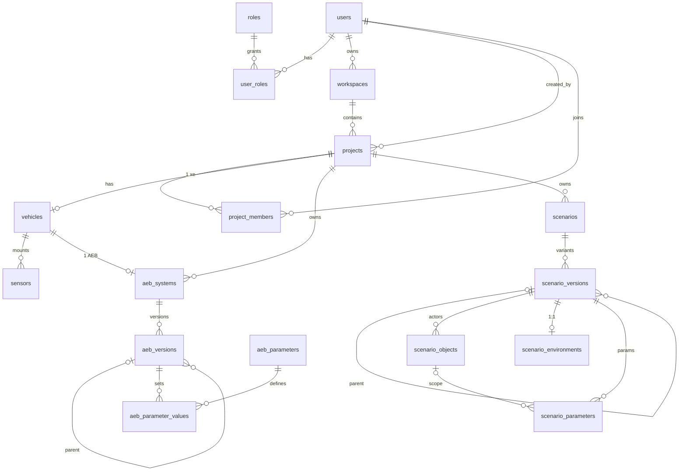
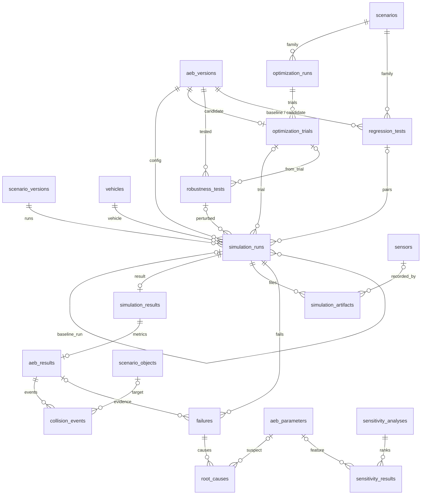
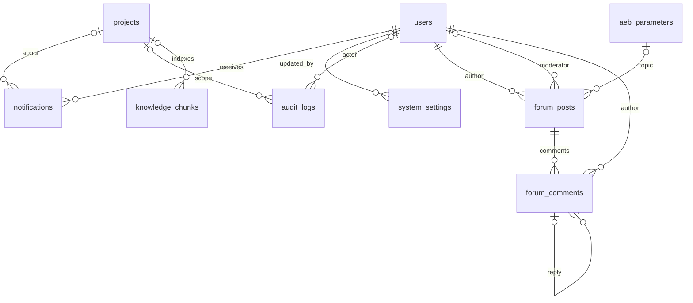

# Từ điển dữ liệu VehicSim (MySQL)

Tài liệu giải thích **từng bảng, từng cột** của database VehicSim: nghĩa nghiệp vụ, ràng buộc,
ai ghi/đọc, dữ liệu thật đang có, và bảng nào phục vụ chức năng nào (FE-01 → FE-14).

- **Nguồn sự thật:** [database/mysql/01_schema.sql](../../database/mysql/01_schema.sql). Tài liệu này
  chỉ giải thích; lệch nhau thì file SQL đúng. Code đọc/ghi qua bản SQLAlchemy song song ở
  [src/services/vehicsim/tables.py](../../src/services/vehicsim/tables.py) (chỉ các bảng code dùng).
- **DB tạo từ bản cũ hơn:** chạy các file trong `database/mysql/migrations/` theo thứ tự (§11).
- **Máy kiểm:** `test_schema_doc_covers_every_table_and_column` bắt buộc mọi bảng và cột trong file SQL
  có mặt ở đây — thêm cột mà quên tài liệu thì test đỏ.
- **Số liệu "Dữ liệu dev"** đo ngày 03/10/2026 trên MySQL 8.4.11 máy TrungDQ (project seed + demo, mọi
  run chạy bằng bộ động học). Chỉ để hình dung quy mô, không phải dữ liệu chuẩn.
- **Trạng thái "chưa có code":** bảng đã có trong DB (thiết kế trước theo FE, [ADR-031](../adr/ADR-031-database-phu-du-chuc-nang.md))
  nhưng chưa có API/màn hình đọc ghi — 0 dòng.
- MySQL `vehicsim` là **database duy nhất** của hệ thống (SQLite của Scenario Forge đã gỡ cùng Forge,
  ADR-032).

## 1. Tổng quan

| | Số lượng |
|---|---|
| Bảng | 36 (code đang đọc/ghi 24) |
| View | 1 (`v_simulation_traceability`) |
| Cột | 435 |
| Khoá ngoại | 91 (tính cả khoá ghép) |
| CHECK | 15 |
| Index (gồm PK, UQ) | 158 |
| Engine / charset | InnoDB · `utf8mb4` / `utf8mb4_0900_ai_ci` · MySQL ≥ 8.0.16 (cần CHECK) |

| # | Nhóm | Bảng | Vai trò | Trạng thái |
|---|---|---|---|---|
| 1 | Danh tính & dự án | `users`, `roles`, `user_roles`, `workspaces`, `projects`, `project_members` | Ai dùng hệ thống, dữ liệu thuộc project nào | Đang dùng (trừ `project_members`) |
| 2 | Xe | `vehicles`, `sensors` | Digital twin của **một xe duy nhất**, không có phiên bản | `vehicles` dùng; `sensors` chưa có code |
| 3 | AEB | `aeb_systems`, `aeb_versions`, `aeb_parameters`, `aeb_parameter_values` | Cấu hình AEB, baseline và candidate | Đang dùng |
| 4 | Kịch bản | `scenarios`, `scenario_versions`, `scenario_objects`, `scenario_environments`, `scenario_parameters` | Họ kịch bản và các biến thể | Đang dùng |
| 5 | Tối ưu & độ bền | `optimization_runs`, `optimization_trials`, `robustness_tests` | Bayesian Opt / NSGA-II, active learning, kiểm dưới nhiễu | Chưa có code — Demo 3 |
| 6 | Mô phỏng | `simulation_runs`, `simulation_results`, `simulation_artifacts` | Mỗi lần chạy một biến thể với một AEB version + seed | Đang dùng |
| 7 | Đánh giá AEB | `aeb_results`, `collision_events` | Chỉ số an toàn của từng run | Đang dùng |
| 8 | Phân tích lỗi & độ nhạy | `failures`, `root_causes`, `sensitivity_analyses`, `sensitivity_results` | Lỗi, chuỗi nguyên nhân, tham số nào ảnh hưởng nhất | Lỗi đang dùng; độ nhạy chưa có code |
| 9 | Regression & quyết định | `regression_tests` | So candidate với baseline, kỹ sư Accept/Reject | Đang dùng |
| 10 | Trợ lý dự án | `knowledge_chunks` | Chỉ mục RAG của Meomeo Agent | Đang dùng (dữ liệu dẫn xuất) |
| 11 | Quản trị hệ thống | `notifications`, `system_settings`, `audit_logs` | Thông báo, cấu hình, nhật ký kiểm toán | Chưa có code |
| 12 | Forum AEB | `forum_posts`, `forum_comments` | Forum chung, EXPERT/ENGINEER đăng bài ([ADR-030](../adr/ADR-030-bo-viewer-them-expert-va-forum.md)) | Chưa có code |

### 1.1 Chức năng nào dùng bảng nào

| FE | Chức năng (báo cáo §1.7) | Bảng |
|---|---|---|
| FE-01 | Đăng nhập, đăng xuất, đổi/quên/đặt lại mật khẩu | `users`, `roles`, `user_roles` (mã OTP ở Redis, không ở MySQL) |
| FE-02 | Quản lý user và role | `users` (`is_active` = khoá), `roles`, `user_roles` |
| FE-03 | Profile | `users` (`full_name`, `avatar_url`) |
| FE-04 | Dashboard, workspace, thông báo | `workspaces`, `projects`, `project_members`, `notifications` |
| FE-05 | Vehicle Digital Twin: model, thông số | `vehicles`, `sensors`. **Phiên bản và trạng thái hiệu chuẩn: ngoài phạm vi** (TrungDQ 03/10 — chỉ một xe, không version; xem §6.2) |
| FE-06 | Câu mô tả → Scenario IR | `scenario_versions` (`natural_language_input`, `scenario_ir`, `llm_model`) |
| FE-07 | Họ kịch bản, sinh biến thể, nhập/xuất `.xosc` | `scenarios`, `scenario_versions` (`xosc_content`, `xosc_sha256`), `scenario_objects`, `scenario_environments`, `scenario_parameters`; bộ sinh `.xosc` ở `src/services/openscenario/` (chưa nối API) |
| FE-08 | Cấu hình/điều khiển/liệt kê job mô phỏng, phát lại | `simulation_runs`, `simulation_results` |
| FE-09 | Dữ liệu mô phỏng, cảm biến, ground truth, xuất | `simulation_results.raw_metrics`, `simulation_artifacts`, `sensors` |
| FE-10 | Cài đặt hệ thống, nhật ký kiểm toán | `system_settings`, `audit_logs` |
| FE-11 | Cấu hình AEB, chỉ số an toàn, đồ thị động học | `aeb_systems`, `aeb_versions`, `aeb_parameters`, `aeb_parameter_values`, `aeb_results` |
| FE-12 | Ca lỗi, nguyên nhân, sửa nhãn, độ nhạy/tương tác, truy vấn lịch sử | `failures`, `root_causes`, `collision_events`, `sensitivity_analyses`, `sensitivity_results`, view `v_simulation_traceability` |
| FE-13 | Bài toán tối ưu, active learning, Pareto, robustness | `optimization_runs`, `optimization_trials`, `robustness_tests` |
| FE-14 | Regression, khuyến nghị, Accept/Reject, knowledge base, nhật ký phiên bản | `regression_tests`, `aeb_versions`, `knowledge_chunks`, `forum_posts`, `forum_comments` |

Khuyến nghị (Engineering Recommendation) **không có bảng riêng**: nó là một `regression_tests` cùng
diff tham số giữa hai `aeb_versions` (+ `robustness_tests` khi có) — lưu riêng sẽ tạo nguồn sự thật thứ
hai cho quyết định Accept/Reject.

## 2. Quy ước

- **Khoá chính:** `id BIGINT UNSIGNED AUTO_INCREMENT`; bảng tra cứu nhỏ dùng `SMALLINT`/`TINYINT`
  (`roles`, `aeb_parameters`, `system_settings`). Bảng nối dùng khoá chính ghép (`user_roles`,
  `aeb_parameter_values`).
- **Đơn vị SI, ghi trong tên cột:** `_m` mét · `_mps` m/s · `_mps2` m/s² · `_mps3` m/s³ · `_s` giây ·
  `_deg` độ · `_pct` phần trăm 0–100 · `_kg` · `_hz`. Tốc độ lưu m/s; km/h chỉ xuất hiện trong IR/JSON
  và tham số `speed_kmh`.
- **Thời gian:** `DATETIME` (không múi giờ). `created_at` mặc định `CURRENT_TIMESTAMP`, `updated_at`
  tự cập nhật `ON UPDATE CURRENT_TIMESTAMP`.
- **Cờ:** `TINYINT(1)` 0/1. **JSON:** ảnh chụp (snapshot) tại thời điểm ghi, không bị sửa về sau.
- **Không lưu file nhị phân:** video, dữ liệu cảm biến, ảnh đại diện chỉ lưu đường dẫn/URL; ngoại lệ có
  chủ đích là vector embedding (`knowledge_chunks.embedding`).
- **Không lưu bí mật dạng rõ:** mật khẩu là hash; mã OTP ở Redis (HMAC); `system_settings` kiểu `SECRET`
  là bản mã hoá; `audit_logs.details` không chứa mật khẩu, OTP, token, API key.
- **Chính sách xoá:** `RESTRICT` cho dữ liệu gốc (không xoá được project/kịch bản/AEB version/user đã
  được dùng); `CASCADE` cho bảng con thuần (kết quả, object, tham số, comment); `SET NULL` cho tham chiếu
  tuỳ chọn (người tạo, trial, tham số nghi ngờ).
- **Ký hiệu trong bảng cột:** **PK** khoá chính · **FK** khoá ngoại · **UQ** duy nhất · **CK** CHECK ·
  **GEN** cột sinh (`GENERATED ALWAYS … VIRTUAL`) · **AI** auto increment. Cột "Bắt buộc": ✓ = `NOT NULL`.

## 3. Mẫu thiết kế xuyên suốt

### 3.1 Khoá ngoại ghép ép "cùng project"

Một run phải dùng kịch bản, xe, AEB **của cùng project**. Thay vì tin tầng ứng dụng, DB ép bằng khoá
ngoại ghép: bảng cha có `UNIQUE (project_id, id)`, bảng con lặp lại `project_id` và trỏ cả cặp.

```sql
-- simulation_runs không thể trỏ sang kịch bản của project khác:
FOREIGN KEY (project_id, scenario_id) REFERENCES scenarios(project_id, id)
```

Các khoá UQ phục vụ việc này: `vehicles(project_id, id)`, `aeb_systems(project_id, id)`, `scenarios(project_id, id)`, `scenario_versions(scenario_id, id)`,
`aeb_versions(aeb_system_id, id)`, `simulation_runs(project_id, id)`,
`optimization_runs(id, aeb_system_id)`, `robustness_tests(id, aeb_version_id)`,
`regression_tests(id, candidate_aeb_version_id)`. Vì vậy một số cột (`scenario_id`, `aeb_system_id`)
**lặp lại có chủ đích** trong `simulation_runs`, `optimization_runs`, `robustness_tests`,
`regression_tests`, `sensitivity_analyses` — đừng "chuẩn hoá" bỏ chúng.

### 3.2 Họ kịch bản = `scenarios` + `scenario_versions`

`scenarios` là **họ** (mô típ, vd. "Người đi bộ băng ngang"). Mỗi dòng `scenario_versions` là **một
biến thể**:

- **Bản gốc:** `source = NATURAL_LANGUAGE` (từ câu mô tả qua LLM) hoặc `MANUAL`; `parent_version_id = NULL`;
  `scenario_ir` chứa `parameter_space` (lưới giá trị).
- **Biến thể:** `source = GENERATED`; `parent_version_id` = bản gốc **cùng họ**; `scenario_ir` là một
  điểm trong lưới. CHECK `ck_sv_parent` ép đúng cặp này.

Sửa bản gốc rồi sinh lại thì biến thể mới trỏ về bản gốc mới — không trộn với biến thể cũ.

### 3.3 "Đúng một bản đang dùng" bằng cột sinh + UNIQUE

`aeb_versions.baseline_system_key` = `aeb_system_id` khi `status = 'BASELINE'`, ngược lại `NULL`;
`UNIQUE` bỏ qua `NULL` ⇒ mỗi hệ AEB có tối đa một baseline. Accept trong `regression.py` chạy **một
transaction**: baseline cũ → `ARCHIVED` **trước**, rồi candidate → `BASELINE`.

Cùng mẹo cột sinh: `scenario_parameters.object_scope_key` và `sensitivity_results.interaction_key` biến
`NULL` thành giá trị cố định để `UNIQUE` chặn trùng cả dòng "toàn cục"/"đơn lẻ".

### 3.4 Run lặp lại phải đúng cấu hình được kiểm

- **Regression** (`purpose = 'REGRESSION'`): bắt buộc có `regression_test_id` **và** `baseline_run_id`
  (`ck_sr_regression`); `fk_sr_baseline_run (baseline_run_id, scenario_version_id, random_seed)` ép **cùng
  biến thể và cùng seed** với run baseline; `fk_sr_regression (regression_test_id, aeb_version_id)` ép dùng
  đúng AEB candidate. Máy kiểm: `test_regression_pairs_same_seeds_and_accept_swaps_baseline`.
- **Robustness** (`purpose = 'ROBUSTNESS'`): bắt buộc có `robustness_test_id` (`ck_sr_robustness`);
  `fk_sr_robustness (robustness_test_id, aeb_version_id)` ép dùng đúng AEB version được kiểm.

### 3.5 Danh tính bộ mô phỏng

`simulation_runs.carla_version` lưu **bộ mô phỏng nào** chạy run: `vehicsim-kinematic-1.0` (bộ động học,
toàn bộ 1.134 run dev) hoặc `carla-<x.y.z>` (vd. `carla-0.9.16`, sinh bởi `bundle.carla_simulator`).
Regression chép giá trị này từ run baseline nên không bao giờ ghép động học với CARLA
(`test_regression_never_pairs_kinematic_with_carla`,
[ADR-027](../adr/ADR-027-bo-mo-phong-cam-duoc-hop-dong-json.md)). DB **chưa** ép điều này (TD-20).

### 3.6 Đúng 10 tham số AEB

`aeb_parameters.code` là `ENUM` 10 giá trị + `UNIQUE` ⇒ không thêm được tham số thứ 11. Seed Python
phải khớp seed SQL (`test_python_parameter_seed_matches_sql_seed`).

### 3.7 Giới hạn MySQL đã gặp (đừng "sửa" ngược)

- Cột nằm trong `CHECK` không được tham gia FK có referential action — kể cả `ON UPDATE CASCADE`
  (ERROR 3823) ⇒ `fk_sv_parent`, `fk_sr_regression`, `fk_sr_baseline_run`, `fk_sr_robustness`,
  `fk_rt_baseline`, `fk_rt_candidate`, `fk_fp_author`, `fk_fp_moderator` dùng `RESTRICT` cả hai chiều.
- Cột sinh `STORED` cấm FK có `CASCADE` trên cột gốc (ERROR 1215) ⇒ mọi cột sinh đều `VIRTUAL`
  (vẫn đánh index được).
- `optimization_*` và `robustness_tests` được tạo **trước** `simulation_runs` để tránh vòng khoá ngoại.
- Nạp file SQL **phải** dùng `--default-character-set=utf8mb4`; client latin1 làm chữ tiếng Việt vỡ và
  để literal `_latin1` trong CHECK/cột sinh (đã gặp, sửa ở migration 001).

### 3.8 Chuỗi truy vết một run

```
simulation_runs ─1:1─ simulation_results ─1:1─ aeb_results ─1:n─ collision_events
      │                                              │
      ├──1:n── failures ──1:n── root_causes ──n:1── aeb_parameters  (tham số nghi ngờ)
      ├──1:n── simulation_artifacts ──n:1── sensors  (file cảm biến / ground truth)
      │
      └── scenario_versions · vehicles · aeb_versions · random_seed · carla_version  (tái lập được)
```

View `v_simulation_traceability` trả lời nhanh "run này dùng đúng cấu hình nào".

## 4. Sơ đồ quan hệ (ERD)

Cấu hình — ai, xe nào, AEB nào, kịch bản nào:



Thực thi và phân tích (bỏ bớt cạnh tới `users`/`projects` cho dễ đọc):



Quản trị, trợ lý và forum:



## 5. Luồng dữ liệu theo vòng MVP

| Bước | Màn / lệnh | Module ghi | Bảng được ghi |
|---|---|---|---|
| 0. Khởi tạo | `scripts/seed_vehicsim.py` | `vehicsim/bootstrap.py` | `aeb_parameters` (nếu thiếu), `workspaces`, `projects`, `vehicles`, `aeb_systems`, `aeb_versions` (v1 `BASELINE`), `aeb_parameter_values` (10 dòng) |
| — Tài khoản | Đăng ký / đăng nhập; `scripts/create_admin.py [--role EXPERT]` | `services/auth/users.py` | `users`, `user_roles` (tự đăng ký = ENGINEER; ADMIN/EXPERT chỉ qua script) |
| 1. Mô tả → biến thể | Kịch bản mới | `vehicsim/describe.py` (LLM) → `vehicsim/family.py` | `scenarios`, `scenario_versions` (bản gốc + biến thể), `scenario_objects` (ego + người đi bộ), `scenario_environments`, `scenario_parameters` |
| 2. Chạy baseline | Chạy họ | `vehicsim/runs.py` | `simulation_runs` (`BASELINE`, `QUEUED → RUNNING → COMPLETED/FAILED`), rồi `_persist`: `simulation_results`, `aeb_results`, `collision_events` (khi va chạm), `failures` + `root_causes` (khi lỗi), `simulation_artifacts` (khi bộ mô phỏng tiến trình con trả file) |
| 3. Phân tích lỗi | Ca lỗi, phát lại | `vehicsim/views.py` (chỉ đọc) | — đọc `failures`, `root_causes`, `simulation_results.raw_metrics` |
| 4. Candidate | Cấu hình AEB | `vehicsim/aeb.py` | `aeb_versions` (`CANDIDATE`, `parent_version_id` = baseline), `aeb_parameter_values` (kiểm trong `[min, max]`) |
| 5. Regression | Kiểm định | `vehicsim/regression.py` + `runs.py` | `regression_tests` (`PENDING → RUNNING → PASSED/FAILED`), `simulation_runs` (`REGRESSION`, cùng biến thể + seed) |
| 6. Quyết định | Khuyến nghị → Review | `vehicsim/regression.py` | `regression_tests.review_*`; Accept: `aeb_versions` baseline cũ `ARCHIVED`, candidate `BASELINE`; Reject: candidate `REJECTED` |
| Trợ lý | Meomeo Agent | `vehicsim/knowledge.py` | Chỉ `knowledge_chunks` (`test_assistant_never_writes_project_data`) |

Các bảng chưa có code sẽ được ghi theo luồng dự kiến: thêm xe (FE-05) → clone thông số từ CARLA vào
`vehicles` (§6.2); độ nhạy (FE-12) đọc run lịch sử → ghi
`sensitivity_*`; robustness (FE-13) tạo `robustness_tests` rồi các run `ROBUSTNESS`; mọi thao tác quan
trọng ghi `audit_logs`; sự kiện cần người khác xử lý tạo `notifications`.

## 6. Từ điển từng bảng

### 6.1 Danh tính & dự án

#### `users`

Tài khoản đăng nhập của phần xác thực dùng chung. Ghi bởi `services/auth/users.py` và
`scripts/create_admin.py`. **Dữ liệu dev:** 2 dòng.

| Cột | Kiểu | Bắt buộc | Mặc định | Ràng buộc | Ý nghĩa |
|---|---|---|---|---|---|
| `id` | BIGINT UNSIGNED | ✓ | AI | PK | Định danh người dùng |
| `email` | VARCHAR(255) | ✓ | | UQ `uq_users_email` | Email đăng nhập. API không bao giờ lộ email có tồn tại hay không |
| `password_hash` | VARCHAR(255) | ✓ | | | Băm mật khẩu; không lưu mật khẩu gốc |
| `full_name` | VARCHAR(150) | ✓ | | | Họ tên hiển thị |
| `avatar_url` | VARCHAR(1024) | | | | FE-03: URL ảnh đại diện (không lưu nhị phân). Chưa có code ghi |
| `is_active` | TINYINT(1) | ✓ | 1 | | 0 = tài khoản bị khoá (FE-02 "Delete-Lock User") |
| `last_login_at` | DATETIME | | | | Lần đăng nhập gần nhất (cập nhật khi login) |
| `created_at` | DATETIME | ✓ | CURRENT_TIMESTAMP | | Thời điểm tạo |
| `updated_at` | DATETIME | ✓ | CURRENT_TIMESTAMP | ON UPDATE | Lần sửa gần nhất |

#### `roles`

Bảng tra cứu role hệ thống. **Dữ liệu dev:** 3 dòng seed `ADMIN`, `ENGINEER`, `EXPERT` (role `VIEWER` đã
bỏ theo [ADR-030](../adr/ADR-030-bo-viewer-them-expert-va-forum.md)).

| Cột | Kiểu | Bắt buộc | Mặc định | Ràng buộc | Ý nghĩa |
|---|---|---|---|---|---|
| `id` | SMALLINT UNSIGNED | ✓ | AI | PK | |
| `code` | VARCHAR(50) | ✓ | | UQ `uq_roles_code` | Mã dùng trong code: `ADMIN` / `EXPERT` / `ENGINEER` |
| `name` | VARCHAR(100) | ✓ | | | Tên hiển thị |
| `description` | VARCHAR(255) | | | | Mô tả quyền |
| `created_at` | DATETIME | ✓ | CURRENT_TIMESTAMP | | |

Quyền trong code: `WRITE_ROLES = {"ADMIN", "EXPERT", "ENGINEER"}` ở `api/vehicsim_routes.py`; tài khoản
không mang role nào trong đó chỉ đọc (`test_viewer_can_read_but_not_write`); EXPERT ghi được như ENGINEER
(`test_expert_can_run_and_test_like_engineer`).

| Quyền | ADMIN | EXPERT | ENGINEER |
|---|---|---|---|
| Đọc mọi màn, chạy/kiểm thử, regression, Accept/Reject, hỏi Meomeo Agent | ✓ | ✓ | ✓ |
| Đăng bài forum | – | ✓ hiện ngay | ✓ chờ duyệt |
| Comment forum | ✓ | ✓ | ✓ |
| Duyệt / ẩn nội dung forum | ✓ | ✓ | – |
| Cấp quyền | chỉ bằng `scripts/create_admin.py` trên máy chủ | như ADMIN | tự đăng ký |

#### `user_roles`

Gán role cho người dùng (n–n). **Dữ liệu dev:** 2 dòng.

| Cột | Kiểu | Bắt buộc | Mặc định | Ràng buộc | Ý nghĩa |
|---|---|---|---|---|---|
| `user_id` | BIGINT UNSIGNED | ✓ | | PK, FK → `users.id` CASCADE | Xoá user thì xoá gán role |
| `role_id` | SMALLINT UNSIGNED | ✓ | | PK, FK → `roles.id` RESTRICT | Không xoá được role còn người dùng |
| `assigned_at` | DATETIME | ✓ | CURRENT_TIMESTAMP | | Thời điểm gán |

#### `workspaces`

Không gian làm việc của một chủ sở hữu, chứa các project (FE-04). **Dữ liệu dev:** 1 dòng (tạo bởi seed).

| Cột | Kiểu | Bắt buộc | Mặc định | Ràng buộc | Ý nghĩa |
|---|---|---|---|---|---|
| `id` | BIGINT UNSIGNED | ✓ | AI | PK | |
| `name` | VARCHAR(150) | ✓ | | UQ (`owner_id`, `name`) | Tên, duy nhất theo chủ sở hữu |
| `description` | TEXT | | | | |
| `owner_id` | BIGINT UNSIGNED | ✓ | | FK → `users.id` RESTRICT | Chủ sở hữu |
| `created_at` | DATETIME | ✓ | CURRENT_TIMESTAMP | | |
| `updated_at` | DATETIME | ✓ | CURRENT_TIMESTAMP | ON UPDATE | |

#### `projects`

Đơn vị cô lập dữ liệu: mọi xe, AEB, kịch bản, run thuộc đúng một project. **Dữ liệu dev:** 1 dòng.

| Cột | Kiểu | Bắt buộc | Mặc định | Ràng buộc | Ý nghĩa |
|---|---|---|---|---|---|
| `id` | BIGINT UNSIGNED | ✓ | AI | PK | |
| `workspace_id` | BIGINT UNSIGNED | ✓ | | FK → `workspaces.id` RESTRICT; UQ (`workspace_id`, `name`) | Workspace chứa project |
| `name` | VARCHAR(150) | ✓ | | | Tên, duy nhất trong workspace |
| `description` | TEXT | | | | |
| `status` | ENUM('ACTIVE','ARCHIVED') | ✓ | ACTIVE | | Lưu trữ thay cho xoá |
| `created_by` | BIGINT UNSIGNED | ✓ | | FK → `users.id` RESTRICT | Người tạo |
| `created_at` | DATETIME | ✓ | CURRENT_TIMESTAMP | | |
| `updated_at` | DATETIME | ✓ | CURRENT_TIMESTAMP | ON UPDATE | |

#### `project_members`

Thành viên và vai trò **trong một project**. **Chưa có code:** 0 dòng; phân quyền hiện chỉ dựa vào role
hệ thống.

| Cột | Kiểu | Bắt buộc | Mặc định | Ràng buộc | Ý nghĩa |
|---|---|---|---|---|---|
| `project_id` | BIGINT UNSIGNED | ✓ | | PK, FK → `projects.id` CASCADE | |
| `user_id` | BIGINT UNSIGNED | ✓ | | PK, FK → `users.id` CASCADE | |
| `member_role` | ENUM('OWNER','ENGINEER','EXPERT') | ✓ | ENGINEER | | Vai trò trong project |
| `joined_at` | DATETIME | ✓ | CURRENT_TIMESTAMP | | |

### 6.2 Xe

#### `vehicles`

Digital twin của **xe duy nhất** được nghiên cứu: **tối đa 1 xe / project** (`uq_vehicles_project`) và
**không có phiên bản xe** — quyết định phạm vi của TrungDQ ngày 03/10 (mục "Versions and calibration
status" của FE-05 nằm ngoài phạm vi). **Dữ liệu dev:** 1 dòng — `VF8 v1.2`, `vehicle.tesla.model3`,
2.100 kg, phanh tối đa 9,5 m/s².

Bộ mô phỏng đọc `length_m`, `width_m`, `max_brake_decel_mps2` **lúc chạy và lúc xuất JSON**
(`runs.spec_for_run`). Vì không có phiên bản, **không sửa thông số xe khi project đã có run**: run cũ xuất
lại sẽ mang thông số mới, còn regression sẽ so hai lần chạy khác xe (phá luật "không đổi hai thứ trong
một lần so sánh"). Cần xe khác thì thêm xe mới như dưới.

**Thêm xe = clone thông số từ CARLA** vào một dòng `vehicles` ở project mới (mỗi project một xe). Chưa có
script; script phải nằm ở `worker/` vì `src/` không được import `carla` (luật cứng 2). Spawn blueprint
trong CARLA, chạy ít nhất một tick, rồi lấy từng cột như sau. Nguyên tắc với cột CARLA **không có**:
không bịa số — cột bộ mô phỏng dùng thì **đo trong CARLA**; cột không ai dùng mà cho NULL thì **để NULL**;
mọi cột đều ghi cách lấy vào `extra_config.provenance`.

| Cột | Bắt buộc | Bộ mô phỏng dùng | Lấy thế nào |
|---|---|---|---|
| `carla_blueprint` | ✓ | | id blueprint, vd. `vehicle.tesla.model3` |
| `name` | ✓ | | kỹ sư đặt (CARLA không có) |
| `length_m`, `width_m` | ✓ | **có** — kích thước va chạm | 2 × `actor.bounding_box.extent.x` / `.y` |
| `height_m` | ✓ | | 2 × `bounding_box.extent.z` |
| `mass_kg` | ✓ | | `get_physics_control().mass` |
| `wheelbase_m` | ✓ | | **tính**: khoảng cách tâm trục trước – tâm trục sau từ `get_physics_control().wheels[i].position` (đơn vị cm → m; kiểm: phải nhỏ hơn `length_m`) |
| `max_brake_decel_mps2` | ✓ | **có** — giới hạn phanh của bộ động học và lực phanh AEB tính toán trong CARLA runner | CARLA **không có** → **đo** (cách đo dưới bảng). Không suy từ `max_brake_torque`: TD-17 đo phanh hết cỡ chỉ ~4,6 m/s² ở 40 km/h và đổi mô-men phanh qua `apply_physics_control` không có tác dụng — số suy từ mô-men không phản ánh CARLA |
| `max_speed_mps` | ✓ | | CARLA **không có** → **tính cận trên** từ hộp số: `max_rpm` × 2π × bán kính bánh (cm → m) ÷ (60 × `final_ratio` × tỉ số số cao nhất); bỏ qua lực cản nên chỉ là cận trên. Cần số chính xác thì đo (ga hết cỡ trên đường thẳng tới khi tốc độ ngừng tăng) |
| `drag_coefficient` | | | `get_physics_control().drag_coefficient` |
| `cg_height_m` | | | **để NULL**: `center_of_mass` của CARLA là độ lệch so với tâm mặc định, không phải chiều cao trọng tâm |
| `tire_friction_coeff` | | | **để NULL**: `tire_friction` của CARLA là thang riêng, không phải hệ số μ (và đổi nó không có tác dụng — TD-17); giá trị gốc lưu ở `extra_config` |
| `extra_config` | | | bản chụp đầy đủ + nguồn gốc từng cột (mẫu dưới) |

Tên trường theo Python API CARLA 0.9.x (`VehiclePhysicsControl`, `WheelPhysicsControl`) — kiểm lại trên
bản 0.9.16 khi viết script.

**Đo `max_brake_decel_mps2`:** chế độ đồng bộ, `fixed_delta_seconds` như run thật (0,05 s), đường thẳng
phẳng mặt khô. Tăng tốc tới 40 và 60 km/h (dải tốc độ của kịch bản), phanh hết cỡ (`brake = 1.0`), lấy giảm
tốc trung bình từ khung vận tốc **sau** đoạn lực phanh đang tăng và **trước** khi xuống dưới ~6 m/s (dưới
mức đó CARLA dừng gần như tức thì — TD-17). Vận tốc CARLA đọc về có dạng răng cưa chu kỳ 2 tick, nên lấy
trung bình theo cửa sổ như `DecelMeter` trong `worker/run_variant.py` (dùng lại được), đừng lấy đạo hàm
từng tick. Mỗi tốc độ chạy 3 lần, ghi giá trị **nhỏ nhất** (an toàn cho AEB). Đo bằng đúng phiên bản CARLA
sẽ chạy run.

**Mẫu `extra_config`:**

```json
{
  "source": "carla",
  "carla_version": "carla-0.9.16",
  "provenance": {
    "length_m": "carla_bbox", "width_m": "carla_bbox", "height_m": "carla_bbox",
    "mass_kg": "carla_physics", "drag_coefficient": "carla_physics",
    "wheelbase_m": "computed_from_wheels",
    "max_speed_mps": "computed_from_gearing",
    "max_brake_decel_mps2": {"method": "measured_in_carla", "from_kmh": [40, 60], "repeats": 3, "rule": "min"},
    "name": "manual", "cg_height_m": null, "tire_friction_coeff": null
  },
  "carla_raw": {"physics_control": {"...": "bản chụp đầy đủ"}, "tire_friction": ["...giá trị từng bánh..."]}
}
```

Xe hiện có trên DB dev (`VF8 v1.2`) **không** clone từ CARLA: số do `bootstrap.py` gõ tay (vd. phanh 9,5 m/s²)
— đó là một nguyên nhân của chênh lệch động học ↔ CARLA ở TD-17. Đã có 1.134 run nên không sửa dòng này;
muốn một xe khớp CARLA thì clone sang project mới.

| Cột | Kiểu | Bắt buộc | Mặc định | Ràng buộc | Ý nghĩa |
|---|---|---|---|---|---|
| `id` | BIGINT UNSIGNED | ✓ | AI | PK; UQ (`project_id`, `id`) | |
| `project_id` | BIGINT UNSIGNED | ✓ | | FK → `projects.id` RESTRICT; UQ | Project sở hữu (1 xe / project) |
| `name` | VARCHAR(150) | ✓ | | | Tên model, vd. "VF8 v1.2" |
| `carla_blueprint` | VARCHAR(100) | ✓ | | | Blueprint CARLA, vd. `vehicle.tesla.model3` |
| `mass_kg` | DECIMAL(8,2) | ✓ | | CK > 0 | Khối lượng |
| `length_m` | DECIMAL(5,3) | ✓ | | CK > 0 | Chiều dài |
| `width_m` | DECIMAL(5,3) | ✓ | | CK > 0 | Chiều rộng |
| `height_m` | DECIMAL(5,3) | ✓ | | CK > 0 | Chiều cao |
| `wheelbase_m` | DECIMAL(5,3) | ✓ | | CK > 0 | Chiều dài cơ sở |
| `cg_height_m` | DECIMAL(5,3) | | | | Chiều cao trọng tâm |
| `max_speed_mps` | DECIMAL(7,3) | ✓ | | CK > 0 | Tốc độ tối đa |
| `max_brake_decel_mps2` | DECIMAL(5,2) | ✓ | | CK > 0 | Giới hạn giảm tốc vật lý của xe (khác tham số AEB `MAX_DECELERATION`) |
| `tire_friction_coeff` | DECIMAL(4,3) | | | | Hệ số ma sát lốp |
| `drag_coefficient` | DECIMAL(4,3) | | | | Hệ số cản khí động |
| `extra_config` | JSON | | | | Thông số mở rộng (dev: NULL) |
| `created_at` | DATETIME | ✓ | CURRENT_TIMESTAMP | | |
| `updated_at` | DATETIME | ✓ | CURRENT_TIMESTAMP | ON UPDATE | |

CHECK: `ck_vehicles_dims` (kích thước, khối lượng > 0), `ck_vehicles_perf` (tốc độ, phanh > 0).

#### `sensors`

Cảm biến gắn trên xe. **Chưa có code:** 0 dòng — perception hiện tổng hợp trên ground truth (TD-01).

| Cột | Kiểu | Bắt buộc | Mặc định | Ràng buộc | Ý nghĩa |
|---|---|---|---|---|---|
| `id` | BIGINT UNSIGNED | ✓ | AI | PK | |
| `vehicle_id` | BIGINT UNSIGNED | ✓ | | FK → `vehicles.id` CASCADE; UQ (`vehicle_id`, `name`) | Xe mang cảm biến |
| `name` | VARCHAR(100) | ✓ | | | Tên, duy nhất trên một xe |
| `sensor_type` | ENUM('CAMERA','RADAR','LIDAR') | ✓ | | | Loại cảm biến |
| `carla_blueprint` | VARCHAR(100) | ✓ | | | vd. `sensor.other.radar` |
| `mount_x_m` | DECIMAL(6,3) | ✓ | 0 | | Vị trí gắn theo trục dọc xe |
| `mount_y_m` | DECIMAL(6,3) | ✓ | 0 | | Vị trí gắn theo trục ngang |
| `mount_z_m` | DECIMAL(6,3) | ✓ | 0 | | Độ cao gắn |
| `mount_yaw_deg` | DECIMAL(6,2) | ✓ | 0 | | Góc quay |
| `range_m` | DECIMAL(7,2) | | | | Tầm đo |
| `fov_deg` | DECIMAL(6,2) | | | | Góc nhìn |
| `update_rate_hz` | DECIMAL(6,2) | | | | Tần số cập nhật |
| `config` | JSON | | | | Thuộc tính blueprint khác |
| `is_enabled` | TINYINT(1) | ✓ | 1 | | Bật/tắt khi chạy |
| `created_at` | DATETIME | ✓ | CURRENT_TIMESTAMP | | |
| `updated_at` | DATETIME | ✓ | CURRENT_TIMESTAMP | ON UPDATE | |

### 6.3 AEB

#### `aeb_systems`

Hệ AEB của một xe — **1 hệ / xe** (`uq_aeb_systems_vehicle`). Ghi bởi seed. **Dữ liệu dev:** 1 dòng ("AEB").

| Cột | Kiểu | Bắt buộc | Mặc định | Ràng buộc | Ý nghĩa |
|---|---|---|---|---|---|
| `id` | BIGINT UNSIGNED | ✓ | AI | PK; UQ (`project_id`, `id`) | |
| `project_id` | BIGINT UNSIGNED | ✓ | | FK → `projects.id` RESTRICT; UQ (`project_id`, `name`) | |
| `vehicle_id` | BIGINT UNSIGNED | ✓ | | UQ; FK (`project_id`, `vehicle_id`) → `vehicles(project_id, id)` RESTRICT | Xe dùng hệ này, cùng project |
| `name` | VARCHAR(150) | ✓ | | | Tên hệ AEB |
| `description` | TEXT | | | | |
| `created_at` | DATETIME | ✓ | CURRENT_TIMESTAMP | | |
| `updated_at` | DATETIME | ✓ | CURRENT_TIMESTAMP | ON UPDATE | |

#### `aeb_versions`

Một bộ cấu hình AEB (10 giá trị tham số) có đánh số — đồng thời là **nhật ký phiên bản** của FE-14.
Baseline là bản đang dùng; candidate là bản đề xuất chờ regression. **Dữ liệu dev:** 7 dòng — v1.0
`BASELINE`, 6 `CANDIDATE`.

| Cột | Kiểu | Bắt buộc | Mặc định | Ràng buộc | Ý nghĩa |
|---|---|---|---|---|---|
| `id` | BIGINT UNSIGNED | ✓ | AI | PK; UQ (`aeb_system_id`, `id`) | |
| `aeb_system_id` | BIGINT UNSIGNED | ✓ | | FK → `aeb_systems.id` RESTRICT | Hệ AEB |
| `version_number` | INT UNSIGNED | ✓ | | UQ (`aeb_system_id`, `version_number`) | Số thứ tự trong hệ |
| `label` | VARCHAR(100) | | | | Nhãn hiển thị, vd. "v1.3" |
| `source` | ENUM('MANUAL','OPTIMIZATION') | ✓ | MANUAL | | Kỹ sư nhập tay hay do bộ tối ưu sinh |
| `status` | ENUM('BASELINE','CANDIDATE','ACCEPTED','REJECTED','ARCHIVED') | ✓ | CANDIDATE | | Vòng đời (dưới bảng). `ACCEPTED` hiện chưa dùng: Accept nâng thẳng lên `BASELINE` |
| `parent_version_id` | BIGINT UNSIGNED | | | FK → `aeb_versions.id` SET NULL | Bản gốc mà candidate được sinh ra từ đó |
| `notes` | TEXT | | | | Ghi chú của kỹ sư |
| `created_by` | BIGINT UNSIGNED | | | FK → `users.id` SET NULL | |
| `created_at` | DATETIME | ✓ | CURRENT_TIMESTAMP | | |
| `baseline_system_key` | BIGINT UNSIGNED | | (sinh) | GEN VIRTUAL; UQ `uq_aeb_versions_one_baseline` | `aeb_system_id` nếu là baseline, ngược lại NULL — ép 1 baseline / hệ (§3.3) |

Vòng đời: `CANDIDATE` →(Accept)→ `BASELINE` →(bị thay)→ `ARCHIVED`; `CANDIDATE` →(Reject)→ `REJECTED`.

#### `aeb_parameters`

Danh mục **đúng 10** tham số AEB (bảng tra cứu, không có màn CRUD) và **không gian tìm kiếm** cho tối ưu.
Seed ở §8.

| Cột | Kiểu | Bắt buộc | Mặc định | Ràng buộc | Ý nghĩa |
|---|---|---|---|---|---|
| `id` | TINYINT UNSIGNED | ✓ | AI | PK | |
| `code` | ENUM(10 mã ở §8) | ✓ | | UQ `uq_aeb_parameters_code` | Mã tham số |
| `name` | VARCHAR(100) | ✓ | | | Tên hiển thị |
| `category` | ENUM('PERCEPTION','DECISION','CONTROL','VEHICLE_DYNAMICS') | ✓ | | | Khâu của chuỗi AEB — dùng chung với `root_causes.cause_category` |
| `unit` | VARCHAR(20) | ✓ | | | Đơn vị |
| `description` | VARCHAR(255) | | | | Mô tả |
| `min_value` | DECIMAL(12,4) | ✓ | | CK `min < max` | Cận dưới hợp lệ / không gian tìm kiếm |
| `max_value` | DECIMAL(12,4) | ✓ | | | Cận trên |
| `default_value` | DECIMAL(12,4) | ✓ | | CK nằm trong `[min, max]` | Giá trị khởi tạo cho baseline đầu tiên |
| `sort_order` | TINYINT UNSIGNED | ✓ | | | Thứ tự hiển thị |

#### `aeb_parameter_values`

Giá trị 10 tham số của một AEB version (khoá ghép version × tham số). `aeb.py` từ chối giá trị ngoài
`[min_value, max_value]` — DB không ép điều này. **Dữ liệu dev:** 70 dòng (7 version × 10).

| Cột | Kiểu | Bắt buộc | Mặc định | Ràng buộc | Ý nghĩa |
|---|---|---|---|---|---|
| `aeb_version_id` | BIGINT UNSIGNED | ✓ | | PK, FK → `aeb_versions.id` CASCADE | |
| `aeb_parameter_id` | TINYINT UNSIGNED | ✓ | | PK, FK → `aeb_parameters.id` RESTRICT | |
| `value` | DECIMAL(12,4) | ✓ | | | Giá trị theo `aeb_parameters.unit` |

### 6.4 Kịch bản

#### `scenarios`

**Họ kịch bản** (mô típ) trong một project. **Dữ liệu dev:** 9 họ `PX`…`PX9`, đều `PEDESTRIAN`.

| Cột | Kiểu | Bắt buộc | Mặc định | Ràng buộc | Ý nghĩa |
|---|---|---|---|---|---|
| `id` | BIGINT UNSIGNED | ✓ | AI | PK; UQ (`project_id`, `id`) | |
| `project_id` | BIGINT UNSIGNED | ✓ | | FK → `projects.id` RESTRICT | |
| `code` | VARCHAR(30) | ✓ | | UQ (`project_id`, `code`) | Mã ngắn, vd. `PX3`; nhãn biến thể là `PX-002` |
| `name` | VARCHAR(200) | ✓ | | | Tên họ (được trùng — TD-09) |
| `description` | TEXT | | | | |
| `category` | ENUM('PEDESTRIAN','VEHICLE','CYCLIST','OTHER') | ✓ | PEDESTRIAN | | Loại đối tượng chính |
| `created_by` | BIGINT UNSIGNED | ✓ | | FK → `users.id` RESTRICT | |
| `created_at` | DATETIME | ✓ | CURRENT_TIMESTAMP | | |
| `updated_at` | DATETIME | ✓ | CURRENT_TIMESTAMP | ON UPDATE | |

#### `scenario_versions`

Bản gốc hoặc **một biến thể** của họ (§3.2). **Dữ liệu dev:** 591 dòng — 7 `NATURAL_LANGUAGE`, 2 `MANUAL`,
582 `GENERATED`, tất cả `VALID`, bản đồ `Town10HD`.

| Cột | Kiểu | Bắt buộc | Mặc định | Ràng buộc | Ý nghĩa |
|---|---|---|---|---|---|
| `id` | BIGINT UNSIGNED | ✓ | AI | PK; UQ (`scenario_id`, `id`) | |
| `scenario_id` | BIGINT UNSIGNED | ✓ | | FK → `scenarios.id` RESTRICT | Họ |
| `version_number` | INT UNSIGNED | ✓ | | UQ (`scenario_id`, `version_number`) | Số thứ tự trong họ |
| `source` | ENUM('NATURAL_LANGUAGE','MANUAL','GENERATED') | ✓ | NATURAL_LANGUAGE | CK `ck_sv_parent` | Nguồn gốc |
| `parent_version_id` | BIGINT UNSIGNED | | | FK (`scenario_id`, `parent_version_id`) → `scenario_versions(scenario_id, id)` RESTRICT | Bản gốc (cùng họ); NULL nếu chính nó là bản gốc. `GENERATED` ⇔ có giá trị |
| `natural_language_input` | TEXT | | | | Câu mô tả gốc của kỹ sư |
| `llm_model` | VARCHAR(100) | | | | Model LLM đã dịch câu → IR (dev: `deepseek-flash`) |
| `scenario_ir` | JSON | ✓ | | | Scenario IR đã chốt — cấu trúc ở §7 |
| `validation_status` | ENUM('PENDING','VALID','INVALID') | ✓ | PENDING | | Kết quả kiểm IR |
| `validation_errors` | JSON | | | | Danh sách lỗi khi `INVALID` |
| `opendrive_map` | VARCHAR(100) | ✓ | | | Bản đồ, vd. `Town10HD` |
| `openscenario_version` | VARCHAR(20) | | | | vd. `1.2` — chưa ghi (chưa sinh `.xosc`) |
| `xosc_content` | LONGTEXT | | | | Nội dung `.xosc` đã sinh / nhập (FE-07 import-export) — chưa dùng |
| `xosc_sha256` | CHAR(64) | | | | Băm `.xosc` để phát hiện trùng/sửa |
| `change_note` | VARCHAR(500) | | | | Ghi chú thay đổi |
| `created_by` | BIGINT UNSIGNED | ✓ | | FK → `users.id` RESTRICT | |
| `created_at` | DATETIME | ✓ | CURRENT_TIMESTAMP | | |

#### `scenario_objects`

Các actor trong một biến thể. **Dữ liệu dev:** 1.164 dòng = 582 biến thể × (`ego` `EGO_VEHICLE` +
`pedestrian_1` `PEDESTRIAN`).

| Cột | Kiểu | Bắt buộc | Mặc định | Ràng buộc | Ý nghĩa |
|---|---|---|---|---|---|
| `id` | BIGINT UNSIGNED | ✓ | AI | PK | |
| `scenario_version_id` | BIGINT UNSIGNED | ✓ | | FK → `scenario_versions.id` CASCADE; UQ (version, `name`) | |
| `name` | VARCHAR(100) | ✓ | | | `ego`, `pedestrian_1` |
| `role` | ENUM('EGO','TARGET','OTHER') | ✓ | | | Vai trò: xe kiểm thử / mục tiêu AEB / khác |
| `object_type` | ENUM('EGO_VEHICLE','PEDESTRIAN','CAR','TRUCK','MOTORCYCLE','BICYCLE','STATIC_OBSTACLE') | ✓ | | | Loại actor |
| `carla_blueprint` | VARCHAR(100) | | | | vd. `walker.pedestrian.0001` |
| `spawn_x_m` | DECIMAL(9,3) | | | | Vị trí xuất hiện (dev: NULL — bộ động học tự đặt theo khoảng cách trigger) |
| `spawn_y_m` | DECIMAL(9,3) | | | | |
| `spawn_z_m` | DECIMAL(9,3) | | | | |
| `spawn_yaw_deg` | DECIMAL(7,3) | | | | Hướng xuất hiện |
| `extra_config` | JSON | | | | |

#### `scenario_environments`

Môi trường của một biến thể (1:1). **Dữ liệu dev:** 582 dòng — `CLEAR/DAY/DRY` 108, `CLEAR/NIGHT/DRY` 108,
`CLEAR/DUSK/DRY` 204, `RAIN/NIGHT/WET` 162 (ma sát 0,7).

| Cột | Kiểu | Bắt buộc | Mặc định | Ràng buộc | Ý nghĩa |
|---|---|---|---|---|---|
| `id` | BIGINT UNSIGNED | ✓ | AI | PK | |
| `scenario_version_id` | BIGINT UNSIGNED | ✓ | | UQ; FK → `scenario_versions.id` CASCADE | 1:1 |
| `weather` | ENUM('CLEAR','CLOUDY','RAIN','HEAVY_RAIN','FOG') | ✓ | CLEAR | | Thời tiết |
| `time_of_day` | ENUM('DAY','DUSK','NIGHT') | ✓ | DAY | | Thời điểm |
| `road_condition` | ENUM('DRY','WET','ICY') | ✓ | DRY | | Mặt đường |
| `friction` | DECIMAL(4,3) | ✓ | 1.000 | CK (0, 1.5] | Hệ số ma sát đường (bộ động học dùng; CARLA chưa — TD-17) |
| `visibility_m` | DECIMAL(8,2) | | | | Tầm nhìn |
| `precipitation_pct` | DECIMAL(5,2) | | | CK 0–100 | Lượng mưa |
| `cloudiness_pct` | DECIMAL(5,2) | | | CK 0–100 | Mây |
| `fog_density_pct` | DECIMAL(5,2) | | | CK 0–100 | Mật độ sương |
| `sun_altitude_deg` | DECIMAL(6,2) | | | | Góc mặt trời |
| `speed_limit_mps` | DECIMAL(7,3) | | | | Giới hạn tốc độ đoạn đường |
| `extra_config` | JSON | | | | |

#### `scenario_parameters`

Tham số số của biến thể, gắn với một object hoặc toàn cục. Boolean lưu 0/1 với `unit = 'bool'`.
**Dữ liệu dev:** 2.328 dòng = 582 × 4: `ego.speed_kmh`, `pedestrian_1.speed_mps`,
`pedestrian_1.trigger_distance_m`, `pedestrian_1.stops_at_curb`.

| Cột | Kiểu | Bắt buộc | Mặc định | Ràng buộc | Ý nghĩa |
|---|---|---|---|---|---|
| `id` | BIGINT UNSIGNED | ✓ | AI | PK | |
| `scenario_version_id` | BIGINT UNSIGNED | ✓ | | FK → `scenario_versions.id` CASCADE | |
| `scenario_object_id` | BIGINT UNSIGNED | | | FK → `scenario_objects.id` CASCADE | NULL = tham số toàn cục |
| `param_name` | VARCHAR(64) | ✓ | | | Tên tham số |
| `value` | DECIMAL(14,4) | ✓ | | | Giá trị |
| `unit` | VARCHAR(20) | | | | `km/h`, `m/s`, `m`, `bool` |
| `object_scope_key` | BIGINT UNSIGNED | | (sinh) | GEN VIRTUAL; UQ (version, key, `param_name`) | `COALESCE(scenario_object_id, 0)` — để UNIQUE chặn trùng cả tham số toàn cục |

### 6.5 Tối ưu và độ bền — chưa có code (FE-13, Demo 3)

#### `optimization_runs`

Một chiến dịch tối ưu trên **cả họ kịch bản**, xuất phát từ một baseline. **0 dòng.**

| Cột | Kiểu | Bắt buộc | Mặc định | Ràng buộc | Ý nghĩa |
|---|---|---|---|---|---|
| `id` | BIGINT UNSIGNED | ✓ | AI | PK; UQ (`id`, `aeb_system_id`) | |
| `project_id` | BIGINT UNSIGNED | ✓ | | FK → `projects.id` RESTRICT | |
| `scenario_id` | BIGINT UNSIGNED | ✓ | | FK (`project_id`, `scenario_id`) → `scenarios` | Họ được tối ưu |
| `base_scenario_version_id` | BIGINT UNSIGNED | ✓ | | FK (`scenario_id`, …) → `scenario_versions` | Bản gốc; bộ biến thể = các bản có `parent_version_id` = cột này |
| `aeb_system_id` | BIGINT UNSIGNED | ✓ | | FK (`project_id`, …) → `aeb_systems` | Lặp lại có chủ đích (§3.1) |
| `baseline_aeb_version_id` | BIGINT UNSIGNED | ✓ | | FK (`aeb_system_id`, …) → `aeb_versions` | Điểm xuất phát |
| `name` | VARCHAR(150) | ✓ | | | |
| `algorithm` | ENUM('BAYESIAN_OPTIMIZATION','NSGA_II','RANDOM_SEARCH') | ✓ | | | Thuật toán |
| `objective_config` | JSON | ✓ | | | Mục tiêu + ràng buộc + ghi đè không gian tìm kiếm |
| `max_trials` | INT UNSIGNED | ✓ | | CK > 0 | Ngân sách (khoảng 50–100 theo kế hoạch rủi ro) |
| `random_seed` | BIGINT | | | | Seed để tái lập |
| `status` | ENUM('PENDING','RUNNING','COMPLETED','FAILED','CANCELLED') | ✓ | PENDING | | |
| `error_message` | TEXT | | | | |
| `created_by` | BIGINT UNSIGNED | ✓ | | FK → `users.id` RESTRICT | |
| `started_at` | DATETIME | | | | |
| `finished_at` | DATETIME | | | | |
| `created_at` | DATETIME | ✓ | CURRENT_TIMESTAMP | | |
| `updated_at` | DATETIME | ✓ | CURRENT_TIMESTAMP | ON UPDATE | |

#### `optimization_trials`

Một lần thử = một AEB candidate được chấm trên cả họ. Hai cột `sampling_source` + `acquisition_value`
phục vụ màn **Active learning tracker**. **0 dòng.**

| Cột | Kiểu | Bắt buộc | Mặc định | Ràng buộc | Ý nghĩa |
|---|---|---|---|---|---|
| `id` | BIGINT UNSIGNED | ✓ | AI | PK | |
| `optimization_run_id` | BIGINT UNSIGNED | ✓ | | FK (`optimization_run_id`, `aeb_system_id`) → `optimization_runs(id, aeb_system_id)` CASCADE | |
| `trial_number` | INT UNSIGNED | ✓ | | UQ (run, `trial_number`) | |
| `aeb_system_id` | BIGINT UNSIGNED | ✓ | | | = hệ của run — ép candidate cùng hệ |
| `candidate_aeb_version_id` | BIGINT UNSIGNED | ✓ | | UQ; FK (`aeb_system_id`, …) → `aeb_versions` RESTRICT | Mỗi candidate thuộc đúng một trial |
| `status` | ENUM('PENDING','RUNNING','COMPLETED','FAILED','PRUNED') | ✓ | PENDING | | `PRUNED` = bị cắt sớm |
| `sampling_source` | ENUM('INITIAL_DESIGN','ACQUISITION','ACTIVE_LEARNING','MANUAL') | ✓ | INITIAL_DESIGN | | Điểm thử từ đâu: thiết kế ban đầu / hàm thu nhận / active learning vùng rủi ro / kỹ sư thêm |
| `acquisition_value` | DECIMAL(14,6) | | | | Giá trị EI / UCB / PI lúc chọn điểm |
| `objective_values` | JSON | | | | vd. `{"collision_rate":0.1,"false_braking_rate":0.02}` |
| `score` | DECIMAL(14,6) | | | | Mục tiêu vô hướng (BO / Random) |
| `constraint_violated` | TINYINT(1) | ✓ | 0 | | Vi phạm ràng buộc |
| `is_pareto_optimal` | TINYINT(1) | ✓ | 0 | | Nằm trên Pareto front (NSGA-II) |
| `is_recommended` | TINYINT(1) | ✓ | 0 | | Được đề xuất cho kỹ sư |
| `started_at` | DATETIME | | | | |
| `completed_at` | DATETIME | | | | |
| `created_at` | DATETIME | ✓ | CURRENT_TIMESTAMP | | |

#### `robustness_tests`

**Robustness validation** (FE-13): chạy MỘT AEB version trên cả họ dưới nhiễu (ma sát 0,6–0,9, trễ phanh
0,15–0,30 s, nhiễu cảm biến, latency, thời tiết) — đúng danh sách nhiễu của kế hoạch tối ưu bền vững.
Từng run nằm ở `simulation_runs` (`purpose = ROBUSTNESS`). **0 dòng.**

| Cột | Kiểu | Bắt buộc | Mặc định | Ràng buộc | Ý nghĩa |
|---|---|---|---|---|---|
| `id` | BIGINT UNSIGNED | ✓ | AI | PK; UQ (`id`, `aeb_version_id`) | |
| `project_id` | BIGINT UNSIGNED | ✓ | | FK → `projects.id` RESTRICT | |
| `name` | VARCHAR(150) | | | | |
| `aeb_system_id` | BIGINT UNSIGNED | ✓ | | FK (`project_id`, …) → `aeb_systems` | Lặp lại có chủ đích (§3.1) |
| `aeb_version_id` | BIGINT UNSIGNED | ✓ | | FK (`aeb_system_id`, …) → `aeb_versions` | Cấu hình được kiểm (thường là candidate) |
| `scenario_id` | BIGINT UNSIGNED | ✓ | | FK (`project_id`, …) → `scenarios` | Họ |
| `base_scenario_version_id` | BIGINT UNSIGNED | ✓ | | FK (`scenario_id`, …) → `scenario_versions` | Bản gốc; bộ biến thể là con của nó |
| `optimization_trial_id` | BIGINT UNSIGNED | | | FK → `optimization_trials.id` SET NULL | Khi kiểm một candidate sinh từ tối ưu |
| `perturbation_config` | JSON | ✓ | | | Khoảng nhiễu từng đại lượng (§7) |
| `samples_per_variant` | SMALLINT UNSIGNED | ✓ | 10 | CK > 0 | Số mẫu nhiễu mỗi biến thể |
| `random_seed` | BIGINT | | | | Seed sinh mẫu nhiễu |
| `pass_criteria` | JSON | ✓ | | | vd. `{"min_pass_rate":0.95,"max_collision_rate":0.02}` |
| `result_summary` | JSON | | | | Tỉ lệ đạt, ca xấu nhất, phân bố chỉ số theo nhiễu |
| `robustness_score` | DECIMAL(6,4) | | | CK 0–1 | Tỉ lệ mẫu nhiễu vẫn đạt |
| `status` | ENUM('PENDING','RUNNING','PASSED','FAILED','ERROR') | ✓ | PENDING | | |
| `error_message` | TEXT | | | | |
| `created_by` | BIGINT UNSIGNED | ✓ | | FK → `users.id` RESTRICT | |
| `started_at` | DATETIME | | | | |
| `finished_at` | DATETIME | | | | |
| `created_at` | DATETIME | ✓ | CURRENT_TIMESTAMP | | |
| `updated_at` | DATETIME | ✓ | CURRENT_TIMESTAMP | ON UPDATE | |

### 6.6 Mô phỏng

#### `simulation_runs`

**Một lần chạy** một biến thể với một AEB version và một seed. Bảng trung tâm của toàn hệ thống.
Ghi/cập nhật bởi `vehicsim/runs.py`. **Dữ liệu dev:** 1.134 dòng — 750 `BASELINE` + 384 `REGRESSION`,
tất cả `COMPLETED`, `carla_version = vehicsim-kinematic-1.0`.

| Cột | Kiểu | Bắt buộc | Mặc định | Ràng buộc | Ý nghĩa |
|---|---|---|---|---|---|
| `id` | BIGINT UNSIGNED | ✓ | AI | PK; UQ (`project_id`, `id`); UQ (`id`, `scenario_version_id`, `random_seed`) | |
| `project_id` | BIGINT UNSIGNED | ✓ | | FK → `projects.id` RESTRICT | |
| `scenario_id` | BIGINT UNSIGNED | ✓ | | FK (`project_id`, …) → `scenarios` | Lặp lại có chủ đích (§3.1) |
| `scenario_version_id` | BIGINT UNSIGNED | ✓ | | FK (`scenario_id`, …) → `scenario_versions` | Biến thể được chạy |
| `vehicle_id` | BIGINT UNSIGNED | ✓ | | FK (`project_id`, …) → `vehicles` | |
| `aeb_system_id` | BIGINT UNSIGNED | ✓ | | FK (`project_id`, …) → `aeb_systems` | |
| `aeb_version_id` | BIGINT UNSIGNED | ✓ | | FK (`aeb_system_id`, …) → `aeb_versions` | Cấu hình AEB đã dùng |
| `optimization_trial_id` | BIGINT UNSIGNED | | | FK → `optimization_trials.id` SET NULL | Có khi run thuộc một trial |
| `regression_test_id` | BIGINT UNSIGNED | | | FK (…, `aeb_version_id`) → `regression_tests(id, candidate_aeb_version_id)` RESTRICT | Có khi `purpose = REGRESSION` (§3.4) |
| `baseline_run_id` | BIGINT UNSIGNED | | | FK (…, `scenario_version_id`, `random_seed`) → `simulation_runs` RESTRICT | Run baseline được chạy lại (§3.4) |
| `robustness_test_id` | BIGINT UNSIGNED | | | FK (…, `aeb_version_id`) → `robustness_tests(id, aeb_version_id)` RESTRICT; CK `ck_sr_robustness` | Có khi `purpose = ROBUSTNESS`; nhiễu của run ở `run_config.perturbation` |
| `purpose` | ENUM('MANUAL','BASELINE','OPTIMIZATION','REGRESSION','ROBUSTNESS') | ✓ | MANUAL | CK `ck_sr_regression`, `ck_sr_robustness` | Mục đích chạy |
| `random_seed` | BIGINT | ✓ | | | Seed — cùng biến thể + cùng seed ⇒ cùng kết quả (`test_same_seed_gives_identical_run`) |
| `status` | ENUM('QUEUED','RUNNING','COMPLETED','FAILED','CANCELLED') | ✓ | QUEUED | | Vòng đời job (FE-08: `CANCELLED` = kỹ sư dừng) |
| `carla_version` | VARCHAR(30) | | | | **Danh tính bộ mô phỏng** (§3.5) |
| `openscenario_version` | VARCHAR(20) | | | | Chưa ghi |
| `fixed_delta_seconds` | DECIMAL(6,4) | | | | Bước thời gian mô phỏng (dev: 0,05 s) |
| `max_duration_s` | DECIMAL(8,2) | | | | Thời lượng tối đa (dev: 12 s) |
| `worker_host` | VARCHAR(150) | | | | Máy đã chạy |
| `run_config` | JSON | | | | Ảnh chụp tham số biến thể lúc chạy (§7) |
| `error_message` | TEXT | | | | Lý do khi `FAILED` |
| `requested_by` | BIGINT UNSIGNED | | | FK → `users.id` SET NULL | Người bấm chạy |
| `queued_at` | DATETIME | ✓ | CURRENT_TIMESTAMP | | Vào hàng đợi (`idx_sr_queue` theo `status`, `queued_at`) |
| `started_at` | DATETIME | | | | |
| `finished_at` | DATETIME | | | | |
| `created_at` | DATETIME | ✓ | CURRENT_TIMESTAMP | | |
| `updated_at` | DATETIME | ✓ | CURRENT_TIMESTAMP | ON UPDATE | |

#### `simulation_results`

Kết quả thô của một run (1:1). **Dữ liệu dev:** 1.134 dòng — `EGO_STOPPED` 544, `TARGET_CLEARED` 438,
`COLLISION` 152.

| Cột | Kiểu | Bắt buộc | Mặc định | Ràng buộc | Ý nghĩa |
|---|---|---|---|---|---|
| `id` | BIGINT UNSIGNED | ✓ | AI | PK | |
| `simulation_run_id` | BIGINT UNSIGNED | ✓ | | UQ; FK → `simulation_runs.id` CASCADE | 1:1 |
| `end_reason` | ENUM('TARGET_CLEARED','EGO_STOPPED','COLLISION','TIMEOUT','ERROR') | ✓ | | | Vì sao mô phỏng dừng |
| `simulated_duration_s` | DECIMAL(9,3) | | | | Thời gian mô phỏng |
| `total_frames` | INT UNSIGNED | | | | Số khung |
| `ego_final_speed_mps` | DECIMAL(7,3) | | | | Tốc độ xe lúc kết thúc |
| `ego_distance_m` | DECIMAL(9,3) | | | | Quãng đường xe đã đi |
| `raw_metrics` | JSON | | | | Toàn bộ payload: khung thời gian (trạng thái xe + ground truth), sự kiện, chuỗi nguyên nhân (§7) |
| `created_at` | DATETIME | ✓ | CURRENT_TIMESTAMP | | |

#### `simulation_artifacts`

File sinh ra từ run — chỉ lưu đường dẫn (FE-09). `runs.py` hiện ghi `RESULT_JSON` và `VIDEO_MP4` khi bộ mô
phỏng chạy bằng tiến trình con (CARLA); ba loại `SENSOR_RECORDING` / `GROUND_TRUTH` / `TELEMETRY_CSV` dành
cho dữ liệu cảm biến thật. **Dữ liệu dev:** 0 dòng (mọi run chạy inline).

| Cột | Kiểu | Bắt buộc | Mặc định | Ràng buộc | Ý nghĩa |
|---|---|---|---|---|---|
| `id` | BIGINT UNSIGNED | ✓ | AI | PK | |
| `simulation_run_id` | BIGINT UNSIGNED | ✓ | | FK → `simulation_runs.id` CASCADE | |
| `artifact_type` | ENUM('VIDEO_MP4','LOG','RESULT_JSON','SCREENSHOT','XOSC','SENSOR_RECORDING','GROUND_TRUTH','TELEMETRY_CSV','OTHER') | ✓ | | | `SENSOR_RECORDING` = dữ liệu thô một cảm biến (RGB/depth/LiDAR/radar); `GROUND_TRUTH` = object id/loại/vị trí/bbox/quỹ đạo từng khung; `TELEMETRY_CSV` = trạng thái xe từng khung |
| `sensor_id` | BIGINT UNSIGNED | | | FK → `sensors.id` SET NULL | Cảm biến sinh ra file (với `SENSOR_RECORDING`) |
| `file_name` | VARCHAR(255) | ✓ | | | Tên file |
| `storage_url` | VARCHAR(1024) | ✓ | | | Đường dẫn / URL object storage, không lưu nhị phân |
| `mime_type` | VARCHAR(100) | | | | |
| `file_size_bytes` | BIGINT UNSIGNED | | | | |
| `checksum_sha256` | CHAR(64) | | | | Chưa ghi |
| `metadata` | JSON | | | | Số khung, độ phân giải, hệ toạ độ… |
| `created_at` | DATETIME | ✓ | CURRENT_TIMESTAMP | | |

### 6.7 Đánh giá AEB

#### `aeb_results`

Chỉ số an toàn và phán quyết của một run (1:1 với `simulation_results`). Đây là dữ liệu mà regression,
màn Tổng quan và Meomeo Agent tổng hợp. **Dữ liệu dev:** 1.134 dòng.

| Cột | Kiểu | Bắt buộc | Mặc định | Ràng buộc | Ý nghĩa |
|---|---|---|---|---|---|
| `id` | BIGINT UNSIGNED | ✓ | AI | PK | |
| `simulation_result_id` | BIGINT UNSIGNED | ✓ | | UQ; FK → `simulation_results.id` CASCADE | 1:1 |
| `collision` | TINYINT(1) | ✓ | | CK `ck_aebres_collision` | Có va chạm |
| `collision_count` | SMALLINT UNSIGNED | ✓ | 0 | CK: 0 khi không va chạm, ≥ 1 khi có | Số va chạm |
| `impact_speed_mps` | DECIMAL(7,3) | | | CK ≥ 0 | Tốc độ lúc va chạm; NULL nếu không va chạm |
| `min_ttc_s` | DECIMAL(8,4) | | | | Time-to-collision nhỏ nhất |
| `min_distance_m` | DECIMAL(8,3) | | | CK ≥ 0 | Khoảng cách nhỏ nhất tới mục tiêu |
| `aeb_triggered` | TINYINT(1) | ✓ | 0 | | AEB có kích hoạt |
| `aeb_trigger_time_s` | DECIMAL(8,3) | | | | Thời điểm kích hoạt |
| `braking_latency_s` | DECIMAL(8,4) | | | CK ≥ 0 | Trễ từ quyết định tới khi phanh có tác dụng |
| `false_activation` | TINYINT(1) | ✓ | 0 | | Phanh khi không cần (false braking) |
| `missed_activation` | TINYINT(1) | ✓ | 0 | | Cần phanh mà không phanh |
| `max_deceleration_mps2` | DECIMAL(7,3) | | | | Giảm tốc lớn nhất |
| `mean_deceleration_mps2` | DECIMAL(7,3) | | | | Giảm tốc trung bình |
| `max_jerk_mps3` | DECIMAL(8,3) | | | | Jerk lớn nhất (êm ái) |
| `stopping_distance_m` | DECIMAL(8,3) | | | | Quãng phanh |
| `verdict` | ENUM('PASS','FAIL') | ✓ | | idx (`verdict`, `collision`) | Phán quyết của run |
| `evaluated_at` | DATETIME | ✓ | CURRENT_TIMESTAMP | | |

#### `collision_events`

Chi tiết từng va chạm. Bộ động học ghi đúng 1 sự kiện/run va chạm, `collision_type = FRONT`,
`distance_at_trigger_m`, `impact_z_m`, `carla_actor_id` để NULL. **Dữ liệu dev:** 152 dòng.

| Cột | Kiểu | Bắt buộc | Mặc định | Ràng buộc | Ý nghĩa |
|---|---|---|---|---|---|
| `id` | BIGINT UNSIGNED | ✓ | AI | PK | |
| `aeb_result_id` | BIGINT UNSIGNED | ✓ | | FK → `aeb_results.id` CASCADE; UQ (`aeb_result_id`, `event_index`) | |
| `event_index` | SMALLINT UNSIGNED | ✓ | 1 | | Thứ tự va chạm trong run |
| `target_object_id` | BIGINT UNSIGNED | | | FK → `scenario_objects.id` SET NULL | Actor bị va chạm |
| `timestamp_s` | DECIMAL(9,3) | ✓ | | | Thời điểm va chạm |
| `impact_speed_mps` | DECIMAL(7,3) | ✓ | | | Tốc độ va chạm |
| `relative_speed_mps` | DECIMAL(7,3) | | | | Tốc độ tương đối |
| `distance_at_trigger_m` | DECIMAL(8,3) | | | | Khoảng cách khi AEB kích hoạt |
| `collision_type` | ENUM('FRONT','SIDE','REAR','OTHER') | ✓ | FRONT | | Hướng va chạm |
| `impact_x_m` | DECIMAL(9,3) | | | | Toạ độ va chạm (dev: vạch người đi bộ băng qua) |
| `impact_y_m` | DECIMAL(9,3) | | | | |
| `impact_z_m` | DECIMAL(9,3) | | | | |
| `carla_actor_id` | INT | | | | Actor id phía CARLA |
| `created_at` | DATETIME | ✓ | CURRENT_TIMESTAMP | | |

### 6.8 Phân tích lỗi và độ nhạy

#### `failures`

Lỗi phát hiện ở một run. Schema cho phép mỗi loại một dòng/run (`uq_failures_run_cat`); bộ chấm hiện
ghi **tối đa một lỗi chính** mỗi run. Bốn cột `auto_failure_type` / `labeled_*` / `label_note` phục vụ màn
05 **Edit label** (FE-12): kỹ sư sửa nhãn, nhãn gốc của máy được giữ để đo độ đúng của bộ chấm.
**Dữ liệu dev:** 717 dòng — `FALSE_BRAKING` 311, `COLLISION` 150, `INSUFFICIENT_STOPPING_DISTANCE` 133,
`LATE_BRAKING` 123; chưa dòng nào bị sửa nhãn.

| Cột | Kiểu | Bắt buộc | Mặc định | Ràng buộc | Ý nghĩa |
|---|---|---|---|---|---|
| `id` | BIGINT UNSIGNED | ✓ | AI | PK | |
| `simulation_run_id` | BIGINT UNSIGNED | ✓ | | FK → `simulation_runs.id` CASCADE; UQ (run, `failure_type`) | |
| `aeb_result_id` | BIGINT UNSIGNED | | | FK → `aeb_results.id` SET NULL | Bằng chứng số liệu |
| `failure_type` | ENUM('COLLISION','MISSED_BRAKING','LATE_BRAKING','FALSE_BRAKING','HIGH_IMPACT_SPEED','INSUFFICIENT_STOPPING_DISTANCE') | ✓ | | | Nhãn **hiện hành** (sau khi kỹ sư sửa, nếu có) |
| `severity` | ENUM('LOW','MEDIUM','HIGH','CRITICAL') | ✓ | | | Mức nghiêm trọng |
| `description` | TEXT | | | | Mô tả do bộ chấm sinh |
| `detected_at_s` | DECIMAL(9,3) | | | | Thời điểm phát hiện trong run |
| `detected_by` | ENUM('AUTO','MANUAL') | ✓ | AUTO | | Bộ chấm tự động hay kỹ sư thêm |
| `auto_failure_type` | ENUM(như `failure_type`) | | | | Nhãn gốc của máy chấm; NULL nếu chưa ai sửa |
| `labeled_by` | BIGINT UNSIGNED | | | FK → `users.id` SET NULL | Kỹ sư sửa nhãn |
| `labeled_at` | DATETIME | | | | |
| `label_note` | VARCHAR(500) | | | | Lý do sửa nhãn |
| `created_at` | DATETIME | ✓ | CURRENT_TIMESTAMP | | |

#### `root_causes`

Nguyên nhân của một lỗi, theo **bốn khâu** Perception / Decision / Control / Vehicle Dynamics. Mỗi khâu
không đạt trong chuỗi phân tích tạo một dòng; khâu chính có `is_primary = 1`. `related_aeb_parameter_id`
nối lỗi sang tham số nên chỉnh — cầu nối tới candidate/tối ưu. **Dữ liệu dev:** 653 dòng.

| Cột | Kiểu | Bắt buộc | Mặc định | Ràng buộc | Ý nghĩa |
|---|---|---|---|---|---|
| `id` | BIGINT UNSIGNED | ✓ | AI | PK | |
| `failure_id` | BIGINT UNSIGNED | ✓ | | FK → `failures.id` CASCADE; UQ (`failure_id`, `cause_code`) | |
| `cause_category` | ENUM('PERCEPTION','DECISION','CONTROL','VEHICLE_DYNAMICS') | ✓ | | | Khâu gây lỗi |
| `cause_code` | VARCHAR(64) | ✓ | | | Mã nguyên nhân (danh sách đang sinh ở dưới) |
| `related_aeb_parameter_id` | TINYINT UNSIGNED | | | FK → `aeb_parameters.id` SET NULL | Tham số nghi ngờ |
| `description` | TEXT | | | | Câu giải thích |
| `confidence` | DECIMAL(4,3) | | | | Độ tin 0–1 |
| `is_primary` | TINYINT(1) | ✓ | 0 | | Nguyên nhân chính |
| `analysis_method` | ENUM('RULE_BASED','MANUAL','LLM_ASSISTED') | ✓ | RULE_BASED | | Cách phân tích (hiện chỉ `RULE_BASED`) |
| `created_at` | DATETIME | ✓ | CURRENT_TIMESTAMP | | |

`cause_code` đang có trên DB dev: `PATH_PREDICTION_TOO_CONSERVATIVE` (311), `PATH_ENTERED_LATE` (127),
`THRESHOLD_TOO_LOW` (78), `LOW_FRICTION` (76, Vehicle Dynamics), `NO_TRIGGER` (54),
`TRIGGERED_TOO_LATE` (5), `SIDE_ENTRY_NOT_PREDICTED` (2 — TD-18).

#### `sensitivity_analyses`

Một lần phân tích **độ nhạy / tương tác tham số** (FE-12, màn 07–08) trên các run **lịch sử** — không sinh
run mới. Đầu vào: tham số AEB + tham số kịch bản + môi trường của từng run; đầu ra: mức ảnh hưởng tới
một chỉ số mục tiêu. **Chưa có code:** 0 dòng.

| Cột | Kiểu | Bắt buộc | Mặc định | Ràng buộc | Ý nghĩa |
|---|---|---|---|---|---|
| `id` | BIGINT UNSIGNED | ✓ | AI | PK | |
| `project_id` | BIGINT UNSIGNED | ✓ | | FK → `projects.id` RESTRICT | |
| `name` | VARCHAR(150) | | | | |
| `aeb_system_id` | BIGINT UNSIGNED | ✓ | | FK (`project_id`, …) → `aeb_systems` | |
| `scenario_id` | BIGINT UNSIGNED | | | FK (`project_id`, …) → `scenarios` | NULL = mọi họ trong project |
| `method` | ENUM('CORRELATION','RANDOM_FOREST','SHAP') | ✓ | | | Phương pháp (concept: tương quan → RF importance → SHAP) |
| `target_metric` | VARCHAR(64) | ✓ | | | Chỉ số mục tiêu: `collision`, `min_ttc_s`, `false_activation`, `impact_speed_mps`… |
| `run_filter` | JSON | | | | Run nào được dùng: purpose, bộ mô phỏng, khoảng thời gian |
| `sample_size` | INT UNSIGNED | | | | Số run thực dùng |
| `model_score` | DECIMAL(8,6) | | | | R² / AUC của mô hình thay thế (RF, SHAP) |
| `status` | ENUM('PENDING','RUNNING','COMPLETED','FAILED') | ✓ | PENDING | | |
| `error_message` | TEXT | | | | |
| `created_by` | BIGINT UNSIGNED | ✓ | | FK → `users.id` RESTRICT | |
| `started_at` | DATETIME | | | | |
| `finished_at` | DATETIME | | | | |
| `created_at` | DATETIME | ✓ | CURRENT_TIMESTAMP | | |
| `updated_at` | DATETIME | ✓ | CURRENT_TIMESTAMP | ON UPDATE | |

#### `sensitivity_results`

Mỗi dòng: mức ảnh hưởng của **một đặc trưng** (`interaction_with` NULL) hoặc của **một cặp tương tác**
(vd. `TTC_THRESHOLD × BRAKE_ACTIVATION_DELAY`, đúng ví dụ concept). **Chưa có code:** 0 dòng.

| Cột | Kiểu | Bắt buộc | Mặc định | Ràng buộc | Ý nghĩa |
|---|---|---|---|---|---|
| `id` | BIGINT UNSIGNED | ✓ | AI | PK | |
| `analysis_id` | BIGINT UNSIGNED | ✓ | | FK → `sensitivity_analyses.id` CASCADE | |
| `feature_name` | VARCHAR(64) | ✓ | | UQ (analysis, `feature_name`, `interaction_key`) | `TTC_THRESHOLD`, `ego_speed_kmh`, `friction`… |
| `feature_source` | ENUM('AEB_PARAMETER','SCENARIO_PARAMETER','ENVIRONMENT') | ✓ | | | Đặc trưng thuộc loại nào |
| `aeb_parameter_id` | TINYINT UNSIGNED | | | FK → `aeb_parameters.id` SET NULL | Có khi là tham số AEB — nối sang candidate |
| `interaction_with` | VARCHAR(64) | | | | Đặc trưng thứ hai của cặp tương tác |
| `importance` | DECIMAL(12,6) | ✓ | | | \|hệ số tương quan\| / importance RF / mean\|SHAP\| |
| `direction` | ENUM('POSITIVE','NEGATIVE','MIXED') | | | | Tăng đặc trưng thì chỉ số mục tiêu tăng / giảm |
| `rank_order` | SMALLINT UNSIGNED | ✓ | | idx (analysis, `rank_order`) | 1 = ảnh hưởng mạnh nhất |
| `details` | JSON | | | | Dữ liệu vẽ: PDP, phân bố SHAP, lưới tương tác |
| `interaction_key` | VARCHAR(64) | | (sinh) | GEN VIRTUAL | `COALESCE(interaction_with, '')` — để UNIQUE chặn trùng cả dòng đơn lẻ |

### 6.9 Regression và quyết định của kỹ sư

#### `regression_tests`

So **candidate** với **baseline** trên cả họ kịch bản (mọi biến thể, cùng seed), rồi kỹ sư quyết định.
Không bao giờ tự Accept ([ADR-025](../adr/ADR-025-cong-regression-cung-seed-khong-tu-accept.md)).
**Dữ liệu dev:** 4 dòng — 2 `PASSED`, 2 `FAILED`, cả 4 chưa review.

| Cột | Kiểu | Bắt buộc | Mặc định | Ràng buộc | Ý nghĩa |
|---|---|---|---|---|---|
| `id` | BIGINT UNSIGNED | ✓ | AI | PK; UQ (`id`, `candidate_aeb_version_id`) | Mã hiển thị `RT-004` |
| `project_id` | BIGINT UNSIGNED | ✓ | | FK → `projects.id` RESTRICT | |
| `name` | VARCHAR(150) | | | | |
| `aeb_system_id` | BIGINT UNSIGNED | ✓ | | FK (`project_id`, …) → `aeb_systems` | Ép baseline + candidate cùng hệ |
| `baseline_aeb_version_id` | BIGINT UNSIGNED | ✓ | | FK (`aeb_system_id`, …) → `aeb_versions` RESTRICT; CK khác candidate | Baseline lúc tạo test |
| `candidate_aeb_version_id` | BIGINT UNSIGNED | ✓ | | FK (`aeb_system_id`, …) → `aeb_versions` RESTRICT | Candidate được kiểm |
| `scenario_id` | BIGINT UNSIGNED | ✓ | | FK (`project_id`, …) → `scenarios` | Họ kịch bản |
| `base_scenario_version_id` | BIGINT UNSIGNED | ✓ | | FK (`scenario_id`, …) → `scenario_versions` | Bản gốc; bộ biến thể là con của nó |
| `baseline_simulation_id` | BIGINT UNSIGNED | | | FK (`project_id`, …) → `simulation_runs` | Chỉ dùng khi so đúng 1 cặp run; so cả họ thì NULL |
| `candidate_simulation_id` | BIGINT UNSIGNED | | | FK (`project_id`, …) → `simulation_runs` | Như trên |
| `pass_criteria` | JSON | ✓ | | | Tiêu chí đạt + phạm vi kịch bản (§7) |
| `metric_deltas` | JSON | | | | Kết quả so sánh từng cặp và tổng hợp (§7) |
| `status` | ENUM('PENDING','RUNNING','PASSED','FAILED','ERROR') | ✓ | PENDING | | Kết quả máy chấm. `FAILED` thì không Accept được |
| `review_decision` | ENUM('PENDING','ACCEPT','REJECT','REQUEST_MORE_TESTS') | ✓ | PENDING | | Quyết định của kỹ sư; `REQUEST_MORE_TESTS` = trả lại kèm yêu cầu thêm kịch bản |
| `reviewed_by` | BIGINT UNSIGNED | | | FK → `users.id` RESTRICT | Người quyết định |
| `reviewed_at` | DATETIME | | | | |
| `review_note` | TEXT | | | | Lý do — bắt buộc khi quyết định (kiểm ở API) |
| `review_conditions` | TEXT | | | | Điều kiện / việc cần làm tiếp |
| `created_by` | BIGINT UNSIGNED | ✓ | | FK → `users.id` RESTRICT | |
| `created_at` | DATETIME | ✓ | CURRENT_TIMESTAMP | | |
| `updated_at` | DATETIME | ✓ | CURRENT_TIMESTAMP | ON UPDATE | |

Từng cặp run không nằm ở đây mà ở `simulation_runs` (`regression_test_id` + `baseline_run_id`). Không
Accept test cũ khi baseline đã đổi — bảng bất biến đầy đủ ở
[architecture.md](architecture.md#bất-biến-và-máy-kiểm).

### 6.10 Trợ lý dự án

#### `knowledge_chunks`

Chỉ mục RAG của Meomeo Agent ([ADR-028](../adr/ADR-028-tro-ly-du-an-rag-chi-doc.md)): mỗi dòng là một đoạn
tri thức + vector. **Dữ liệu dẫn xuất** — xoá đi thì lần hỏi sau tự dựng lại; chỉ `knowledge.py` ghi.
**Dữ liệu dev:** 804 dòng — `FAILURE` 696, `DOC` 88, `FAMILY` 8, `AEB` 7, `REGRESSION` 4, `PROJECT` 1;
model `text-embedding-3-small`.

| Cột | Kiểu | Bắt buộc | Mặc định | Ràng buộc | Ý nghĩa |
|---|---|---|---|---|---|
| `id` | BIGINT UNSIGNED | ✓ | AI | PK | |
| `project_id` | BIGINT UNSIGNED | | | FK → `projects.id` CASCADE | NULL = tài liệu repo dùng chung |
| `source_type` | ENUM('DOC','PROJECT','AEB','FAMILY','FAILURE','REGRESSION') | ✓ | | | Loại nguồn |
| `source_key` | VARCHAR(255) | ✓ | | UQ `uq_kc_source` | Khoá nguồn, vd. `doc:docs/adr/ADR-027…md#3`, `p1:failure:1055` |
| `source_ref` | VARCHAR(255) | ✓ | | | Mã người đọc thấy: `#1055`, `RT-004`, `v1.3`, đường dẫn tài liệu |
| `title` | VARCHAR(255) | ✓ | | | Tiêu đề đoạn |
| `link` | VARCHAR(255) | | | | URL màn VehicSim tương ứng |
| `content` | TEXT | ✓ | | | Nội dung đã làm sạch (không có dữ liệu người dùng) |
| `content_hash` | CHAR(64) | ✓ | | | sha256(model + nội dung) — đổi thì embed lại (chỉ mục tăng dần) |
| `embedding_model` | VARCHAR(64) | ✓ | | idx (`project_id`, `embedding_model`) | `text-embedding-3-small` hoặc `hashing-bow-v1` (offline) |
| `embedding` | BLOB | ✓ | | | float32 little-endian, đã chuẩn hoá L2 |
| `created_at` | DATETIME | ✓ | CURRENT_TIMESTAMP | | |
| `updated_at` | DATETIME | ✓ | CURRENT_TIMESTAMP | ON UPDATE | |

### 6.11 Quản trị hệ thống — chưa có code

#### `notifications`

Thông báo trong app cho **từng người** (FE-04): run xong, regression cần review, quyết định đã ra, bài
forum chờ duyệt / đã duyệt, có trả lời. **0 dòng.**

| Cột | Kiểu | Bắt buộc | Mặc định | Ràng buộc | Ý nghĩa |
|---|---|---|---|---|---|
| `id` | BIGINT UNSIGNED | ✓ | AI | PK | |
| `user_id` | BIGINT UNSIGNED | ✓ | | FK → `users.id` CASCADE; idx (`user_id`, `is_read`, `created_at`) | Người nhận — hộp thư đọc theo index này |
| `type` | ENUM('RUN_COMPLETED','RUN_FAILED','REGRESSION_COMPLETED','REVIEW_REQUESTED','REVIEW_DECIDED','OPTIMIZATION_COMPLETED','ROBUSTNESS_COMPLETED','FORUM_POST_PENDING','FORUM_POST_MODERATED','FORUM_REPLY','SYSTEM') | ✓ | | | Loại sự kiện |
| `title` | VARCHAR(255) | ✓ | | | Dòng tiêu đề |
| `message` | TEXT | | | | Nội dung |
| `link` | VARCHAR(255) | | | | Màn hình liên quan, vd. `/validation/regression/4` |
| `project_id` | BIGINT UNSIGNED | | | FK → `projects.id` CASCADE | Project liên quan (NULL với forum/hệ thống) |
| `entity_type` | VARCHAR(50) | | | | `regression_test`, `forum_post`… |
| `entity_id` | BIGINT UNSIGNED | | | | |
| `is_read` | TINYINT(1) | ✓ | 0 | | Đã đọc |
| `read_at` | DATETIME | | | | |
| `created_at` | DATETIME | ✓ | CURRENT_TIMESTAMP | | |

#### `system_settings`

Cấu hình hệ thống do ADMIN sửa trên web (FE-10: LLM API key, CARLA host/port…). Hiện các giá trị này đọc
từ `.env` (`src/config.py`); khi code đọc bảng này thì phải quyết định thứ tự ưu tiên DB ↔ `.env`.
**0 dòng** — chưa seed để không có hai nguồn giá trị.

| Cột | Kiểu | Bắt buộc | Mặc định | Ràng buộc | Ý nghĩa |
|---|---|---|---|---|---|
| `id` | SMALLINT UNSIGNED | ✓ | AI | PK | |
| `setting_key` | VARCHAR(100) | ✓ | | UQ `uq_settings_key` | `llm.api_key`, `llm.model`, `carla.host`, `carla.port`… |
| `category` | ENUM('LLM','CARLA','SIMULATION','SECURITY','GENERAL') | ✓ | | idx | Nhóm hiển thị |
| `value_type` | ENUM('STRING','INT','DECIMAL','BOOL','JSON','SECRET') | ✓ | STRING | | Kiểu để kiểm và hiển thị |
| `value` | TEXT | | | | Giá trị; `SECRET` = bản **mã hoá** ở tầng ứng dụng, API không bao giờ trả ra (chỉ "đã đặt / chưa đặt") |
| `description` | VARCHAR(255) | | | | |
| `updated_by` | BIGINT UNSIGNED | | | FK → `users.id` SET NULL | Người sửa gần nhất (chi tiết ở `audit_logs`) |
| `created_at` | DATETIME | ✓ | CURRENT_TIMESTAMP | | |
| `updated_at` | DATETIME | ✓ | CURRENT_TIMESTAMP | ON UPDATE | |

#### `audit_logs`

Nhật ký kiểm toán (FE-10) — **chỉ thêm**, ứng dụng không sửa/xoá. `details` không bao giờ chứa mật khẩu,
mã OTP, token, API key hay nội dung câu hỏi gửi Meomeo Agent (TD-25). **0 dòng.**

| Cột | Kiểu | Bắt buộc | Mặc định | Ràng buộc | Ý nghĩa |
|---|---|---|---|---|---|
| `id` | BIGINT UNSIGNED | ✓ | AI | PK | |
| `user_id` | BIGINT UNSIGNED | | | FK → `users.id` SET NULL; idx (`user_id`, `created_at`) | Người thực hiện; NULL = hệ thống / chưa đăng nhập |
| `action` | VARCHAR(64) | ✓ | | idx (`action`, `created_at`) | `auth.login`, `auth.login_failed`, `regression.decide`, `settings.update`, `forum.moderate`… |
| `outcome` | ENUM('SUCCESS','DENIED','FAILED') | ✓ | SUCCESS | | `DENIED` = bị chặn quyền (403) |
| `project_id` | BIGINT UNSIGNED | | | FK → `projects.id` SET NULL | |
| `entity_type` | VARCHAR(50) | | | idx (`entity_type`, `entity_id`) | Đối tượng bị tác động |
| `entity_id` | BIGINT UNSIGNED | | | | |
| `details` | JSON | | | | Trước/sau của thay đổi, đã che dữ liệu nhạy cảm |
| `ip_address` | VARCHAR(45) | | | | Đủ cho IPv6 |
| `user_agent` | VARCHAR(255) | | | | |
| `created_at` | DATETIME | ✓ | CURRENT_TIMESTAMP | | |

### 6.12 Forum AEB — chưa có code

Một forum chung toàn hệ thống về AEB ([ADR-030](../adr/ADR-030-bo-viewer-them-expert-va-forum.md)). EXPERT
đăng bài hiện ngay; bài của ENGINEER chờ ADMIN/EXPERT duyệt; comment không cần duyệt; ADMIN/EXPERT ẩn được
nội dung vi phạm. Forum không gắn project nên **không** link tới run (sẽ lộ dữ liệu project cho người
ngoài).

#### `forum_posts`

**0 dòng.**

| Cột | Kiểu | Bắt buộc | Mặc định | Ràng buộc | Ý nghĩa |
|---|---|---|---|---|---|
| `id` | BIGINT UNSIGNED | ✓ | AI | PK | |
| `author_id` | BIGINT UNSIGNED | ✓ | | FK → `users.id` RESTRICT | EXPERT hoặc ENGINEER (kiểm ở API) |
| `title` | VARCHAR(255) | ✓ | | | |
| `content` | LONGTEXT | ✓ | | | Markdown; render tắt HTML thô (chống XSS) |
| `post_type` | ENUM('QUESTION','DISCUSSION','GUIDE','ANNOUNCEMENT') | ✓ | DISCUSSION | | |
| `topic` | ENUM('PERCEPTION','DECISION','CONTROL','VEHICLE_DYNAMICS','SCENARIO','PARAMETER_TUNING','REGRESSION','GENERAL') | ✓ | GENERAL | idx (`topic`, `created_at`) | Chủ đề AEB |
| `aeb_parameter_id` | TINYINT UNSIGNED | | | FK → `aeb_parameters.id` SET NULL | Tham số được bàn tới |
| `status` | ENUM('OPEN','RESOLVED','CLOSED') | ✓ | OPEN | | Trạng thái thảo luận |
| `view_count` | INT UNSIGNED | ✓ | 0 | | |
| `is_pinned` | TINYINT(1) | ✓ | 0 | | Ghim đầu danh sách |
| `moderation_status` | ENUM('PENDING','APPROVED','REJECTED','HIDDEN') | ✓ | PENDING | idx (`moderation_status`, `is_pinned`, `created_at`) | Chỉ `APPROVED` hiện cho mọi người; bài EXPERT tạo ra đã `APPROVED` |
| `moderated_by` | BIGINT UNSIGNED | | | FK → `users.id` RESTRICT; CK ≠ `author_id` | ADMIN/EXPERT đã duyệt/ẩn — không ai tự duyệt bài mình |
| `moderated_at` | DATETIME | | | | |
| `moderation_note` | VARCHAR(500) | | | | Lý do — bắt buộc khi `REJECTED`/`HIDDEN` (kiểm ở API) |
| `created_at` | DATETIME | ✓ | CURRENT_TIMESTAMP | | |
| `updated_at` | DATETIME | ✓ | CURRENT_TIMESTAMP | ON UPDATE | |

#### `forum_comments`

**0 dòng.**

| Cột | Kiểu | Bắt buộc | Mặc định | Ràng buộc | Ý nghĩa |
|---|---|---|---|---|---|
| `id` | BIGINT UNSIGNED | ✓ | AI | PK | |
| `post_id` | BIGINT UNSIGNED | ✓ | | FK → `forum_posts.id` CASCADE | |
| `parent_comment_id` | BIGINT UNSIGNED | | | FK → `forum_comments.id` CASCADE | Trả lời theo luồng |
| `author_id` | BIGINT UNSIGNED | ✓ | | FK → `users.id` RESTRICT | Mọi role |
| `content` | TEXT | ✓ | | | Hiện ngay, không cần duyệt |
| `is_expert_answer` | TINYINT(1) | ✓ | 0 | | EXPERT đánh dấu câu trả lời chuyên gia |
| `is_hidden` | TINYINT(1) | ✓ | 0 | | ADMIN/EXPERT ẩn khi vi phạm |
| `hidden_by` | BIGINT UNSIGNED | | | FK → `users.id` SET NULL | |
| `hidden_at` | DATETIME | | | | |
| `hidden_note` | VARCHAR(500) | | | | Lý do ẩn |
| `created_at` | DATETIME | ✓ | CURRENT_TIMESTAMP | | |
| `updated_at` | DATETIME | ✓ | CURRENT_TIMESTAMP | ON UPDATE | |

## 7. Cấu trúc các cột JSON

Mẫu lấy từ DB dev; khoá có thể thêm về sau, code đọc bằng `.get()`.

**`scenario_versions.scenario_ir`** — bản gốc (`NATURAL_LANGUAGE`):

```json
{
  "motif": "pedestrian_crossing",
  "described": {
    "ir": {"motif": "pedestrian_crossing", "weather": "RAIN", "time_of_day": "NIGHT", "ego_speed_kmh": 60,
           "stops_at_curb": false, "trigger_distance_m": 25, "pedestrian_speed_mps": 3},
    "origins": {"weather": "stated", "pedestrian_speed_mps": "inferred"},
    "source": "llm", "repairs": 3, "notes": null, "llm_error": null
  },
  "parameter_space": {"weather": ["RAIN"], "time_of_day": ["NIGHT"], "ego_speed_kmh": [50, 60, 70],
                      "stops_at_curb": [false, true], "trigger_distance_m": [15, 25, 35],
                      "pedestrian_speed_mps": [2.5, 3.0, 3.5]}
}
```

`origins` cho biết trường nào kỹ sư nói rõ (`stated`) và trường nào LLM tự suy (`inferred`); `repairs` là
số vòng sửa schema. Bản `MANUAL` chỉ có `motif` + `parameter_space`. **Biến thể (`GENERATED`)** là một
điểm của lưới: `{"motif", "weather", "time_of_day", "ego_speed_kmh", "stops_at_curb", "trigger_distance_m",
"pedestrian_speed_mps"}`.

**`simulation_runs.run_config`** — cùng khoá với IR biến thể, chụp lúc chạy. Run `ROBUSTNESS` thêm khoá
`perturbation` (giá trị nhiễu đã rút cho run đó, vd. `{"friction": 0.72, "brake_delay_s": 0.21}`).

**`simulation_results.raw_metrics`** (ghi bởi `runs._persist`):

| Khoá | Nội dung |
|---|---|
| `frames` | Chuỗi khung thời gian: `t`, `ego_x`, `ego_v`, `ego_a`, `ped_x`, `ped_y`, `ped_vy`, `ttc`, `ttc_gt`, `detected`, `confidence`, `perceived_y`, `fcw`, `aeb` (dev: ~63 khung/run) — vừa là trạng thái xe vừa là ground truth so với perception |
| `events` | Sự kiện có nhãn: `detection`, `gt_start`, `collision`, … (`t`, `kind`, `label`, số đo kèm) |
| `metrics` | Chỉ số tổng hợp, nguồn của `aeb_results` (`min_ttc_s`, `impact_speed_mps`, `first_detection_t`, `aeb_decision_t`, `brake_onset_t`, `decel_available_mps2`, …) |
| `case` | Điều kiện biến thể đã dùng (thời tiết, ma sát, tốc độ, khoảng trigger) |
| `params` | 10 tham số AEB đã dùng (tên snake_case) |
| `crossing_x` | Toạ độ vạch người đi bộ băng qua |
| `outcome` | `SAFE` / `NEAR_MISS` / `COLLISION` |
| `headline` | Câu tóm tắt cho kỹ sư |
| `chain` | Chuỗi 4 khâu: `stage`, `passed`, `summary`, `cause_code`, `parameter_code`, `confidence` — nguồn của `root_causes` |

**`regression_tests.pass_criteria`:**

```json
{
  "criteria": {
    "identical_seeds": {"enabled": true, "required": true},
    "no_new_collision": {"enabled": true, "required": true},
    "collision_rate_not_increase": {"enabled": true, "required": false},
    "median_min_ttc_change_min_s": {"enabled": true, "required": false, "value": -0.1},
    "false_activation_increase_max_pts": {"enabled": true, "required": false, "value": 0.5}
  },
  "scenario_set": {"all_variants": true, "old_critical": true, "variant_count": 96, "old_critical_count": 64}
}
```

**`regression_tests.metric_deltas`:**

| Khoá | Nội dung |
|---|---|
| `pairs` | Từng cặp baseline ↔ candidate: `label`, `variant_id`, `baseline_run_id`, `baseline_outcome`, `change` (`fixed` / `regressed` / `unchanged`), `min_ttc_delta_s`, … |
| `counts` | `scenarios`, `fixed`, `regressed`, `unchanged`, `new_collisions` |
| `rates` | Tỉ lệ va chạm / false activation của baseline và candidate (%) |
| `transitions` | Ma trận chuyển `SAFE` / `NEAR_MISS` / `COLLISION` từ baseline sang candidate |
| `median_min_ttc` | `baseline`, `candidate`, `delta` |
| `families` | Tổng hợp theo họ |
| `criteria` | Từng tiêu chí: `key`, `label`, `actual`, `threshold`, `passed`, `required` |

**Dự kiến cho bảng chưa có code** (để code sau ghi đúng một kiểu):

- `robustness_tests.perturbation_config`: khoảng cho từng đại lượng, vd.
  `{"friction": [0.6, 0.9], "brake_delay_s": [0.15, 0.30], "latency_s": [0, 0.1], "detection_noise_std": 0.05}`.
- `robustness_tests.result_summary`: `{"pass_rate", "collision_rate", "worst_case": {"run_id", "perturbation"}, "by_factor": {...}}`.
- `sensitivity_analyses.run_filter`: `{"purpose": ["BASELINE"], "simulator": "vehicsim-kinematic-1.0", "since": "2026-10-01"}`.
- `optimization_runs.objective_config`, `optimization_trials.objective_values`: theo chú thích ở §6.5.

## 8. Dữ liệu seed

`roles`: `ADMIN` (quản trị hệ thống), `ENGINEER` (tạo scenario, chạy simulation, review), `EXPERT`
(chuyên gia: chạy và kiểm thử như Engineer, đăng bài và duyệt forum AEB).

`aeb_parameters` — 10 tham số, min/max là không gian tìm kiếm của tối ưu:

| # | `code` | Khâu | Đơn vị | Min | Max | Mặc định | Ý nghĩa |
|---|---|---|---|---|---|---|---|
| 1 | `DETECTION_CONFIDENCE_THRESHOLD` | PERCEPTION | ratio | 0,30 | 0,99 | 0,70 | Ngưỡng confidence để chấp nhận object |
| 2 | `RELATIVE_VELOCITY_THRESHOLD` | DECISION | m/s | 0,5 | 10 | 2,0 | Ngưỡng vận tốc tương đối để xét nguy hiểm |
| 3 | `PREDICTION_HORIZON` | DECISION | s | 0,5 | 4 | 2,0 | Khoảng dự đoán chuyển động object |
| 4 | `SAFETY_DISTANCE_MARGIN` | DECISION | m | 0,5 | 5 | 2,0 | Khoảng đệm an toàn |
| 5 | `TTC_THRESHOLD` | DECISION | s | 0,5 | 4 | 1,8 | Ngưỡng TTC kích hoạt phanh |
| 6 | `BRAKE_ACTIVATION_DELAY` | CONTROL | s | 0 | 0,5 | 0,15 | Trễ từ quyết định tới lúc bắt đầu phanh |
| 7 | `MAX_DECELERATION` | VEHICLE_DYNAMICS | m/s² | 3 | 10 | 8,0 | Giảm tốc mục tiêu/tối đa |
| 8 | `BRAKE_BUILDUP_RATE` | CONTROL | m/s³ | 10 | 100 | 50 | Tốc độ tăng lực phanh |
| 9 | `JERK_LIMIT` | CONTROL | m/s³ | 5 | 50 | 20 | Giới hạn thay đổi gia tốc |
| 10 | `ACTUATOR_RESPONSE_TIME` | VEHICLE_DYNAMICS | s | 0,02 | 0,3 | 0,10 | Thời gian phản hồi actuator |

## 9. View `v_simulation_traceability`

Trả lời "run này dùng đúng cấu hình nào?" — một dòng mỗi run (FE-12 truy vấn lịch sử):

| Cột | Lấy từ |
|---|---|
| `simulation_run_id`, `random_seed`, `status`, `carla_version`, `optimization_trial_id`, `regression_test_id`, `baseline_run_id`, `robustness_test_id` | `simulation_runs` |
| `project_id`, `project_name` | `projects` |
| `vehicle_name` | `vehicles.name` |
| `scenario_code`, `scenario_version` | `scenarios.code`, `scenario_versions.version_number` |
| `aeb_system`, `aeb_version` | `aeb_systems.name`, `aeb_versions.version_number` |
| `optimization_run_id` | `optimization_trials` (LEFT JOIN) |

## 10. Lệch và khoảng trống đã biết

**DB của các thành viên khác (TD-26):** DB tạo trước 03/10 vẫn là bản 28 bảng — thiếu
`REQUEST_MORE_TESTS` (bấm "Yêu cầu thêm kiểm thử" sẽ lỗi khi ghi), thiếu 8 bảng mới, mô tả tiếng Việt
vỡ chữ. Chạy migration 001 (§11). Máy TrungDQ đã nâng ngày 03/10 và đối chiếu: cấu trúc khớp 100% với DB
dựng mới từ `01_schema.sql` (36 bảng, 435 cột, 91 FK, 15 CHECK, 158 index).

**ERD `vehicsim_erd.drawio` (PhuongNA) ≠ DB:** thiếu `knowledge_chunks` và 8 bảng mới; thiếu cột nghiệp vụ
ở `simulation_runs`, `aeb_results`, `regression_tests`, `scenario_versions`; 4 ENUM viết sai
(`MED`/`CRIT`, `BAYESIAN_OPT`, `RULE`, `NATURAL_LANG`); forum vẽ theo project + link run (đã bỏ, §6.12);
chỉ vẽ 31/56 cặp quan hệ cũ. Dùng tài liệu này để vẽ lại.

**Ràng buộc chỉ code ép, DB chưa ép:** giá trị tham số trong `[min, max]` (`aeb.py`); không ghép run khác
bộ mô phỏng (TD-20); lý do bắt buộc khi quyết định; quyền đăng/duyệt forum theo role; `SECRET` được mã hoá.

**Chưa có trong schema (cố ý):** dữ liệu cảm biến/ground truth từng khung không thành bảng — file nằm ở
`simulation_artifacts`, bản tóm tắt ở `raw_metrics.frames` (bảng theo khung sẽ lên hàng triệu dòng);
truy vấn lịch sử đã lưu (saved query) chưa cần bảng.

## 11. Đổi schema thì làm gì

1. Sửa `database/mysql/01_schema.sql`; nếu code đọc/ghi bảng đó thì sửa cả
   `src/services/vehicsim/tables.py` — cùng PR.
2. Thêm file đánh số tiếp theo vào `database/mysql/migrations/` (vd. `002_<ngày>_<việc>.sql`) để nâng DB
   đang chạy; kiểm bằng cách dựng DB mới từ `01_schema.sql` và so cấu trúc với DB đã migrate.
3. Sửa tài liệu này — `test_schema_doc_covers_every_table_and_column` sẽ nhắc nếu quên.
4. Không `docker compose down -v` trên máy người khác (mất tài khoản và dữ liệu).
5. Đổi tham số AEB thì giữ `test_python_parameter_seed_matches_sql_seed` xanh.

Cách chạy một migration (PowerShell và bash như nhau; luôn kèm utf8mb4):

```bash
docker compose exec mysql sh -c 'mysqldump -uroot -p"$MYSQL_ROOT_PASSWORD" --single-transaction vehicsim > /tmp/backup.sql'
docker compose cp database/mysql/migrations/001_2026-10-03_phu-du-chuc-nang.sql mysql:/tmp/001.sql
docker compose exec mysql sh -c 'mysql --default-character-set=utf8mb4 -uroot -p"$MYSQL_ROOT_PASSWORD" vehicsim < /tmp/001.sql'
```

Chạy lại file đã chạy sẽ dừng ngay ở lệnh `ADD COLUMN` đầu tiên (`Duplicate column`) mà không đổi dữ liệu.
