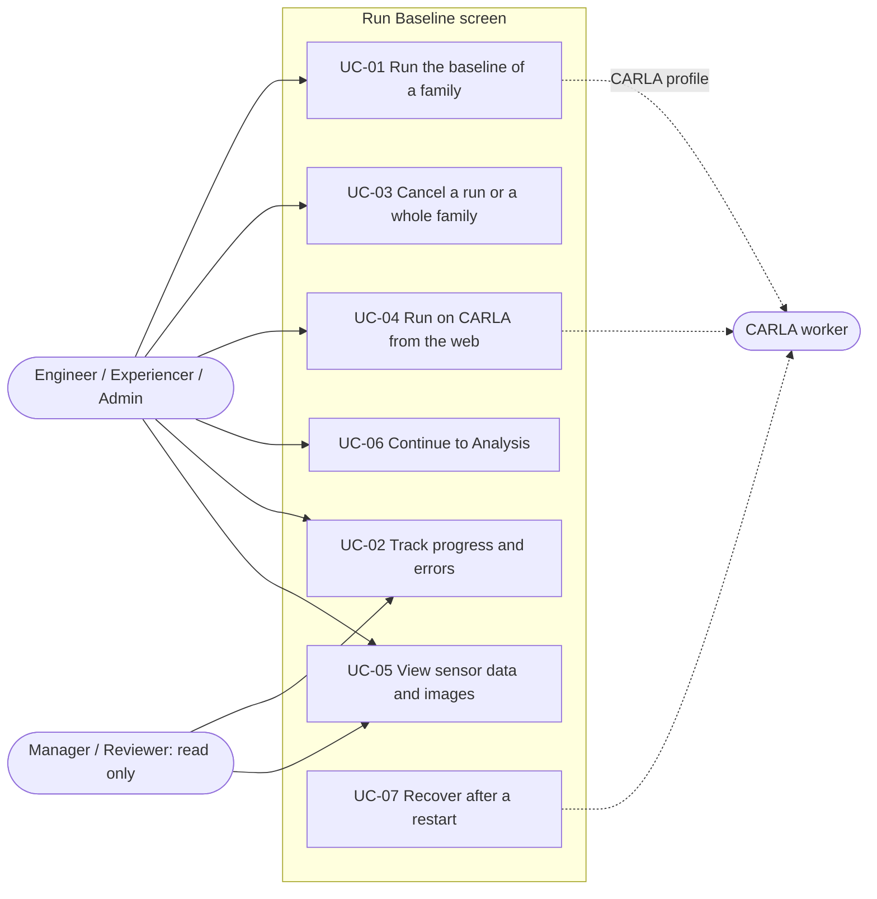
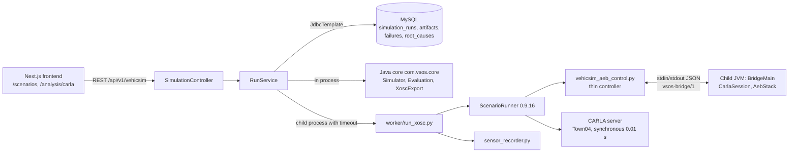
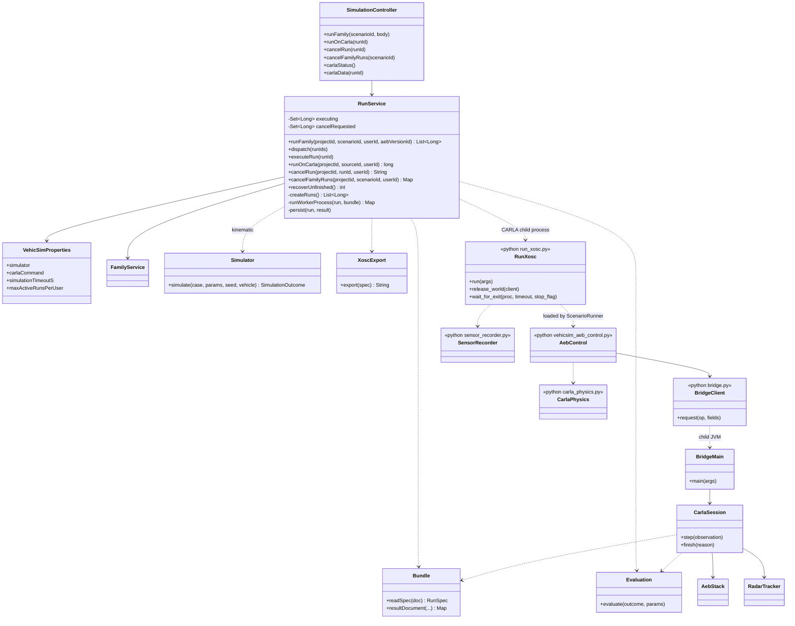
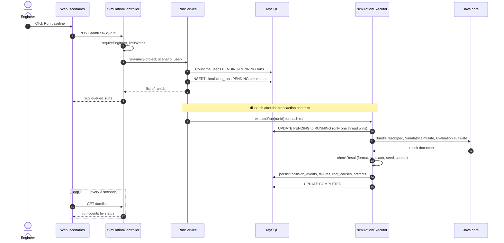
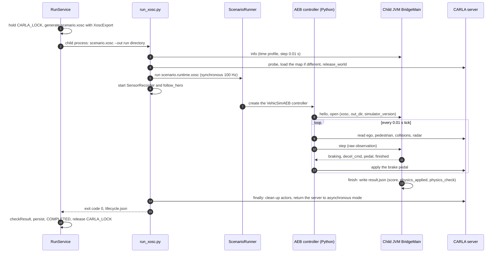
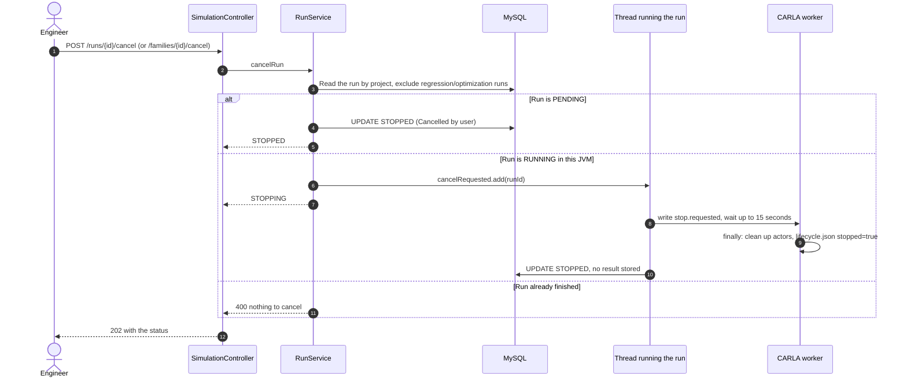
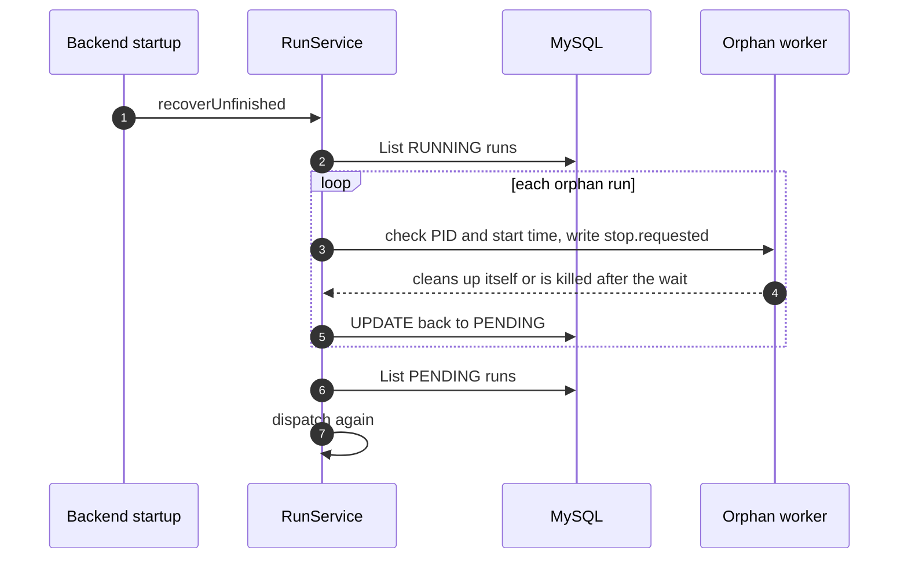

# Report 7 — "Run Baseline" Screen: Use Case Specification, Design and Test Cases

**Owner:** Member 2 (TrungDQ). **Status:** draft of 22/10/2026, checked against the code at commit `37403a0` (branch `trungdam`); vehicle study results added on 22/10.
English version of [report7-man-chay-baseline.md](report7-man-chay-baseline.md), written for the official Report 7. The Vietnamese file stays the working copy;
when one changes, update the other.
This document describes **the code as it runs today**. Work that is not done or that waits for a team decision is listed in [section 6](#6-limitations-and-open-work)
and does not count as an implemented feature.

Acceptance criteria come from the [5-member work split](phan-chia-cong-viec-5-thanh-vien.md) §4 and the
[20/10 plan](ke-hoach-sua-theo-pdf-va-quyet-dinh-2026-10-20.md) §6 "Member 2". Evidence measured on a real CARLA server:
[exec plan 22/10](../exec-plans/active/2026-10-22-chay-baseline-thanh-vien-2.md) and
[exec plan 20/10](../exec-plans/active/2026-10-20-do-dung-sai-va-vong-doi-run-carla.md).

## 1. Scope and execution paths

Main screens: `/scenarios` (run a scenario family) and `/analysis/carla` (CARLA: check the connection, run `.xosc`, view images and sensor data).
The same run can take one of two paths, selected by the `VEHICSIM_SIMULATOR` setting:

| | Kinematic simulator | CARLA |
|---|---|---|
| Configuration | `kinematic` (default) | `carla-xosc` + `VEHICSIM_CARLA_COMMAND` (`scripts/dev-carla.ps1`) |
| Identity (`simulator_version`) | `vehicsim-kinematic-1.0`, step 0.05 s | `carla-0.9.16-xosc3`, step 0.01 s (100 Hz) |
| Execution | Inside the Java process (`RunService.runKinematic` → `Simulator` → `Evaluation`), a few ms per run | Child process `run_xosc.py` → ScenarioRunner; AEB runs in the Java core through the `vsos-bridge/1` bridge |
| Concurrency | Thread pool (`run-concurrency`) | Sequential: one `CARLA_LOCK`, one server |
| Use of the numbers | Batch optimization | Observation and cross-checking only; braking is not calibrated (TD-17) and is not used as regression evidence |

Results from the two simulators are never mixed or compared (hard rule 9). Every run stores its seed, vehicle, AEB version and `simulator_version` so it can be traced.

## 2. Use case specification

### 2.1. Actors

| Actor | Role | Permissions on this screen |
|---|---|---|
| Engineer, Experiencer, Admin | Primary users | Run, cancel, re-run on CARLA (`WRITE_ROLES`) |
| Manager, Reviewer | Viewers | Read only; write actions return 403 |
| CARLA worker (system) | `run_xosc.py` + ScenarioRunner + controller | Executes one run, writes `result.json` and artifacts |
| Backend (system) | `RunService` | Queue, run lifecycle, recovery at startup |

### 2.2. UC-01 — Run the baseline of a scenario family

| Item | Content |
|---|---|
| Actors | Engineer / Experiencer / Admin |
| Trigger | Click **Run baseline** on `/scenarios` (or create a new family with `run_baseline`, on by default) |
| Preconditions | Logged in with write permission; the family has ≥ 1 variant; the project has an active vehicle and a baseline AEB; quota not exceeded; for CARLA: `VEHICSIM_SIMULATOR=carla-xosc`, `VEHICSIM_CARLA_COMMAND` set, CARLA server running |
| Main flow | 1. The user clicks Run baseline. 2. The web app calls `POST /families/{id}/run`. 3. The backend checks the role, the rate limit and the quota of pending/running runs. 4. The backend creates one `PENDING` run per variant: seed = `48000 + variant id`, `simulator_version` from the configuration, step 0.05 s or 0.01 s, the active vehicle, the baseline AEB. 5. It returns `202` with `queued_runs`. 6. After the transaction commits, the runs enter the background queue. 7. For each run: `PENDING → RUNNING`, simulate, check the result, store the result and the failure/root cause, set `COMPLETED`. 8. The screen refreshes every 3 seconds (pending / running / succeeded / failed / cancelled counts). |
| Alternative flows | A1. Read-only role → `403`. A2. Quota exceeded → `429` with the number of runs held. A3. Too many actions within the rate-limit window → `429`. A4. Family outside the project → `404`. A5. `carla` (the removed direct runner) or `carla-*` without a CARLA command → `400` with instructions. A6. A run fails (worker exits ≠ 0, timeout, result with the wrong seed/source) → run `FAILED` with `error_message`; the queue continues with the other runs. |
| Postconditions | Each variant has one run, ending as `COMPLETED`, `FAILED` or `STOPPED`. A `COMPLETED` run has its result, failure case, root cause and artifacts. A `RunFinished` event is published so that a regression owning the run can conclude |
| Business rules | BR-01 → BR-08, BR-10, BR-11 |

### 2.3. UC-02 — Track progress and errors

| Item | Content |
|---|---|
| Actors | All roles (read) |
| Preconditions | The family already has runs |
| Main flow | 1. `/scenarios` refreshes every 3 seconds; each family shows its run counts by status (`PENDING/RUNNING/COMPLETED/FAILED/STOPPED`). 2. On `/analysis/carla`, `GET /carla/runs` (the 30 latest runs) shows a status label per run. 3. On `/analysis/carla`, a `FAILED` run shows its `error_message` (usually the tail of the worker log). |
| Alternative flows | When there is no data yet, the screen shows empty or "not available", never 0 or a fake pass (BR-11) |
| Postconditions | No data changes |

### 2.4. UC-03 — Cancel a run or a whole family

| Item | Content |
|---|---|
| Actors | Engineer / Experiencer / Admin |
| Trigger | **Cancel** on a run (`POST /runs/{id}/cancel`) or **Cancel N runs** on a family (`POST /families/{id}/cancel`) |
| Preconditions | The run/family belongs to the project; the run is still `PENDING` or `RUNNING`; the run does **not** belong to a regression or an optimization |
| Main flow | 1. A `PENDING` run → `STOPPED` immediately with the reason `Cancelled by user`; the worker never picks it up. 2. A `RUNNING` run in this JVM → the backend sets a stop flag and returns `STOPPING`; the 0.5-second wait loop sees the flag, writes `stop.requested` into the run directory (on Linux also sends SIGTERM), and waits up to `STOP_GRACE_S` (15 seconds) for the worker to clean up its actors/sensors and return the server to asynchronous mode before killing the process tree. 3. The run becomes `STOPPED`; **no** result is stored and the regression is **not** notified. 4. Cancelling a family: pending runs first, then running ones, each by the single-run rules; returns the `stopped` and `stopping` counts. |
| Alternative flows | A1. Run of a regression/optimization → `400` (they only stop with the whole test). A2. Run already finished → `400 nothing to cancel`; skipped when cancelling a family. A3. Run/family of another project → `404`, nothing is touched. A4. Orphan `RUNNING` run (the backend restarted mid-run and no thread holds it): stop the still-live worker outside the HTTP thread, then close the run as `STOPPED` |
| Postconditions | A cancelled run has no valid score; the next run is not polluted (the world is cleaned up) |
| Business rules | BR-09, BR-12 |

### 2.5. UC-04 — Run on CARLA from the web (replay a run, download `.xosc`)

| Item | Content |
|---|---|
| Actors | Engineer / Experiencer / Admin |
| Trigger | **Check connection**, **Run on CARLA** (the selected family) or download `.xosc` on `/analysis/carla`; re-run one run from the failure detail page `/analysis/failures/{runId}` |
| Preconditions | The backend runs in `carla-xosc` mode (the UI warns when it does not); the CARLA server has loaded Town04 |
| Main flow | 1. Check connection: `GET /carla/status` runs `run_xosc.py --status` (15-second limit) and reports client/server compatibility and whether ScenarioRunner is present. 2. Run a family: **Run on CARLA** calls `POST /families/{id}/run` as in UC-01; the runs carry the identity `carla-0.9.16-xosc3`. Re-run one run: `POST /runs/{id}/carla` creates a new `EVALUATION` run with the same variant, AEB, vehicle and **seed** as the original, without linking a baseline from another simulator. 3. Download `.xosc`: `GET /runs/{id}/xosc` (generated offline by `XoscExport`, no LLM). 4. The run then follows UC-01 (steps 6–8). |
| Alternative flows | A1. Server down or version mismatch → "not ready" status with the error; the environment is not changed automatically. A2. The backend has not picked up the new profile → `400` with the `dev-carla.ps1 -RestartBackend` command. A3. Submitting a `result.json` produced on another machine: only for a CARLA run that is `PENDING/FAILED`, through the same checks as a run executed by the backend (`POST /runs/{id}/carla-result`) |
| Postconditions | The run directory holds `scenario.xosc`, `result.json`, `scenario_runner.log`, `follow_hero.log`, `lifecycle.json` and the `sensors/` directory |
| Business rules | BR-03, BR-05, BR-06, BR-08 |

### 2.6. UC-05 — View sensor data and images of a CARLA run

| Item | Content |
|---|---|
| Actors | All roles (read) |
| Main flow | 1. Select a `COMPLETED` run on `/analysis/carla`. 2. `GET /runs/{id}/carla-data` returns a summary computed from `frames.csv` and `collisions.json` (braking, collision, jerk) and the list of RGB images. 3. `GET /runs/{id}/carla-files/{name}` downloads `frames.csv`, `collisions.json` or an image `NNNNNNNN.png`. 4. The **Playback** link opens `/analysis/failures/{id}/playback`. |
| Alternative flows | Without camera recording the UI says there are no images; no fake video is built. A file name outside the allow-list or escaping the run directory → `404` |
| Postconditions | No data changes |

### 2.7. UC-06 — Continue to Result Analysis

| Item | Content |
|---|---|
| Actors | Engineer / Experiencer / Admin |
| Trigger | The **Continue: Analyse results →** button on each family (`/scenarios`) and on the CARLA panel |
| Main flow | Opens `/analysis/failures?scenario_id={id}`; screen 3 preselects the family and filters from the first request, so the user does not re-enter anything. Hand-over follows the screen 2 → 3 contract: run id, AEB version, seed, vehicle, simulator, result |
| Postconditions | Screen 3 loads its data from the family id |

### 2.8. UC-07 — Recover after the backend restarts or shuts down mid-run

| Item | Content |
|---|---|
| Actors | Backend (automatic) |
| Main flow | 1. At startup, `recoverUnfinished`: for each orphan `RUNNING` run, stop the still-live worker (verified by PID **and** the recorded start time) and set the run back to `PENDING`. 2. Pick up every `PENDING` run and dispatch it again. 3. Backend shutdown mid-run: write `stop.requested` first, wait up to 15 seconds for the worker to clean up, then kill it; the run goes back to `PENDING` instead of `FAILED` (TD-34). |
| Alternative flows | The `result.json` of an orphan worker is **not** accepted (there is no way to verify the worker finished); the whole run is executed again |
| Business rules | BR-13 |

### 2.9. Business rules

| ID | Rule | Enforced in |
|---|---|---|
| BR-01 | Only `ADMIN`/`ENGINEER`/`EXPERIENCER` can run and cancel; other roles get `403` | `VehicSimAccess.requireEngineer` |
| BR-02 | Each user may hold at most `VEHICSIM_MAX_ACTIVE_RUNS_PER_USER` (default 1500) pending + running runs; write actions within the rate-limit window are counted per group `run`, `carla_run`, `run_cancel` → `429` | `RunService.checkActiveRunQuota`, `limitWrites` |
| BR-03 | Stable seed `48000 + scenario_version_id`; a CARLA replay keeps the seed, vehicle and AEB of the original run | `RunService.seedFor`, `runOnCarla` |
| BR-04 | One run per variant; vehicle = the active vehicle; AEB = the baseline (purpose `BASELINE`) or a given version (`EVALUATION`) | `RunService.runFamily` |
| BR-05 | `simulator_version` is an identity: `vehicsim-kinematic-1.0` or `carla-<x.y.z>-xosc3`; old profiles (`-xosc1`, `-xosc2`, the direct JSON runner) are rejected before the worker is called | `RunService.runClaimed` |
| BR-06 | CARLA runs sequentially under one lock; the kinematic simulator runs in parallel | `RunService.runWorker` |
| BR-07 | No double execution: only the thread that moves the run from `PENDING → RUNNING` continues; a duplicate dispatch does not erase the ownership mark of the thread holding the run | `RunService.executeRun` |
| BR-08 | Time limit `SIMULATION_TIMEOUT_S` (default 120 s, `dev-carla.ps1` sets 300); on timeout, request a stop through the flag, wait 15 s, then kill; the run is `FAILED` | `RunService.runWorkerProcess` |
| BR-09 | Cancel: a pending run → `STOPPED` immediately; a running run → `STOPPING` then `STOPPED`; a cancelled run has no valid score; runs of a regression/optimization cannot be cancelled one by one | `RunService.cancelRun` |
| BR-10 | A result is stored only if it matches the run (format, simulator, seed, source); "simulation finished" is not the same as "AEB passed" | `RunService.checkResult` |
| BR-11 | Without real data, leave the value empty with a reason or `NOT_RUN`; never create fake ticks or metrics; a failed run has no score | hard rules in AGENTS.md |
| BR-12 | A run/family of another project → `404` | `RunService.cancelRun`, `cancelFamilyRuns` |
| BR-13 | When the backend restarts: pick up `PENDING` runs; for orphan `RUNNING` runs, stop the worker and set them back to `PENDING` | `RunService.recoverUnfinished` |

## 3. Design

### 3.1. Architecture overview

### 3.2. Class diagram

Fixed boundaries: the Java core does not import `carla`; Python holds no AEB logic (`ArchitectureRulesTest`). `RadarTracker` currently runs only in "shadow" mode (ADR-043)
and does not drive the real AEB.

### 3.3. Sequence diagrams

**(a) Running the baseline of a family with the kinematic simulator (UC-01)**

**(b) One run on CARLA (UC-01 / UC-04)**

**(c) Cancelling a run / a family (UC-03)**

**(d) Recovery at startup (UC-07)**

### 3.4. Main data

| Table / file | Relevant content |
|---|---|
| `simulation_runs` | `status` (`PENDING/RUNNING/PAUSED/COMPLETED/FAILED/STOPPED`), `simulator_type`, `simulator_version`, `fixed_delta_seconds`, `random_seed`, `purpose`, `carla_vehicle_model_id`, `aeb_version_id`, `error_message`, `worker_host` |
| `collision_events`, `failures`, `root_causes`, `simulation_artifacts` | Written when a run is `COMPLETED` (`RunService.persist`) |
| Run directory (`data/vehicsim/runs/<id>`) | `scenario.xosc`, `scenario.runtime.xosc`, `result.json`, `scenario_runner.log`, `follow_hero.log`, `lifecycle.json`, `stop.requested`, `sensors/` |

Column details and meaning: [database-schema.md](database-schema.md). Running CARLA locally: [carla-local.md](carla-local.md).

## 4. Test cases

Convention: **Automated** means a test that exists in the repo (`mvnw -B clean test` 236 tests, `pytest worker/tests` 52 tests; neither needs a CARLA server).
**Manual** needs a machine with CARLA 0.9.16; the last column only cites evidence already in the repo, and "to fill at acceptance" means there is no record yet.

### 4.1. Automated tests

| ID | Goal | Test | UC / BR |
|---|---|---|---|
| TC-A01 | Every route needs login; only write roles can run/cancel | `VehicSimSecurityTest#everyVehicsimRouteRequiresLogin`, `#everyRoleCanReadButOnlyWriteRolesCanWrite`, `#xoscExportAndCarlaRunRespectReadWriteRoles` | UC-01, BR-01 |
| TC-A02 | The pending/running quota cannot be exceeded, even by a CARLA replay | `CarlaWebTest#replayCannotBypassTheActiveRunQuota` | UC-04, BR-02 |
| TC-A03 | A replay keeps the variant, vehicle, AEB and seed; no baseline from another simulator is linked | `CarlaWebTest#carlaReplayKeepsOriginalVariantVehicleAebAndSeedWithoutCrossSimulatorBaselineLink` | UC-04, BR-03 |
| TC-A04 | Simulator identity and step follow the profile | `CarlaWebTest#xoscProfileHasADifferentIdentityFromDirectCarla`, `#stepFollowsTheSimulatorIdentity` | BR-05 |
| TC-A05 | Old profiles and the direct runner are rejected before the worker is called | `CarlaWebTest#oldDirectRunnerConfigurationCannotQueueAnXoscJob`, `#queuedOldXoscRunFailsBeforeBuildingBundleOrLaunchingWorker`, `#queuedDirectRunnerRunFailsBeforeLaunchingWorker`, `#removedDirectRunnerModeCannotCreateNewRuns` | UC-01 A5, BR-05 |
| TC-A06 | The in-process kinematic run gives the core's result; bad input is rejected; a result with the wrong seed/source is rejected | `KinematicInProcessTest#producesTheSameResultAsCallingTheCoreAndCarriesTheEngineVersion`, `#rejectsABundleTheCoreCannotRead`, `#aResultWhoseSeedOrSourceDoesNotMatchTheRunIsRefused`, `#everyFixtureOutcomeMatchesWhatTheServiceStores` | UC-01, BR-10 |
| TC-A07 | Cancelling a pending run: `STOPPED` immediately, never picked up by the worker | `CarlaWebTest#pendingRunIsStoppedImmediatelyAndNeverClaimedByTheWorker` | UC-03, BR-09 |
| TC-A08 | A finished run has nothing to cancel; regression runs cannot be cancelled one by one | `CarlaWebTest#finishedRunHasNothingToCancel`, `#regressionRunsCannotBeCancelledOneByOne` | UC-03 A1–A2 |
| TC-A09 | Cancelling a family follows the single-run rules; a family/run of another project gives `404` and is not touched | `CarlaWebTest#cancellingAFamilyStopsEachActiveBaselineRunThroughTheSingleRunRules`, `#cancellingAFamilyOfAnotherProjectIsNotFoundAndTouchesNothing`, `#cancelOnlyFindsRunsOfTheCallersProject` | UC-03, BR-12 |
| TC-A10 | A duplicate dispatch does not erase the ownership of the thread holding the run | `CarlaWebTest#duplicateDispatchDoesNotEraseTheLiveThreadsOwnership` | BR-07 |
| TC-A11 | Orphan run: closed as `STOPPED`, its live worker killed first; a PID whose start time does not match is not treated as our worker | `CarlaWebTest#orphanRunningRunWithoutALiveWorkerIsClosedAsStopped`, `#cancellingAnOrphanKillsItsStillLiveWorkerBeforeClosingTheRun`, `#aPidThatNoLongerMatchesTheRecordedStartTimeIsNotTreatedAsOurWorker` | UC-03 A4, BR-13 |
| TC-A12 | A restart picks up unfinished runs and stops live workers first | `CarlaWebTest#startupRecoveryRequeuesOrphansAndStopsTheirLiveWorkersFirst`, `#startupRecoveryNoLongerWaitsForTheTimeoutAgeOfAnOrphan` | UC-07, BR-13 |
| TC-A13 | Backend shutdown mid-run: write the stop flag, let the worker clean up, then kill (TD-34) | `CarlaWebTest#shuttingDownMidRunAsksTheWorkerToCleanUpBeforeKillingIt` | UC-07 |
| TC-A14 | Artifact names cannot escape the run directory | `CarlaWebTest#artifactNamesCannotEscapeTheRunDirectory` | UC-05 |
| TC-A15 | Submitting an external `result.json`: only CARLA runs that are `PENDING/FAILED`, never overwriting a finished run, never writing CARLA numbers into a kinematic run, matching simulator/seed/source | `CarlaResultSubmissionTest#acceptsResultForFailedCarlaRunAndIgnoresClientArtifactPaths`, `#completedOrRunningRunsAreNotOverwritten`, `#neverWritesCarlaNumbersIntoAKinematicRun`, `#resultMustMatchTheRunsSimulatorAndFormat`, `#everySourceIdentifierMustMatchTheRunBeforeWriting` | UC-04 A3, BR-10 |
| TC-A16 | Correct pedestrian crossing geometry; extreme parameters stay on the straight road section; `.xosc` valid against the XSD | `XoscExportTest#pedestrianPathCrossesTheLaneWithoutRotatingItsOffset`, `#extremeParametersStayInsideTheStraightRoad`, `OpenScenarioSchemaTest` | Criterion 5 |
| TC-A17 | 100 Hz profile: perception on the sensor period, control every 0.01 s step, decisions match the 20 Hz stack on the same world | `CarlaSessionLogicTest#perceptionUpdatesOnTheSensorPeriodWhileControlRunsEveryStep`, `#decisionsMatchThe20HzStackOnTheSameWorld`, `#perceptionLagIsTimeBasedNotFrameCounted` | UC-04 |
| TC-A18 | Bridge: handshake, protocol errors do not kill the process, a full case runs through the protocol, the process exits when stdin closes without writing a partial result | `BridgeProtocolTest#handshakeRejectsAForeignProtocolAndAcceptsTheRightOne`, `#protocolErrorsAreAnsweredAndDoNotKillTheProcess`, `#aSyntheticCrossingRunsThroughTheProtocolAndWritesResultJson`, `#theProcessExitsWhenStdinClosesAndWritesNoResult` | UC-04, BR-11 |
| TC-A19 | The radar shadow does not change the real result | `BridgeProtocolTest#radarShadowIsMeasuredButNeverChangesTheRealRun` | UC-04 |
| TC-A20 | Physics read-back: a forced field that did not stick and mesh differences are reported separately | `CarlaSessionLogicTest#physicsCheckFlagsAForcedFieldThatDidNotStickAndReportsMeshDifferencesSeparately` | UC-04 |
| TC-A21 | The worker cleans the world: removes leftover actors in the right order, returns the server to asynchronous mode; stops via the flag in < 5 seconds; reports a timeout when no flag is set | `test_run_xosc_lifecycle.py` (6 tests), `test_run_xosc.py` | UC-03, UC-07, BR-08 |
| TC-A22 | `run_xosc.py` rejects `.json`, maps exit codes 2/3/4, turns a stop signal into a clean exit | `test_run_xosc.py` | BR-09 |
| TC-A23 | Sensor recorder: TTC of the nearest target, drops road reflections and the spawn spike, summarizes braking/collision | `test_sensor_recorder.py` (4 tests) | UC-05 |
| TC-A24 | Repeat-run, brake-measurement and vehicle-study tools: statistics never turn a missing number into 0 | `test_repeat_xosc.py`, `test_measure_brake.py`, `test_vehicle_study.py` | Tasks 3, 4 (20/10 plan) |

### 4.2. Manual tests on CARLA / the UI

| ID | Scenario | Main steps | Expected result | Existing evidence |
|---|---|---|---|---|
| TC-M01 | Run a kinematic baseline from the web | Log in as Engineer → `/scenarios` → a family with variants → **Run baseline** | "N runs queued" message; the counters reach all `COMPLETED`; no `FAILED`; the "Run baseline will use" strip shows the right vehicle, AEB and simulator | To fill at acceptance (automated part: TC-A01–A06) |
| TC-M02 | Run a small family on CARLA | `dev-carla.ps1 -RestartBackend` → `/analysis/carla` → **Check connection** → **Run on CARLA** | Runs execute sequentially and end `COMPLETED`; `result.json`, `frames.csv`, RGB images exist; `physics_applied`/`physics_check` are in `result.json` | [exec plan 22/10](../exec-plans/active/2026-10-22-chay-baseline-thanh-vien-2.md) (real CARLA 0.9.16, Town04) |
| TC-M03 | Cancel a running CARLA run | Click **Cancel** while the run is `RUNNING` | `202 STOPPING`, the run is `STOPPED` a few seconds later; `stop.requested` exists; `lifecycle.json` has `stopped=true`; **no** `result.json` | [exec plan 20/10](../exec-plans/active/2026-10-20-do-dung-sai-va-vong-doi-run-carla.md) (2.2 seconds, runs 1782–1785) |
| TC-M04 | Cancel a whole family | A running family → **Cancel N runs** | Pending runs become `STOPPED`, running runs `STOPPING` then `STOPPED`; "N cancelled" is shown; regression runs are not touched | Automated part TC-A09; manual record: to fill at acceptance |
| TC-M05 | Hard-kill the worker, then continue | Kill `run_xosc` + ScenarioRunner + `follow_hero` mid-run → run the next run | The killed run has no `result.json`; the next run removes the leftover actors (`destroyed_before` > 0) and gives a valid result | [exec plan 20/10](../exec-plans/active/2026-10-20-do-dung-sai-va-vong-doi-run-carla.md): 9 leftover actors, the next run cleaned up and was valid |
| TC-M06 | Stop/restart the backend mid-run | Stop the backend while a run is `RUNNING` → start it again | The stop flag is written and the worker cleans up; the run goes back to `PENDING` and runs again; no orphan worker remains | Automated part TC-A11–A13; manual record: to fill at acceptance |
| TC-M07 | Timeout | Set a small `SIMULATION_TIMEOUT_S` → run one CARLA run | Run `FAILED` with "exceeded N s, stopped"; the CARLA server is not stuck in synchronous mode; the next run works | Same stop path as cancel (TC-M03); separate timeout record: to fill at acceptance |
| TC-M08 | Repeat runs on the current profile | `repeat_xosc.py scenario.xosc --runs 5` for a stop case, a collision case and a safe case | Discrete events identical; continuous values within the tolerance proposed in section 6 | [exec plan 22/10](../exec-plans/active/2026-10-22-chay-baseline-thanh-vien-2.md) section 3 (n = 5 per case) |
| TC-M09 | Pedestrian geometry on CARLA | Run a CP_CROSSING `.xosc`, watch it or read `frames.csv` | The pedestrian crosses perpendicular to the lane and does not drift along the road | [crossing direction fix evidence](../exec-plans/completed/2026-10-19-sua-huong-nguoi-di-bo-carla.md) |
| TC-M10 | Hand-over to the Analysis screen | Click **Continue: Analyse results →** | `/analysis/failures?scenario_id=…` opens with the family selected; the first request is already filtered by the family | To fill at acceptance |
| TC-M11 | Braking of several vehicles on CARLA | `vehicle_study.py --out data\vehicle-study` (+ `--blueprints vehicle.audi.etron`) | Every vehicle stops; repeated runs agree; lower tyre friction, higher mass and lower brake torque each lengthen the stopping distance | [exec plan 22/10](../exec-plans/active/2026-10-22-chay-baseline-thanh-vien-2.md) section 6 (5 vehicles, all directions correct) |

## 5. Traceability to the acceptance criteria

The five criteria for Member 2 in the [work split §4](phan-chia-cong-viec-5-thanh-vien.md):

| Criterion | Use case | Automated tests | Manual tests |
|---|---|---|---|
| A scenario family can be run from the web | UC-01, UC-04 | TC-A01–A06 | TC-M01, TC-M02 |
| Progress reflects the real state | UC-02 | TC-A06, TC-A10 | TC-M01, TC-M04 |
| Results open on screen 3 | UC-06 | — | TC-M10 |
| A failed or cancelled run does not hang the queue | UC-03, UC-07 | TC-A07–A13, TC-A21 | TC-M03–M07 |
| The pedestrian crosses with the correct geometry | UC-04 | TC-A16 | TC-M09 |

The four acceptance criteria in the [20/10 plan §6](ke-hoach-sua-theo-pdf-va-quyet-dinh-2026-10-20.md): cancel/timeout does not pollute the next run (real CARLA evidence
for cancel and hard kill: TC-M03, TC-M05; timeout uses the same stop path but has no separate record yet: TC-M07); scoring data traces back to ground truth
(`frames.csv` and `result.json` exist, no separate acceptance record yet); repeat runs within an agreed tolerance (**not agreed yet**, section 6); AEB uses perception
from sensors (**not met**, section 6).

## 6. Limitations and open work

These items are outside what this document describes as "implemented"; do not report them as finished features.

| Item | Current state | Who |
|---|---|---|
| Radar perception driving the real AEB | Shadow mode only ([ADR-043](../adr/ADR-043-perception-tu-radar-chay-bong-truoc.md)); a false track on the safe case; the real AEB still uses ground truth; profile not bumped to `-xosc4` | Member 2; the new criterion needs the team |
| Repeat-run tolerance | Proposed only (events identical; stopping distance/minimum distance ≤ 0.15 m; impact speed ≤ 0.1 m/s; RMS jerk ±5% in the collision case) | Members 3, 5 |
| Brake calibration | e-tron measured at 4.67 m/s²; `carla_full_brake_decel_mps2` not yet written to the DB | Vehicle data owner |
| AEB off | Not coded; cutting the pedal alone is not enough because stopping distance, brake time and jerk are computed from the AEB decision | Members 3, 5 define the metrics |
| Stop at the curb (TD-47) | `PedestrianControl` keeps walking after the last waypoint; not used as false-braking evidence | Member 1 |
| Vehicle range | The DB has one vehicle (`audi.etron`), the only one checked by `physics_check` in a real run. `worker/vehicle_study.py` measured braking on real CARLA for 4 vehicles + the e-tron: measurable, repeatable, and friction/mass/torque changes all act in the expected direction ([exec plan 22/10](../exec-plans/active/2026-10-22-chay-baseline-thanh-vien-2.md) section 6). No vehicle added to the DB yet | Team picks vehicles; vehicle data owner |
| Scenario types | `CP_CROSSING` only (TD-42) | Team |
| Cancel for regression | Regression runs stop only with the whole test | Member 5 |
