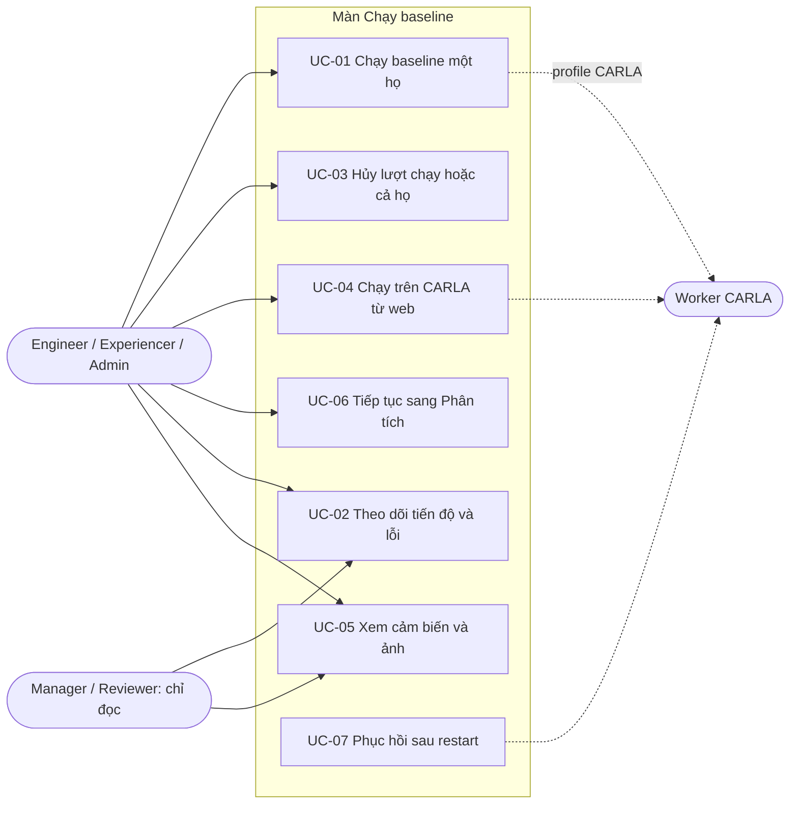
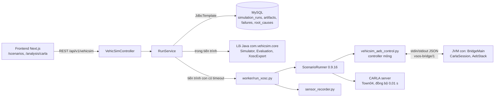
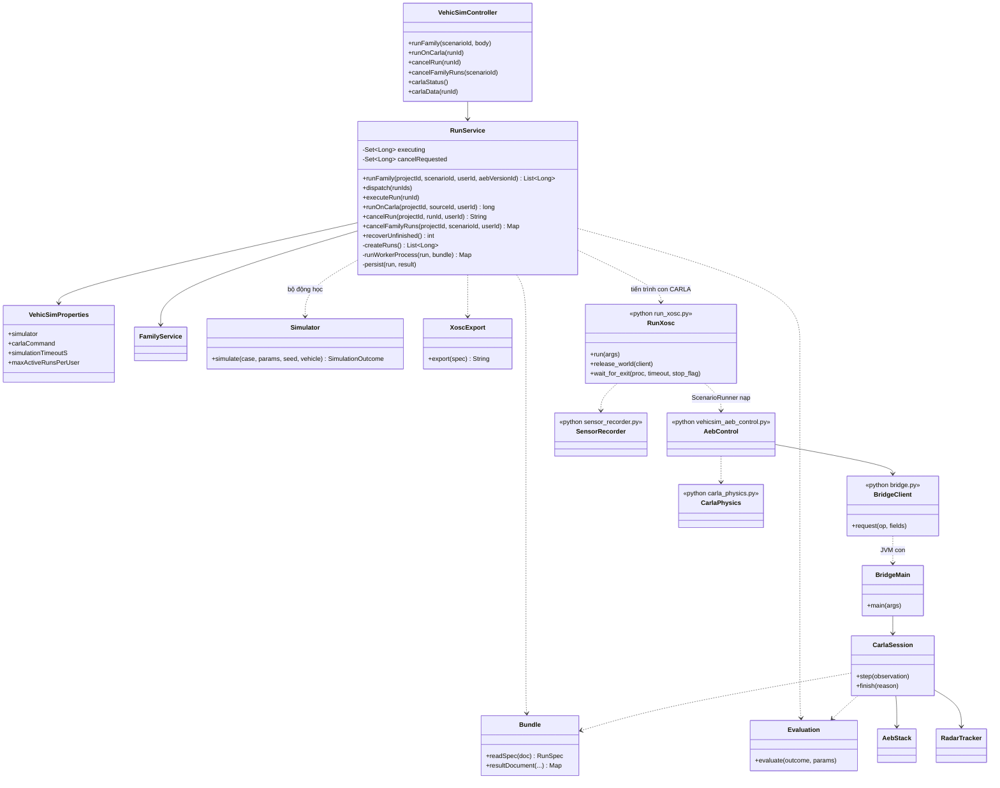
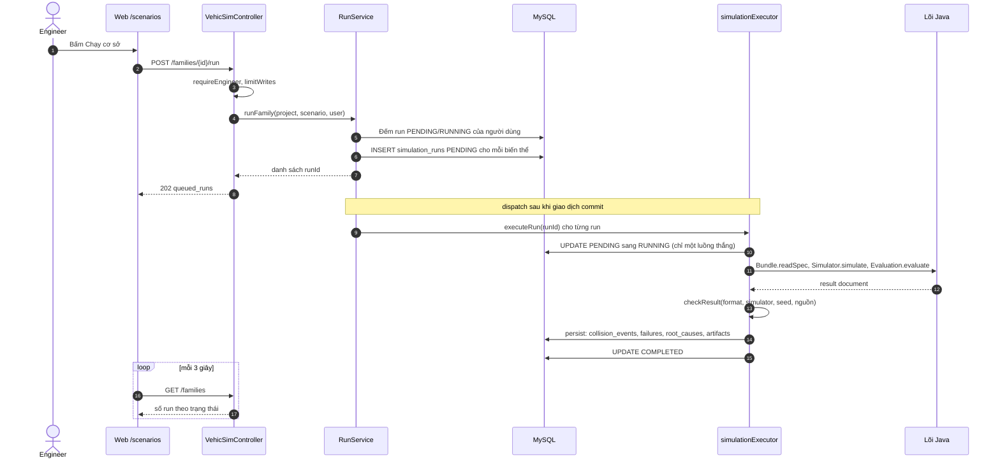
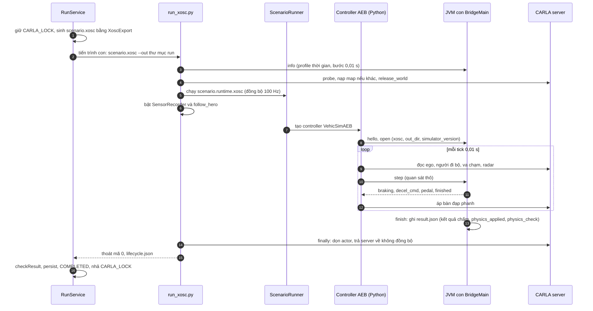
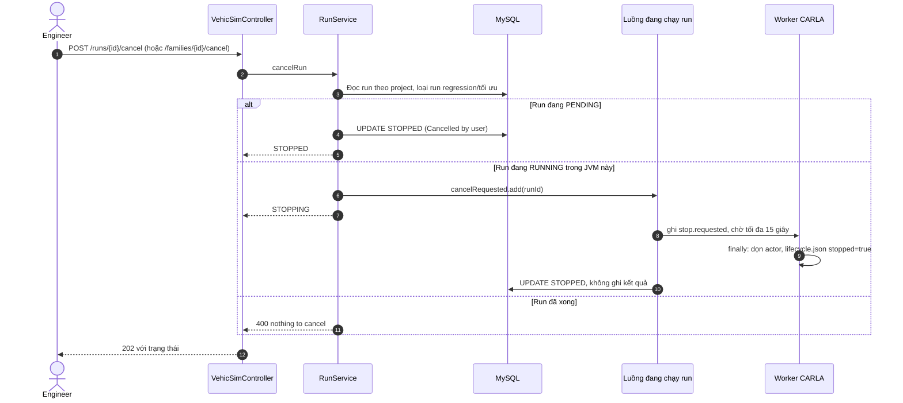
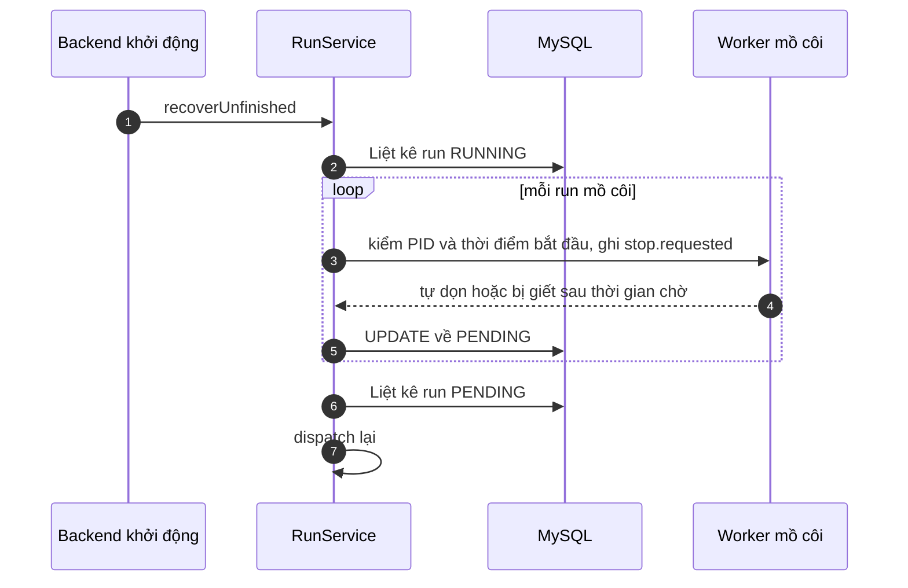

# Report 7 — Màn "Chạy baseline": đặc tả use case, thiết kế và test case

**Người phụ trách:** Thành viên 2 (Trung). **Trạng thái:** bản nháp 22/10/2026, đối chiếu code tại commit `37403a0` (nhánh `trungdam`).
Bản tiếng Anh cho Report 7: [report7-baseline-screen-en.md](report7-baseline-screen-en.md); sửa bản này thì sửa cả bản kia.
Tài liệu mô tả **code đang chạy**; phần chưa làm và phần chờ nhóm quyết định nằm ở [mục 6](#6-giới-hạn-và-phần-chưa-làm), không tính là tính năng đã có.

Nguồn tiêu chí nghiệm thu: [phân chia 5 thành viên](phan-chia-cong-viec-5-thanh-vien.md) §4 và
[kế hoạch 20/10](ke-hoach-sua-theo-pdf-va-quyet-dinh-2026-10-20.md) §6 "Thành viên 2". Bằng chứng đo trên CARLA thật:
[exec plan 22/10](../exec-plans/active/2026-10-22-chay-baseline-thanh-vien-2.md) và
[exec plan 20/10](../exec-plans/active/2026-10-20-do-dung-sai-va-vong-doi-run-carla.md).

## 1. Phạm vi và đường chạy

Màn chính `/scenarios` (chạy họ kịch bản) và `/analysis/carla` (CARLA: kiểm tra kết nối, chạy `.xosc`, xem ảnh và cảm biến).
Có hai đường chạy cho cùng một run, chọn theo cấu hình `VEHICSIM_SIMULATOR`:

| | Bộ động học | CARLA |
|---|---|---|
| Cấu hình | `kinematic` (mặc định) | `carla-xosc` + `VEHICSIM_CARLA_COMMAND` (`scripts/dev-carla.ps1`) |
| Định danh (`simulator_version`) | `vehicsim-kinematic-1.0`, bước 0,05 s | `carla-0.9.16-xosc3`, bước 0,01 s (100 Hz) |
| Thực thi | Trong tiến trình Java (`RunService.runKinematic` → `Simulator` → `Evaluation`), vài ms/run | Tiến trình con `run_xosc.py` → ScenarioRunner; AEB chạy ở lõi Java qua cầu nối `vsos-bridge/1` |
| Song song | Thread pool (`run-concurrency`) | Tuần tự: một khóa `CARLA_LOCK`, một server |
| Số đo | Dùng để tối ưu hàng loạt | Quan sát/đối chiếu, chưa hiệu chuẩn phanh (TD-17), không dùng làm bằng chứng regression |

Hai bộ mô phỏng không bao giờ ghép/so với nhau (luật cứng 9). Mỗi run lưu seed, xe, phiên bản AEB và `simulator_version` để truy ngược.

## 2. Đặc tả use case

### 2.1. Tác nhân

| Tác nhân | Vai trò | Quyền trên màn này |
|---|---|---|
| Engineer, Experiencer, Admin | Người dùng chính | Chạy, hủy, chạy lại trên CARLA (`WRITE_ROLES`) |
| Manager, Reviewer | Người xem | Chỉ đọc; thao tác ghi trả 403 |
| Worker CARLA (hệ thống) | `run_xosc.py` + ScenarioRunner + controller | Thực thi một run, ghi `result.json` và artifact |
| Backend (hệ thống) | `RunService` | Hàng đợi, vòng đời run, phục hồi khi khởi động |

### 2.2. UC-01 — Chạy baseline một họ kịch bản

| Mục | Nội dung |
|---|---|
| Tác nhân | Engineer / Experiencer / Admin |
| Kích hoạt | Bấm **Chạy cơ sở** ở `/scenarios` (hoặc tạo họ mới với `run_baseline`, mặc định bật) |
| Tiền điều kiện | Đã đăng nhập với quyền ghi; họ kịch bản có ≥ 1 biến thể; project có xe đang dùng và AEB baseline; chưa vượt hạn mức; với CARLA: `VEHICSIM_SIMULATOR=carla-xosc`, đã đặt `VEHICSIM_CARLA_COMMAND`, server CARLA đang bật |
| Luồng chính | 1. Người dùng bấm Chạy cơ sở. 2. Web gọi `POST /families/{id}/run`. 3. Backend kiểm quyền, giới hạn tần suất, hạn mức run chờ/đang chạy. 4. Backend tạo một run `PENDING` cho mỗi biến thể: seed = `48000 + id biến thể`, `simulator_version` theo cấu hình, bước 0,05 s hoặc 0,01 s, xe đang dùng, AEB baseline. 5. Trả `202` với `queued_runs`. 6. Sau khi giao dịch commit, run vào hàng đợi nền. 7. Với mỗi run: chuyển `PENDING → RUNNING`, chạy mô phỏng, kiểm kết quả, ghi kết quả và lỗi/nguyên nhân, chuyển `COMPLETED`. 8. Màn hình làm mới mỗi 3 giây (số chờ / chạy / thành công / lỗi / đã hủy). |
| Luồng thay thế | A1. Vai trò chỉ đọc → `403`. A2. Vượt hạn mức → `429` kèm số run đang giữ. A3. Thao tác quá nhiều lần trong cửa sổ giới hạn → `429`. A4. Họ không thuộc project → `404`. A5. Chọn `carla` (runner trực tiếp, đã gỡ) hoặc `carla-*` thiếu lệnh CARLA → `400` kèm hướng dẫn. A6. Một run lỗi (worker thoát ≠ 0, hết thời gian, kết quả sai seed/nguồn) → run `FAILED` kèm `error_message`; hàng đợi chạy tiếp các run còn lại. |
| Hậu điều kiện | Mỗi biến thể có một run; trạng thái cuối `COMPLETED`, `FAILED` hoặc `STOPPED`. Run `COMPLETED` có kết quả, ca lỗi, nguyên nhân, artifact. Sự kiện `RunFinished` được phát để regression chốt nếu run thuộc regression |
| Quy tắc | BR-01 → BR-08, BR-10, BR-11 |

### 2.3. UC-02 — Theo dõi tiến độ và lỗi

| Mục | Nội dung |
|---|---|
| Tác nhân | Mọi vai trò (đọc) |
| Tiền điều kiện | Đã có run của họ |
| Luồng chính | 1. `/scenarios` tự làm mới 3 giây, mỗi họ hiện số run theo trạng thái (`PENDING/RUNNING/COMPLETED/FAILED/STOPPED`). 2. Trên `/analysis/carla`, danh sách `GET /carla/runs` (30 lượt gần nhất) hiện nhãn trạng thái từng lượt. 3. Ở `/analysis/carla`, lượt `FAILED` hiện `error_message` (thường là đuôi log của worker). |
| Luồng thay thế | Dữ liệu chưa có thì hiển thị trống hoặc "chưa có", không thay bằng 0 hay kết quả đạt giả (BR-11) |
| Hậu điều kiện | Không thay đổi dữ liệu |

### 2.4. UC-03 — Hủy lượt chạy hoặc hủy cả họ

| Mục | Nội dung |
|---|---|
| Tác nhân | Engineer / Experiencer / Admin |
| Kích hoạt | **Hủy** ở một lượt (`POST /runs/{id}/cancel`) hoặc **Hủy N lượt** ở họ (`POST /families/{id}/cancel`) |
| Tiền điều kiện | Run/họ thuộc project; run còn `PENDING` hoặc `RUNNING`; run **không** thuộc regression hay tối ưu |
| Luồng chính | 1. Run `PENDING` → `STOPPED` ngay, lý do `Cancelled by user`, worker không bao giờ nhận. 2. Run `RUNNING` trong JVM này → backend ghi cờ dừng, trả `STOPPING`; vòng chờ 0,5 giây thấy cờ, ghi `stop.requested` vào thư mục run (trên Linux gửi thêm SIGTERM), chờ tối đa `STOP_GRACE_S` (15 giây) để worker tự dọn actor/sensor và trả server về không đồng bộ, rồi mới giết cứng cây tiến trình. 3. Run chuyển `STOPPED`, **không** ghi kết quả và **không** báo regression. 4. Hủy cả họ: hủy run chờ trước, rồi run đang chạy, mỗi run theo đúng quy tắc hủy lẻ; trả số `stopped` và `stopping`. |
| Luồng thay thế | A1. Run của regression/tối ưu → `400` (chúng chỉ dừng theo cả test). A2. Run đã xong → `400 nothing to cancel`; trong hủy cả họ thì bỏ qua. A3. Run/họ của project khác → `404`, không đụng gì. A4. Run `RUNNING` mồ côi (backend khởi động lại giữa run, không còn luồng giữ): dừng worker còn sống ngoài luồng HTTP rồi đóng run `STOPPED` |
| Hậu điều kiện | Run bị hủy không có điểm hợp lệ; lần chạy kế tiếp không bị bẩn (world được dọn) |
| Quy tắc | BR-09, BR-12 |

### 2.5. UC-04 — Chạy trên CARLA từ web (replay một run, tải `.xosc`)

| Mục | Nội dung |
|---|---|
| Tác nhân | Engineer / Experiencer / Admin |
| Kích hoạt | **Kiểm tra kết nối**, **Chạy trên CARLA** (cả họ đang chọn) hoặc tải `.xosc` ở `/analysis/carla`; chạy lại một lượt từ trang chi tiết lỗi `/analysis/failures/{runId}` |
| Tiền điều kiện | Backend chạy ở chế độ `carla-xosc` (UI cảnh báo khi chưa chọn); server CARLA đã nạp map Town04 |
| Luồng chính | 1. Kiểm tra kết nối: `GET /carla/status` chạy `run_xosc.py --status` (hạn 15 giây) và báo client/server tương thích, có ScenarioRunner. 2. Chạy cả họ: nút **Chạy trên CARLA** gọi `POST /families/{id}/run` như UC-01, run mang định danh `carla-0.9.16-xosc3`. Chạy lại một lượt: `POST /runs/{id}/carla` tạo run mới `EVALUATION` giữ nguyên biến thể, AEB, xe, **seed** của run gốc, không gắn baseline khác bộ mô phỏng. 3. Tải `.xosc`: `GET /runs/{id}/xosc` (sinh offline bằng `XoscExport`, không dùng LLM). 4. Run đi qua luồng của UC-01 (bước 6–8). |
| Luồng thay thế | A1. Server không chạy/phiên bản lệch → trả trạng thái chưa sẵn sàng kèm lỗi, không tự sửa môi trường. A2. Backend chưa nhận profile mới → `400` kèm lệnh `dev-carla.ps1 -RestartBackend`. A3. Nộp `result.json` từ máy khác: chỉ cho run CARLA đang `PENDING/FAILED`, qua đúng bước kiểm như run trong backend (`POST /runs/{id}/carla-result`) |
| Hậu điều kiện | Có `scenario.xosc`, `result.json`, `scenario_runner.log`, `follow_hero.log`, `lifecycle.json` và thư mục `sensors/` trong thư mục run |
| Quy tắc | BR-03, BR-05, BR-06, BR-08 |

### 2.6. UC-05 — Xem cảm biến và ảnh của run CARLA

| Mục | Nội dung |
|---|---|
| Tác nhân | Mọi vai trò (đọc) |
| Luồng chính | 1. Chọn một lượt `COMPLETED` ở `/analysis/carla`. 2. `GET /runs/{id}/carla-data` trả bản tóm tắt số đo tính từ `frames.csv` và `collisions.json` (phanh, va chạm, jerk) và danh sách ảnh RGB. 3. `GET /runs/{id}/carla-files/{name}` tải `frames.csv`, `collisions.json` hoặc ảnh `NNNNNNNN.png`. 4. Liên kết **Phát lại** mở `/analysis/failures/{id}/playback`. |
| Luồng thay thế | Không ghi camera thì giao diện nói rõ không có ảnh, không dựng video giả. Tên file ngoài danh sách cho phép hoặc thoát khỏi thư mục run → `404` |
| Hậu điều kiện | Không thay đổi dữ liệu |

### 2.7. UC-06 — Tiếp tục sang Phân tích kết quả

| Mục | Nội dung |
|---|---|
| Tác nhân | Engineer / Experiencer / Admin |
| Kích hoạt | Nút **Tiếp tục: Phân tích kết quả →** ở mỗi họ (`/scenarios`) và ở panel CARLA |
| Luồng chính | Mở `/analysis/failures?scenario_id={id}`; màn 3 chọn sẵn đúng họ và lọc ngay request đầu tiên, người dùng không phải nhập lại. Bàn giao theo hợp đồng màn 2 → 3: mã run, phiên bản AEB, seed, xe, bộ mô phỏng, kết quả |
| Hậu điều kiện | Màn 3 tự tải dữ liệu theo mã họ |

### 2.8. UC-07 — Phục hồi sau khi backend khởi động lại hoặc tắt giữa run

| Mục | Nội dung |
|---|---|
| Tác nhân | Backend (tự động) |
| Luồng chính | 1. Lúc khởi động `recoverUnfinished`: với mỗi run `RUNNING` mồ côi, dừng worker còn sống (xác minh bằng PID **và** thời điểm bắt đầu đã ghi), đưa run về `PENDING`. 2. Nhặt mọi run `PENDING` và dispatch lại. 3. Tắt backend giữa run: ghi `stop.requested` trước tiên, chờ tối đa 15 giây cho worker tự dọn rồi mới giết; run trở lại `PENDING` thay vì `FAILED` (TD-34). |
| Luồng thay thế | `result.json` của worker mồ côi **không** được nhận (không xác minh được worker hoàn tất); chạy lại cả run |
| Quy tắc | BR-13 |

### 2.9. Quy tắc nghiệp vụ

| ID | Quy tắc | Nơi thực hiện |
|---|---|---|
| BR-01 | Chỉ `ADMIN`/`ENGINEER`/`EXPERIENCER` chạy và hủy; vai trò khác `403` | `VehicSimController.requireEngineer` |
| BR-02 | Mỗi người tối đa `VEHICSIM_MAX_ACTIVE_RUNS_PER_USER` (mặc định 1500) run chờ + đang chạy; số thao tác ghi trong cửa sổ giới hạn theo nhóm `run`, `carla_run`, `run_cancel` → `429` | `RunService.checkActiveRunQuota`, `limitWrites` |
| BR-03 | Seed ổn định `48000 + scenario_version_id`; replay CARLA giữ seed, xe, AEB của run gốc | `RunService.seedFor`, `runOnCarla` |
| BR-04 | Một run cho mỗi biến thể; xe = xe đang dùng; AEB = baseline (mục đích `BASELINE`) hoặc phiên bản chỉ định (`EVALUATION`) | `RunService.runFamily` |
| BR-05 | `simulator_version` là danh tính: `vehicsim-kinematic-1.0` hoặc `carla-<x.y.z>-xosc3`; profile cũ (`-xosc1`, `-xosc2`, runner JSON trực tiếp) bị từ chối trước khi gọi worker | `RunService.runClaimed` |
| BR-06 | CARLA chạy tuần tự dưới một khóa; bộ động học chạy song song | `RunService.runWorker` |
| BR-07 | Chống chạy đôi: chỉ luồng chuyển được `PENDING → RUNNING` mới chạy tiếp; dispatch trùng không xóa dấu của luồng đang giữ run | `RunService.executeRun` |
| BR-08 | Hạn thời gian `SIMULATION_TIMEOUT_S` (mặc định 120 giây, `dev-carla.ps1` đặt 300); quá hạn thì xin dừng bằng cờ, chờ 15 giây rồi giết, run `FAILED` | `RunService.runWorkerProcess` |
| BR-09 | Hủy: run chờ → `STOPPED` ngay; run chạy → `STOPPING` rồi `STOPPED`; run bị hủy không có điểm hợp lệ; run của regression/tối ưu không hủy lẻ | `RunService.cancelRun` |
| BR-10 | Kết quả phải khớp run (định dạng, simulator, seed, nguồn) mới được ghi; "mô phỏng hoàn tất" khác "AEB đạt" | `RunService.checkResult` |
| BR-11 | Không có dữ liệu thật thì để trống kèm lý do hoặc `NOT_RUN`; không tạo tick/chỉ số giả; run lỗi không có điểm | luật cứng AGENTS.md |
| BR-12 | Run/họ của project khác `404` | `RunService.cancelRun`, `cancelFamilyRuns` |
| BR-13 | Backend khởi động lại: nhặt `PENDING`; `RUNNING` mồ côi dừng worker rồi về `PENDING` | `RunService.recoverUnfinished` |

## 3. Thiết kế

### 3.1. Kiến trúc tổng quan

### 3.2. Sơ đồ lớp

Ranh giới cố định: lõi Java không import `carla`; Python không chứa logic AEB (`ArchitectureRulesTest`). `RadarTracker` hiện chỉ chạy "bóng" (ADR-043), không điều khiển AEB thật.

### 3.3. Sơ đồ tuần tự

**(a) Chạy baseline một họ bằng bộ động học (UC-01)**

**(b) Một run trên CARLA (UC-01 / UC-04)**

**(c) Hủy lượt chạy / cả họ (UC-03)**

**(d) Phục hồi khi khởi động (UC-07)**

### 3.4. Dữ liệu chính

| Bảng / file | Nội dung liên quan |
|---|---|
| `simulation_runs` | `status` (`PENDING/RUNNING/PAUSED/COMPLETED/FAILED/STOPPED`), `simulator_type`, `simulator_version`, `fixed_delta_seconds`, `random_seed`, `purpose`, `carla_vehicle_model_id`, `aeb_version_id`, `error_message`, `worker_host` |
| `collision_events`, `failures`, `root_causes`, `simulation_artifacts` | Ghi khi run `COMPLETED` (`RunService.persist`) |
| Thư mục run (`data/vehicsim/runs/<id>`) | `scenario.xosc`, `scenario.runtime.xosc`, `result.json`, `scenario_runner.log`, `follow_hero.log`, `lifecycle.json`, `stop.requested`, `sensors/` |

Chi tiết cột và ý nghĩa: [database-schema.md](database-schema.md). Cách chạy CARLA local: [carla-local.md](carla-local.md).

## 4. Test case

Quy ước: **Tự động** là test có trong repo (`mvnw -B clean test` 236 test, `pytest worker/tests` 52 test, cả hai không cần server CARLA).
**Thủ công** cần máy có CARLA 0.9.16; cột cuối chỉ ghi bằng chứng đã có trong repo, ô "điền khi nghiệm thu" nghĩa là chưa có biên bản.

### 4.1. Test tự động

| ID | Mục tiêu | Test | UC / BR |
|---|---|---|---|
| TC-A01 | Mọi route cần đăng nhập; chỉ vai trò ghi mới chạy/hủy | `VehicSimSecurityTest#everyVehicsimRouteRequiresLogin`, `#everyRoleCanReadButOnlyWriteRolesCanWrite`, `#xoscExportAndCarlaRunRespectReadWriteRoles` | UC-01, BR-01 |
| TC-A02 | Không vượt hạn mức run chờ/đang chạy kể cả khi chạy lại trên CARLA | `CarlaWebTest#replayCannotBypassTheActiveRunQuota` | UC-04, BR-02 |
| TC-A03 | Replay giữ biến thể, xe, AEB, seed; không gắn baseline khác bộ mô phỏng | `CarlaWebTest#carlaReplayKeepsOriginalVariantVehicleAebAndSeedWithoutCrossSimulatorBaselineLink` | UC-04, BR-03 |
| TC-A04 | Định danh bộ mô phỏng và bước theo profile | `CarlaWebTest#xoscProfileHasADifferentIdentityFromDirectCarla`, `#stepFollowsTheSimulatorIdentity` | BR-05 |
| TC-A05 | Profile cũ/runner trực tiếp bị từ chối trước khi gọi worker | `CarlaWebTest#oldDirectRunnerConfigurationCannotQueueAnXoscJob`, `#queuedOldXoscRunFailsBeforeBuildingBundleOrLaunchingWorker`, `#queuedDirectRunnerRunFailsBeforeLaunchingWorker`, `#removedDirectRunnerModeCannotCreateNewRuns` | UC-01 A5, BR-05 |
| TC-A06 | Bộ động học trong tiến trình ra đúng kết quả của lõi; đầu vào hỏng bị từ chối; kết quả sai seed/nguồn bị từ chối | `KinematicInProcessTest#producesTheSameResultAsCallingTheCoreAndCarriesTheEngineVersion`, `#rejectsABundleTheCoreCannotRead`, `#aResultWhoseSeedOrSourceDoesNotMatchTheRunIsRefused`, `#everyFixtureOutcomeMatchesWhatTheServiceStores` | UC-01, BR-10 |
| TC-A07 | Hủy run chờ: `STOPPED` ngay, worker không bao giờ nhận | `CarlaWebTest#pendingRunIsStoppedImmediatelyAndNeverClaimedByTheWorker` | UC-03, BR-09 |
| TC-A08 | Run đã xong không còn gì để hủy; run của regression không hủy lẻ | `CarlaWebTest#finishedRunHasNothingToCancel`, `#regressionRunsCannotBeCancelledOneByOne` | UC-03 A1–A2 |
| TC-A09 | Hủy cả họ dùng đúng quy tắc hủy lẻ; họ/run của project khác `404` và không bị đụng | `CarlaWebTest#cancellingAFamilyStopsEachActiveBaselineRunThroughTheSingleRunRules`, `#cancellingAFamilyOfAnotherProjectIsNotFoundAndTouchesNothing`, `#cancelOnlyFindsRunsOfTheCallersProject` | UC-03, BR-12 |
| TC-A10 | Dispatch trùng không xóa dấu của luồng đang giữ run | `CarlaWebTest#duplicateDispatchDoesNotEraseTheLiveThreadsOwnership` | BR-07 |
| TC-A11 | Run mồ côi: đóng `STOPPED`, giết worker còn sống trước khi đóng; PID không khớp thời điểm bắt đầu không bị coi là worker của mình | `CarlaWebTest#orphanRunningRunWithoutALiveWorkerIsClosedAsStopped`, `#cancellingAnOrphanKillsItsStillLiveWorkerBeforeClosingTheRun`, `#aPidThatNoLongerMatchesTheRecordedStartTimeIsNotTreatedAsOurWorker` | UC-03 A4, BR-13 |
| TC-A12 | Khởi động lại nhặt run bỏ dở và dừng worker sống trước | `CarlaWebTest#startupRecoveryRequeuesOrphansAndStopsTheirLiveWorkersFirst`, `#startupRecoveryNoLongerWaitsForTheTimeoutAgeOfAnOrphan` | UC-07, BR-13 |
| TC-A13 | Tắt backend giữa run: ghi cờ dừng, chờ worker dọn rồi mới giết (TD-34) | `CarlaWebTest#shuttingDownMidRunAsksTheWorkerToCleanUpBeforeKillingIt` | UC-07 |
| TC-A14 | Tên artifact không thoát khỏi thư mục run | `CarlaWebTest#artifactNamesCannotEscapeTheRunDirectory` | UC-05 |
| TC-A15 | Nộp `result.json` chạy ngoài: chỉ run CARLA `PENDING/FAILED`, không đè run xong, không ghi số CARLA vào run động học, khớp simulator/seed/nguồn | `CarlaResultSubmissionTest#acceptsResultForFailedCarlaRunAndIgnoresClientArtifactPaths`, `#completedOrRunningRunsAreNotOverwritten`, `#neverWritesCarlaNumbersIntoAKinematicRun`, `#resultMustMatchTheRunsSimulatorAndFormat`, `#everySourceIdentifierMustMatchTheRunBeforeWriting` | UC-04 A3, BR-10 |
| TC-A16 | Hình học người đi bộ băng ngang đúng; tham số cực biên nằm trong đoạn đường thẳng; `.xosc` hợp lệ theo XSD | `XoscExportTest#pedestrianPathCrossesTheLaneWithoutRotatingItsOffset`, `#extremeParametersStayInsideTheStraightRoad`, `OpenScenarioSchemaTest` | Tiêu chí 5 |
| TC-A17 | Profile 100 Hz: nhận thức theo chu kỳ cảm biến, điều khiển mỗi bước 0,01 s, quyết định khớp bộ 20 Hz trên cùng thế giới | `CarlaSessionLogicTest#perceptionUpdatesOnTheSensorPeriodWhileControlRunsEveryStep`, `#decisionsMatchThe20HzStackOnTheSameWorld`, `#perceptionLagIsTimeBasedNotFrameCounted` | UC-04 |
| TC-A18 | Cầu nối: bắt tay, lỗi giao thức không giết tiến trình, chạy trọn một ca qua giao thức, thoát khi stdin đóng và không ghi kết quả dở | `BridgeProtocolTest#handshakeRejectsAForeignProtocolAndAcceptsTheRightOne`, `#protocolErrorsAreAnsweredAndDoNotKillTheProcess`, `#aSyntheticCrossingRunsThroughTheProtocolAndWritesResultJson`, `#theProcessExitsWhenStdinClosesAndWritesNoResult` | UC-04, BR-11 |
| TC-A19 | Radar chạy bóng không đổi kết quả thật | `BridgeProtocolTest#radarShadowIsMeasuredButNeverChangesTheRealRun` | UC-04 |
| TC-A20 | Đọc lại physics: trường ép không dính và chênh mesh được báo riêng | `CarlaSessionLogicTest#physicsCheckFlagsAForcedFieldThatDidNotStickAndReportsMeshDifferencesSeparately` | UC-04 |
| TC-A21 | Worker dọn world: xóa actor sót đúng thứ tự, trả server về không đồng bộ; dừng bằng cờ trong < 5 giây; hết hạn không cờ thì báo timeout | `test_run_xosc_lifecycle.py` (6 test), `test_run_xosc.py` | UC-03, UC-07, BR-08 |
| TC-A22 | `run_xosc.py` từ chối `.json`, map mã thoát 2/3/4, đổi tín hiệu dừng thành thoát sạch | `test_run_xosc.py` | BR-09 |
| TC-A23 | Recorder cảm biến: TTC mục tiêu gần nhất, bỏ phản xạ mặt đường và xung khởi tạo, tóm tắt phanh/va chạm | `test_sensor_recorder.py` (4 test) | UC-05 |
| TC-A24 | Công cụ chạy lặp, đo phanh và thí nghiệm xe: thống kê không biến thiếu số thành 0 | `test_repeat_xosc.py`, `test_measure_brake.py`, `test_vehicle_study.py` | Việc 3, 4 (kế hoạch 20/10) |

### 4.2. Test thủ công trên CARLA / giao diện

| ID | Kịch bản | Bước chính | Kết quả mong đợi | Bằng chứng hiện có |
|---|---|---|---|---|
| TC-M01 | Chạy baseline động học từ web | Đăng nhập Engineer → `/scenarios` → họ có biến thể → **Chạy cơ sở** | Thông báo "đã xếp N lượt"; bộ đếm tiến tới hết `COMPLETED`; không có `FAILED`; dải "Chạy cơ sở sẽ dùng" ghi đúng xe, AEB, bộ mô phỏng | Điền khi nghiệm thu (phần tự động: TC-A01–A06) |
| TC-M02 | Chạy một họ nhỏ trên CARLA | `dev-carla.ps1 -RestartBackend` → `/analysis/carla` → **Kiểm tra kết nối** → **Chạy trên CARLA** | Run chạy tuần tự, `COMPLETED`; có `result.json`, `frames.csv`, ảnh RGB; `physics_applied`/`physics_check` trong `result.json` | [exec plan 22/10](../exec-plans/active/2026-10-22-chay-baseline-thanh-vien-2.md) (CARLA 0.9.16 thật, Town04) |
| TC-M03 | Hủy một lượt đang chạy trên CARLA | Bấm **Hủy** khi lượt `RUNNING` | `202 STOPPING`, run `STOPPED` sau vài giây; có `stop.requested`; `lifecycle.json` `stopped=true`; **không** có `result.json` | [exec plan 20/10](../exec-plans/active/2026-10-20-do-dung-sai-va-vong-doi-run-carla.md) (2,2 giây, run 1782–1785) |
| TC-M04 | Hủy cả họ | Họ đang chạy → **Hủy N lượt** | Run chờ thành `STOPPED`, run đang chạy `STOPPING` rồi `STOPPED`; hiện "N đã hủy"; run của regression không bị đụng | Phần tự động TC-A09; biên bản chạy tay: điền khi nghiệm thu |
| TC-M05 | Giết cứng worker rồi chạy tiếp | Giết `run_xosc` + ScenarioRunner + `follow_hero` giữa run → chạy run kế tiếp | Run bị giết không có `result.json`; run kế dọn actor sót (`destroyed_before` > 0) rồi cho kết quả hợp lệ | [exec plan 20/10](../exec-plans/active/2026-10-20-do-dung-sai-va-vong-doi-run-carla.md): sót 9 actor, run kế dọn và hợp lệ |
| TC-M06 | Tắt/khởi động lại backend giữa run | Tắt backend khi run `RUNNING` → bật lại | Cờ dừng được ghi, worker tự dọn; run về `PENDING` rồi chạy lại; không còn worker mồ côi | Phần tự động TC-A11–A13; biên bản chạy tay: điền khi nghiệm thu |
| TC-M07 | Hết thời gian | Đặt `SIMULATION_TIMEOUT_S` nhỏ → chạy một run CARLA | Run `FAILED` với "vượt N s, đã dừng"; server CARLA không kẹt đồng bộ; run kế tiếp chạy được | Cùng đường dừng với hủy (TC-M03); biên bản timeout riêng: điền khi nghiệm thu |
| TC-M08 | Chạy lặp trên profile hiện tại | `repeat_xosc.py scenario.xosc --runs 5` cho ca dừng, ca va chạm, ca an toàn | Sự kiện rời rạc trùng tuyệt đối; số liên tục trong dung sai đề xuất ở mục 6 | [exec plan 22/10](../exec-plans/active/2026-10-22-chay-baseline-thanh-vien-2.md) mục 3 (n = 5 mỗi ca) |
| TC-M09 | Hình học người đi bộ trên CARLA | Chạy `.xosc` CP_CROSSING, quan sát hoặc đọc `frames.csv` | Người đi bộ băng ngang vuông góc làn, không trôi dọc theo đường | [bằng chứng sửa hướng đi](../exec-plans/completed/2026-10-19-sua-huong-nguoi-di-bo-carla.md) |
| TC-M10 | Bàn giao sang màn Phân tích | Bấm **Tiếp tục: Phân tích kết quả →** | `/analysis/failures?scenario_id=…` mở với họ đã chọn; request đầu tiên đã lọc theo họ | Điền khi nghiệm thu |
| TC-M11 | Phanh của nhiều xe trên CARLA | `vehicle_study.py --out data\vehicle-study` (+ `--blueprints vehicle.audi.etron`) | Xe nào cũng dừng; chạy lặp trùng nhau; giảm ma sát lốp, tăng khối lượng, giảm mô-men phanh đều làm quãng dừng dài ra | [exec plan 22/10](../exec-plans/active/2026-10-22-chay-baseline-thanh-vien-2.md) mục 6 (5 xe, cả ba phép đổi đúng chiều) |

## 5. Truy vết tiêu chí nghiệm thu

Năm tiêu chí của Người 2 trong [phân chia §4](phan-chia-cong-viec-5-thanh-vien.md):

| Tiêu chí | Use case | Test tự động | Test thủ công |
|---|---|---|---|
| Chạy được một họ kịch bản từ web | UC-01, UC-04 | TC-A01–A06 | TC-M01, TC-M02 |
| Tiến độ phản ánh trạng thái thực tế | UC-02 | TC-A06, TC-A10 | TC-M01, TC-M04 |
| Kết quả mở được ở màn 3 | UC-06 | — | TC-M10 |
| Chạy lỗi hoặc hủy không làm hàng đợi bị treo | UC-03, UC-07 | TC-A07–A13, TC-A21 | TC-M03–M07 |
| Người đi bộ băng ngang đúng hình học | UC-04 | TC-A16 | TC-M09 |

Bốn tiêu chí nghiệm thu trong [kế hoạch 20/10 §6](ke-hoach-sua-theo-pdf-va-quyet-dinh-2026-10-20.md): hủy/timeout không làm bẩn lần chạy sau (có bằng chứng CARLA thật cho hủy và giết cứng: TC-M03, TC-M05; timeout dùng cùng đường dừng, chưa có biên bản riêng: TC-M07);
dữ liệu chấm truy được về ground truth (có `frames.csv` và `result.json`, chưa có biên bản nghiệm thu riêng); chạy lặp trong dung sai đã chốt (**chưa chốt**, mục 6); AEB dùng perception từ cảm biến (**chưa đạt**, mục 6).

## 6. Giới hạn và phần chưa làm

Các mục này nằm ngoài những gì tài liệu trên mô tả là "đã có"; không ghi chúng vào báo cáo như tính năng hoàn thành.

| Mục | Hiện trạng | Cần ai |
|---|---|---|
| Perception từ radar điều khiển AEB thật | Mới chạy bóng ([ADR-043](../adr/ADR-043-perception-tu-radar-chay-bong-truoc.md)); ca an toàn có track giả; AEB thật vẫn dùng ground truth; chưa bump `-xosc4` | Người 2; tiêu chí mới cần nhóm |
| Dung sai chạy lặp | Mới đề xuất (sự kiện trùng tuyệt đối; quãng dừng/khoảng cách nhỏ nhất ≤ 0,15 m; vận tốc va chạm ≤ 0,1 m/s; RMS jerk ±5% ở ca va chạm) | Thành viên 3, 5 |
| Hiệu chuẩn phanh | Đo e-tron 4,67 m/s²; chưa ghi `carla_full_brake_decel_mps2` vào DB | Người quản lý dữ liệu xe |
| AEB tắt | Chưa code; cắt bàn đạp thôi chưa đủ vì quãng dừng, thời điểm phanh, jerk tính theo quyết định của AEB | Thành viên 3, 5 định nghĩa chỉ số |
| Ca dừng ở lề (TD-47) | `PedestrianControl` đi tiếp sau waypoint cuối; chưa dùng làm bằng chứng phanh oan | Người 1 |
| Phạm vi xe | DB có một xe (`audi.etron`), chỉ xe này kiểm `physics_check` trong run thật. `worker/vehicle_study.py` đã đo phanh trên CARLA thật cho 4 xe + e-tron: đo được, lặp lại được, đổi ma sát/khối lượng/mô-men đều đúng chiều ([exec plan 22/10](../exec-plans/active/2026-10-22-chay-baseline-thanh-vien-2.md) mục 6). Chưa thêm xe nào vào DB | Nhóm chọn xe; người quản lý dữ liệu xe |
| Loại kịch bản | Chỉ `CP_CROSSING` (TD-42) | Nhóm |
| Hủy cho regression | Run của regression chỉ dừng theo cả test | Người 5 |
